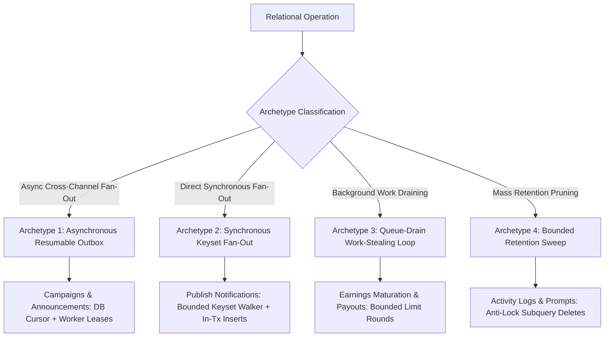

# ⚡ Bounded Batching & Keyset Fan-Out Architecture

## 📋 1. Executive Summary & Philosophy

> **"Assume 10M concurrent users — every bulk operation, every query loop, and every mass mutation must be evaluated against massive scale."**

In a large-scale interactive narrative platform like Twistloom, events frequently trigger operations across thousands or millions of relational records. Examples include:
- Publishing a new book and alerting up to 100,000 followers of the author.
- Admin bulk-status updates approving or moderating queue items.
- Mass retention purges removing millions of expired activity logs and prompt histories.
- Disbursing author earnings across thousands of creator wallets.

When operations process unconstrained arrays or use `OFFSET` pagination, systems suffer from **PostgreSQL driver crashes**, **serverless heap exhaustion (OOM)**, **database lock contention**, and **quadratic query degradation**.

This architecture standardizes bounded batching, defensive parameter guards, and keyset cursor pagination across the Twistloom backend, codified in reusable primitives in [`src/utils/batch.ts`](file:///d:/Projects/Twistloom/Twistloom-backend/src/utils/batch.ts).

---

## 🏛️ 2. The Four Universal Scaling Invariants

```
┌─────────────────────────────────────────────────────────────────────────────┐
│                       The 4 Universal Scaling Invariants                    │
├──────────────────────────┬──────────────────────────┬───────────────────────┤
│ 1. Parameter Wire Limit  │ 2. V8 Heap Budgeting     │ 3. Keyset Pagination  │
│    (Rows × Cols ≤ 65,535)│    (O(Chunk) vs O(N))    │    (O(1) B-tree seek) │
├──────────────────────────┴──────────────────────────┴───────────────────────┤
│ 4. Transaction Lock Health & WAL Pressure (Slice mass writes to < 2,500)    │
└─────────────────────────────────────────────────────────────────────────────┘
```

### Invariant 1: PostgreSQL Wire Protocol Parameter Limit ($65,535$)
PostgreSQL's frontend/backend wire protocol represents prepared statement parameter counts as a signed 16-bit integer (`int16`), establishing an absolute protocol ceiling of **$65,535$ parameters**.
When performing multi-row inserts via Drizzle ORM (`conn.insert(table).values(rows)`), every column in every row consumes one parameter format slot ($1, $2, \dots).
- A notification row (`user_notifications`) binds **11 columns**.
- Inserting 6,000 rows at once binds $6,000 \times 11 = 66,000 \text{ parameters} > 65,535$.
- This triggers an unrecoverable driver termination:
  `error: bind message has 66000 parameter formats but 65535 parameters`.

**Architectural Rule:** Bulk inserts must dynamically enforce a safe ceiling:
$$\text{safeChunkSize} = \min\left(500, \left\lfloor \frac{60,000}{\text{columnsCount}} \right\rfloor\right)$$
This guarantees parameter usage never exceeds $91.5\%$ of the protocol ceiling.

### Invariant 2: Serverless Heap & Garbage Collection Budgeting
Serverless execution environments (Vercel Functions, Netlify, AWS Lambda) allocate constrained memory budgets (typically 512MB to 1024MB RAM).
- Querying an unbounded table (`select().from(users).where(...)`) into V8 heap memory allocates hundreds of megabytes of raw JSON objects.
- Chaining `.returning({ id })` on mass deletes allocates arrays of hundreds of thousands of UUID strings.
- This forces V8 into severe stop-the-world garbage collection pauses and triggers fatal SIGABRT container terminations (`JavaScript heap out of memory`).

**Architectural Rule:** Working memory must stay bounded to **$O(\text{CHUNK\_SIZE})$ constant heap space** ($O(1)$) rather than $O(N)$ unbounded memory.

### Invariant 3: Keyset (Cursor) Pagination over `OFFSET`
In PostgreSQL, `OFFSET N` does **not** jump directly to row $N$. The storage engine must scan and count $N$ B-tree index entries before discarding them.
Across a loop of $K$ pages:
- Page 1 ($N=0$): Scans 500 rows.
- Page 10 ($N=5,000$): Scans 5,000 rows, discards 4,500.
- Page 100 ($N=50,000$): Scans 50,000 rows, discards 49,500.
- **Cumulative work is $O(N^2)$**, causing progressive query timeouts.
- **Concurrency Drift:** If rows are inserted or deleted during iteration, `OFFSET` causes rows to be skipped or duplicated.

**Architectural Rule:** Paginate strictly via **Keyset (Seek) Cursor**:
```sql
WHERE (last_id IS NULL OR id > :last_id)
ORDER BY id ASC
LIMIT :chunk_size;
```
This executes an **$O(1)$ B-tree index seek** directly to the next slice, runs in linear $O(N)$ cumulative time, and is completely immune to concurrent drift.

### Invariant 4: Transaction Lock Health & WAL Pressure
Monolithic statements updating or deleting millions of rows hold long-lived exclusive table and index locks, blocking concurrent reads and writes. Additionally, huge write transactions cause burst writes to PostgreSQL's Write-Ahead Log (WAL), increasing checkpoint write latency.

**Architectural Rule:** Mass mutations and deletions must execute in bounded slices ($\le 2,500$ rows) without `.returning()` payloads.

---

## 🔄 3. The Four Twistloom Batching Archetypes

Twistloom organizes all high-volume relational operations into four standardized architectural archetypes:



### Archetype 1: Asynchronous Resumable Outbox
- **Use Case:** High-volume user broadcast emails, weekly recommendations, system announcements.
- **Exemplar:** [`src/services/email-campaigns.ts`](file:///d:/Projects/Twistloom/Twistloom-backend/src/services/email-campaigns.ts)
- **Mechanics:** 
  - Queues an immutable campaign record (`email_campaigns`).
  - Workers acquire distributed leases (`leaseToken`, `leaseExpiresAt`, `FOR UPDATE SKIP LOCKED`).
  - Enumerates audience via persistent database cursor (`audienceCursor`) with `LIMIT 250`.
  - Stages messages into transactional outbox (`email_messages`).

### Archetype 2: Synchronous Direct Keyset Fan-Out
- **Use Case:** Direct event fan-out when asynchronous outbox transport is disabled, or immediate follower notifications.
- **Exemplar:** [`src/services/book-publish-notification.ts`](file:///d:/Projects/Twistloom/Twistloom-backend/src/services/book-publish-notification.ts)
- **Mechanics:**
  - Queries follower records using `gt(userFollows.followerId, lastFollowerId) ORDER BY userFollows.followerId ASC LIMIT 500`.
  - Dispatches notifications via `createNotificationsBatch()` with internal parameter protection.

### Archetype 3: Queue-Drain Work-Stealing Loop
- **Use Case:** Releasing creator earnings holds, batch disbursements, retrying stuck custom actions.
- **Exemplar:** [`src/services/maturation.ts`](file:///d:/Projects/Twistloom/Twistloom-backend/src/services/maturation.ts)
- **Mechanics:**
  - `while (rounds < MAX_BATCH_ROUNDS)` with `BATCH_SIZE = 500`.
  - Fetches pending items with `status = 'pending' AND matureAt <= NOW() LIMIT 500`.
  - Transitions rows to `'completed'` atomically inside transaction.
  - Halts when returned rows $< 500$ or `MAX_BATCH_ROUNDS` is reached.

### Archetype 4: Bounded Retention Sweeps (Anti-Lock Purges)
- **Use Case:** Daily pruning of historical logs, ImageKit deletion queues, prompt archiving.
- **Exemplars:** [`src/cron/cleanup.ts`](file:///d:/Projects/Twistloom/Twistloom-backend/src/cron/cleanup.ts), [`src/cron/cleanup-prompts.ts`](file:///d:/Projects/Twistloom/Twistloom-backend/src/cron/cleanup-prompts.ts)
- **Mechanics:**
  - Uses `batchDelete` subquery:
    ```sql
    DELETE FROM user_activity_logs
    WHERE id IN (
      SELECT id FROM user_activity_logs
      WHERE created_at < :cutoff
      LIMIT 2500
    );
    ```
  - Loops until 0 rows deleted; does not return IDs into V8 heap.

---

## 🛠️ 4. Standardized Reusable Primitives (`src/utils/batch.ts`)

### `chunkArray<T>`
Pure in-memory array divider that guarantees zero memory reallocation when the input array size is already within bounds.

```typescript
export function chunkArray<T>(items: T[], chunkSize = 500): T[][]
```

### `batchInsert<TTable>`
Dynamically inspects record shape and splits large inserts into parameter-safe slices:

```typescript
export async function batchInsert<TTable extends PgTable>(
  conn: DBClient | DBTransaction,
  table: TTable,
  rows: (typeof table.$inferInsert)[],
  options?: { chunkSize?: number; onConflictDoNothing?: boolean }
): Promise<void>
```

### `paginateWithKeysetCursor<TRow, TCursor>`
Generic cursor iterator implementing the $O(1)$ B-tree seek pattern:

```typescript
export async function paginateWithKeysetCursor<TRow, TCursor extends string | number | Date>(
  options: KeysetCursorPaginationOptions<TRow, TCursor>
): Promise<KeysetCursorResult>
```

### `batchDelete<TTable>`
Subquery-driven bounded delete eliminating table lock starvation:

```typescript
export async function batchDelete<TTable extends PgTable>(
  conn: DBClient,
  table: TTable,
  options: BatchDeleteOptions<TTable>
): Promise<BatchDeleteResult>
```

---

## 📋 5. Code Review Checklist for AI & Developers

Before merging any code that touches bulk data or relational queries:

- [ ] **Parameter Wire Limit**: No multi-row `insert().values(array)` without passing through `batchInsert()` or bounded slice verification ($\text{rows} \times \text{cols} \le 60,000$).
- [ ] **No Monolithic Mass Deletes**: High-volume table deletions use `batchDelete()` with discrete subquery limits (e.g. 2,500), avoiding unpaginated `DELETE ... RETURNING { id }`.
- [ ] **Keyset over OFFSET**: Iteration across multi-row queries uses Keyset Cursor Pagination (`WHERE id > :lastId ORDER BY id ASC LIMIT N`), never `OFFSET`.
- [ ] **Admin Input Ceilings**: Synchronous admin bulk endpoints enforce input size ceilings (`ids.length <= MAX_ADMIN_BULK_IDS`) with standardized validation errors.
- [ ] **Primary Client Integrity**: Retention sweeps and background deletions write to `dbWrite`, never `dbRead`.
