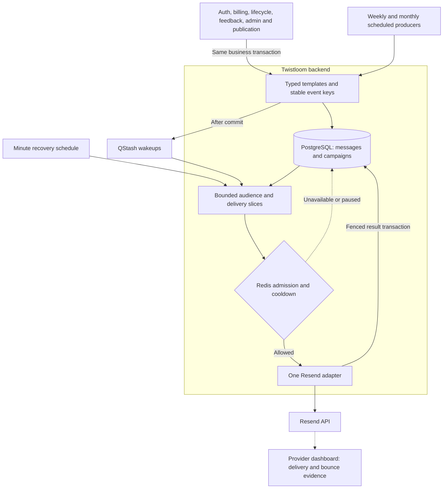

# Shared Email Delivery Architecture

> Living architecture document · Twistloom Backend · 2026-10-13
> Scope: All application-generated email, durable intent, transactional producers,
> bulk audience enumeration, provider admission, retries, privacy, and operations.
> Status: **Implemented** · last verified against the working tree on 2026-10-13.
> Schema deployment and live integration/load validation have not been performed.
> Anchor contract: source files cite this document's `§N` sections. Renumbering
> requires updating those comments in the same change; see the final anchor map.
> Companion: [Roadmap](../roadmap/EMAIL_DELIVERY_ROADMAP.md) ·
> [Email catalogue and copy](./TRANSACTIONAL_EMAILS.md) ·
> [Announcement compatibility](./ANNOUNCEMENT_EMAIL_JOBS.md).

## Table of Contents

1. [Executive Summary & Design Rationale](#1-executive-summary--design-rationale)
2. [System Boundaries & Overview Diagram](#2-system-boundaries--overview-diagram)
3. [Key Architectural Invariants](#3-key-architectural-invariants)
4. [Outbox, Claims, and Recipient State Machine](#4-outbox-claims-and-recipient-state-machine)
5. [Campaigns, Fairness, and Domain Producers](#5-campaigns-fairness-and-domain-producers)
6. [Provider Admission and Error Classification](#6-provider-admission-and-error-classification)
7. [Privacy, Retention, and Operational Rollout](#7-privacy-retention-and-operational-rollout)
8. [Failure Modes & Recovery Matrix](#8-failure-modes--recovery-matrix)
9. [Industry Standard Comparison](#9-industry-standard-comparison)
10. [File Map & Ownership](#10-file-map--ownership)
11. [Verification & Evidence](#11-verification--evidence)
12. [FAQ](#12-faq)
13. [Known Gaps & Future Enhancements](#13-known-gaps--future-enhancements)
14. [Section Anchor Map & Related Documents](#14-section-anchor-map--related-documents)

---

## 1. Executive Summary & Design Rationale

The backend owns one **transactional outbox** and one delivery state machine
for sixteen email types. Existing HTML templates, locale resolution, preference
categories, and Resend remain in use. PostgreSQL stores durable intent and
recipient receipts; QStash wakes bounded workers; Redis coordinates provider
request capacity and recovery probes. Authentication, billing, lifecycle,
feedback, announcements, digests, and publication notifications use this path.
Only **two shared tables** are introduced: `email_messages` and `email_campaigns`.
Implementation and local regressions exist; production deployment, contention,
execution plans, and throughput remain unverified. This document records code
behavior, not an exactly-once inbox-delivery or ten-million-recipient capacity claim.

### 1.1 Problem statement and design decisions

Direct sends after a business commit could lose email on process termination;
announcement-specific delivery tables duplicated policies and did not govern
other senders. Offset scans and unbounded follower lists also violated the
bounded-work expectations of [AGENTS.md §1](../../AGENTS.md).

| Decision | Alternatives considered | Why it wins here | Cost accepted |
|----------|-------------------------|-------------------|---------------|
| **Shared SQL outbox** | Direct sends; QStash-only payload storage | Domain state and email intent commit together, following AGENTS.md §3.3 transaction propagation | One receipt row and state transitions per recipient |
| **Optional campaign table** | One table with unrelated cursor rows; separate tables for each feature | Bulk requests need durable cursors/shared templates/progress; ordinary messages need none | One small row per bulk request; recipient storage remains proportional to audience size |
| **QStash continuations plus recovery schedule** | Minute-only drains; dedicated always-running workers | Uses the existing serverless stack; follows AGENTS.md §1 bounded invocation requirement | Queue requests, scheduler operations, and deployment setup |
| **Maintained Redis rate-limit SDK** | SQL singleton; custom rate-limit algorithm | Avoids SQL permission locks and duplicate limiter implementations | Redis is required for delivery admission; an outage delays email |
| **Small Lua cooldown protocol** | Multiple non-atomic GET/SET calls | Atomic pause/probe ownership prevents simultaneous recovery storms | Application-owned coordination code still needs live race validation |
| **Individual provider keys, batched SQL results** | Resend batch API; managed Broadcasts | Preserves independent recipient eligibility, expiry, and ambiguous-send recovery | More HTTP requests and local receipts than provider-managed marketing |
| **Incremental campaign counters** | Recount all recipient rows every page or poll | Bounded progress updates and O(1) admin projection meet the scale constraint | Counter correctness depends on fenced result transactions |

The outbox is a recognized pattern. This exact combination of schema, QStash,
Redis, and Resend is a project-specific implementation; no vendor prescribes
these two tables or guarantees its production capacity. The accepted tradeoffs
and deferred transports are recorded in the [roadmap §3 and §7](../roadmap/EMAIL_DELIVERY_ROADMAP.md).

---

## 2. System Boundaries & Overview Diagram

Domain services decide **why** an email exists and assign its logical event key.
Templates decide effective content. Shared delivery decides ownership, retry,
expiry, eligibility, and admission. Resend's acceptance response is authoritative
for `sent`; actual delivery, bounces, and complaints remain provider-side evidence.



`POST /api/cron/emails` and the retained `/api/cron/announcement-emails` URI
register the same `handleEmailDelivery` handler (`src/routes/cron.ts:230`). Both
use the existing `CRON_SECRET` middleware (`src/routes/cron.ts:35`) and shared
rollout gate. Normal responses contain `{ success: true, data: { processed,
nextRunAt } }`; a provider pause returns `{ success: true, pausedUntil }` after
publication in-app enumeration. The legacy URI no longer reads/returns an
arbitrary announcement job. Admin progress remains its own API. QStash receives
an empty wakeup body, not recipient
addresses or credentials (`src/services/email-dispatch.ts:4`). Anyone deploying
another environment against the same Resend team must use the same coordination
namespace and Redis, or partition the account allowance externally.

No provider call occurs inside an open SQL transaction. Email receipt counters
do not own credit balances, billing ledger deduplication, authentication proofs,
or account standing; those existing domain authorities remain in place.

---

## 3. Key Architectural Invariants

1. Every enabled database-backed producer awaits intent persistence inside its
   domain transaction; external delivery and queue publication occur after commit.
2. `email_messages.request_key` uniquely identifies a logical email. Replaying
   that identity keeps the first frozen payload; another type/user cannot take it.
3. An HTTP send requires a conditional SQL ownership claim and Redis admission.
   Result updates require the original lease token, so stale workers cannot
   overwrite a replacement owner's receipt or increment campaign counters twice.
4. Automatic retry keeps the original provider key and effective destination/
   subject/from/HTML. It never rotates a key to escape a provider conflict.
5. Ambiguous outcomes stop before the provider's 24-hour key lifetime: at six
   transient attempts or 23 hours from the unresolved intent, whichever comes first.
6. Quota/rate/configuration pauses restore the pre-call attempt count. Redis
   refusal takes no SQL send claim and consumes no recipient attempt.
7. Optional email rechecks primary account address and preferences; credentials
   recheck the live proof and expiry. Mandatory old-address/deletion recipients
   remain explicit snapshots, independently of engagement toggles.
8. Audience pages, selected messages, concurrent calls, cleanup pages, and
   campaign progress writes are bounded. No producer collects the entire audience.
9. Message completion and campaign progress commit together. Announcement
   completion locks the announcement before its campaign, matching draft deletion.
10. `sent` and a true immediate send boolean mean **provider accepted**, not
    delivered to an inbox. Recovery endpoint booleans remain uniform acknowledgements.

These elaborate, rather than replace, [AGENTS.md](../../AGENTS.md) transaction,
runtime, type-safety, and scaling requirements. Request-abuse rate limiting keeps
its existing fail-open policy; provider capacity admission is a separate fail-closed
resource gate because pending durable email can safely wait.

---

## 4. Outbox, Claims, and Recipient State Machine

### 4.1 Implementation: schema and authority

| Record | Significant typed fields | Purpose |
|--------|--------------------------|---------|
| `email_messages` | requestKey, type, userId, priority, status, attempts, expiry, retry time, lease token/expiry, ambiguity clock, providerId | Outbox and per-recipient acceptance receipt |
| Message content | payloadEncrypted or campaignId + recipientEncrypted; locale; credentialHash | Frozen provider input; encrypted credential-bearing payload; supersession link |
| `email_campaigns` | requestKey, type, audience, templates, cursor, expiry, status, lease, nextRunAt, nextDispatchAt | Durable bulk request, content and fair scheduling |
| Campaign progress | recipientCount, pendingCount, sent, failed, skipped, needsReview, completedAt | Incremental admin progress without full-table recounting |

See `src/db/schema.ts:3408` and `src/types/email-delivery.ts:1`. Messages have no
user FK: deletion confirmations and durable cohort identities must survive account
erasure. The nullable announcement FK uses `ON DELETE SET NULL`; deleting a draft
does not destroy its already committed delivery history. Campaign-message deletion
cascades only when a campaign itself is explicitly removed.

JSON stores typed rendering/audience data, not mutable retry authority. Ordinary
messages store their encrypted effective payload; announcement recipients share
two frozen locale templates and store an encrypted destination. Personalized bulk
messages freeze their rendered payload per recipient.

### 4.2 Transaction and immediate attempt

```mermaid
sequenceDiagram
    participant Request
    participant Domain
    participant DB as PostgreSQL
    participant Delivery
    participant Redis
    participant Provider as Resend
    Request->>Domain: Business event
    Domain->>DB: BEGIN; mutation and outbox INSERT
    DB-->>Domain: COMMIT
    Domain->>Delivery: Immediate attempt or QStash wakeup
    Delivery->>Redis: Capacity and cooldown admission
    alt Admission unavailable
        Redis-->>Delivery: Defer
        Delivery-->>Request: Pending / acknowledgement
    else Allowed
        Delivery->>DB: Conditional claim + intent + finite lease
        Delivery->>DB: Primary policy/proof recheck
        Delivery->>Provider: Frozen payload and original key
        Provider-->>Delivery: Accepted / rejected / uncertain
        Delivery->>DB: Fenced results + aggregated campaign counters
        Delivery-->>Request: Provider acceptance or durable retry
    end
```

`queueEmailMessage` (`src/services/email-delivery.ts:28`) inserts once and returns
an existing receipt on replay. It never publishes or sends from inside the supplied
transaction. For standalone template calls, a stable `requestKey` is mandatory
when enabled (`src/utils/email.ts`); omission fails instead of creating random
keys for retrying the same event. An optional-category message also requires a user ID.

Signup and email-change verification may attempt the committed receipt immediately
through `deliverCredentialEmail`; they use the same claim/provider path as workers.
Forgot-password and resend-verification persist first, then issue the same wakeup
shape for known and unknown accounts. They do not await account-dependent provider
latency. Their existing `emailSent: true` response is an anti-enumeration acknowledgement,
not a acceptance receipt. Timing is not claimed cryptographically constant across
different SQL work; it avoids adding the provider's eight-second timing signal.

### 4.3 Claims, lease fencing, and state transitions

`attempt` (`src/services/email-delivery.ts:84`) first checks retry safety/expiry.
Runnable work acquires Redis permission, then uses `UPDATE ... WHERE` to acquire
the current message status/lease. A live `sending` lease cannot be reclaimed.
Expired `sending` intents are conservatively ambiguous even if the crashed worker
may never have reached the provider. Ownership lasts 90 seconds; HTTP timeout is
eight seconds. Failing a primary lookup after claim leaves the finite lease for recovery.

```mermaid
stateDiagram-v2
    [*] --> pending: Intent committed
    pending --> sending: Conditional claim and permit
    sending --> sent: Provider accepted; fenced completion
    sending --> pending: Transient retry or shared pause
    sending --> failed: Definitive rejection or exhausted known retries
    pending --> skipped: Expired or ineligible without uncertainty
    sending --> skipped: Superseded or opted out without uncertainty
    sending --> needs_review: Conflict or unsafe unresolved intent
    sending --> sending: Expired lease recovered with original key
    sent --> [*]
    failed --> [*]
    skipped --> [*]
    needs_review --> [*]
```



Transient backoff starts at 30 seconds, doubles with attempt number, and includes
up to one second of jitter. Six attempts are the maximum. An unambiguous rejection
clears a new uncertainty clock; a pause preserves pre-existing uncertainty.
Expiry yields `skipped` for a definitely unsent message and `needs_review` for
an uncertain one. Operators must inspect provider evidence before a deliberate
new event; simply resetting a review row is unsafe.

`persistCompletions` batches result rows into one conditional SQL update and groups
terminal results by campaign. It updates each affected campaign once, in stable
ID order, in the same transaction (`src/services/email-delivery.ts:128`). Claim
updates remain individual: they provide durable ownership and send intent before
an external effect. Batching SQL statements does not eliminate physical row writes.

### 4.4 Indexed selection and limits

Each slice reads at most 50 due standalone messages, 50 expired leases, and one
campaign page of at most 50 recipients; the merged working set is capped at 50.
Standalone pending work uses `(priority, next_attempt_at, id)` with a literal
`pending AND campaign_id IS NULL` partial predicate. Expired leases use
`(lease_expires_at, id)` with literal `sending`. Campaign pending work uses
`(campaign_id, next_attempt_at, id)` with literal `pending`.

These are separate queries, not an OR across status populations requiring a global
time sort. `LIMIT` bounds returned rows, not an automatic proof of bounded scanned
rows; real plans and the priority/time selectivity still need EXPLAIN evidence.
At most eight calls run locally by default. Admission stops after about 28 seconds
of the delivery stage; in-flight work, result persistence, and wakeup publication
are awaited. The 40-second budget is not a hard bound on every surrounding SQL call.

---

## 5. Campaigns, Fairness, and Domain Producers

### 5.1 Resumable audience enumeration

`processEmailCampaigns` (`src/services/email-campaigns.ts:137`) leases one due
open campaign using primary `FOR UPDATE SKIP LOCKED`. Enumeration locks that
owned campaign, selects at most 250 users after its UUID cursor, inserts recipient
messages, and advances the cursor/counters in the same transaction. A crash
cannot commit messages without its corresponding cursor progress.

Accounts created after campaign creation are excluded. Preferences, follower
relationships, and profile data are evaluated when each page is enumerated;
this is a cutoff cohort with live page-time membership, not a full historical
database snapshot. Each resulting provider payload is immutable. Final send
eligibility rechecks optional consent/address; story mail also checks verification.
Locale is frozen at message creation (`emailLocale ?? preferredLocale ?? en`).

Monthly activity executes three aggregate queries per selected page rather than
three per recipient. Its `pagesRead` remains zero because this refactor does not
invent a page-read metric. Weekly selection remains five trending active public
books. Both scheduled requests use deterministic UTC period keys.

Publication in-app notifications share the page/cursor transaction, preserving
each follower's independent in-app preference. They need no verified email;
email requires both opt-in and verification. This changes delivery from an
unbounded inline fan-out to resumable asynchronous fan-out. During an email quota
pause, the supervisor still enumerates publication campaigns so their in-app
notifications progress; other email-only enumeration waits. Both channels depend
on activating the shared campaign infrastructure. Deploying this code with its
flag off also disables publication fan-out; deploy schema/config together.

### 5.2 Fairness and completion

Audience scheduling rotates due campaigns by `(next_run_at, created_at, id)`.
Message draining separately rotates one campaign with pending recipients using
`(next_dispatch_at, id)` and a small cursor update per slice. This prevents one
large oldest campaign from continually winning the first bulk permit. Urgent
standalone mail remains ahead of bulk work; bulk's smaller Redis bucket leaves
request headroom but does not guarantee an authentication latency SLA.

Progress comes from incremental counters, not a complete recipient recount.
Completion requires audience enumeration to finish or expire **and** zero pending
recipients. Announcement completion locks announcement then campaign and writes
the legacy `emailSentAt` marker only after terminal processing. That marker can
include failed/skipped/review outcomes; the counters explain what happened.

### 5.3 Producer integration and event identities

`queueEmailCampaign` (`src/services/email-campaigns.ts:27`) owns insertion defaults
and immutable event/period replay for **every** bulk category. It accepts the
producer transaction and returns the stored campaign record; announcement admin
responses project this record without an extra post-insert read. Reusing a key
for another category or linked announcement fails. Digest/publication replay
keeps the first snapshot even if the current recommendations or title changed.

`src/services/announcement-email.ts:66` owns announcement validation, sanitization,
resend identity and its creation locks, then calls the same helper. Its optional
`contentHash` is a fingerprint of sanitized source content so manual replay
comparison survives changes to template chrome; other campaigns derive the
fingerprint from their frozen audience/title/templates. Linked-record replay
keeps the original snapshot; manual reuse with changed content fails. The
announcement service contains no worker execution, provider adapter or retry
loop. `src/types/announcement-email.ts:1` retains only the safe admin projection,
whose status is the shared `EmailCampaignStatus`.

| Producer | Atomic intent boundary | Logical identity / policy |
|----------|------------------------|---------------------------|
| Signup / verification resend / email change | Verification proof and intent in token transaction; signup/change propagate their transaction | New issuance key; HMAC proof and 15-minute expiry |
| Forgot password | Reset proof and intent in token transaction | New issuance key; hashed proof and one-hour expiry |
| Password change / reset | Password, proof consumption, revocations, tracked-session deletion and alert intent | Change event; reset proof digest identity |
| Onboarding welcome | First onboarding transition and intent | `welcome/userId` |
| Account deletion | Explicit recipient snapshot and deletion | `account_deleted/userId`; receipt has no account FK |
| Feedback | Feedback row, acknowledgement and optional internal alert | Feedback ID per destination/type |
| Payment failure / cancellation | Subscription mutation and intent | Explicit failure event ID; cancellation event ID or subscription fallback |
| Stripe credit-pack refund | Existing refund ledger transaction and intent | Stripe event ID; credit authority remains unchanged |
| Trial ending | In-app notification and intent | Subscription plus trial-end timestamp; expiry at trial end |
| Announcements | Validated snapshot and campaign creation transaction | Existing manual/record request keys and explicit resend UUID |
| Weekly / monthly | Durable scheduled campaign insert | UTC Monday / previous UTC calendar month |
| Story publication | Book visibility update and campaign insert | `story_published/bookId`, one fan-out per book identity |

The publication key intentionally suppresses a second notification when the same
book is made private and public again. Introducing explicit publication versions
would require a domain event/version contract, not a random retry key.

See `src/routes/auth.ts`, `src/routes/user.ts`, `src/utils/email-verification.ts`,
`src/utils/password-reset.ts`, `src/services/subscription.ts`, and
`src/services/gateways/stripe-webhook-handlers.ts`. Stripe and Xendit retain their
existing payment/webhook idempotency. Invoice/cycle failure events own payment
alerts; status-sync webhooks do not issue a second alert for the same failure.
Recipient absence intentionally produces
no user email; internal feedback remains conditional on `FEEDBACK_INBOX`.

### 5.4 Adding a future email

1. Add an `EmailType` and exhaustive `EMAIL_POLICIES` entry: priority, lifetime,
   and optional preference category. Reuse the existing locale/template layer.
2. Use a stable domain event ID, not a retry-attempt UUID. Credential issuance
   IDs are new events because issuing a fresh proof supersedes the previous proof.
3. Await the template helper with `tx`, `requestKey`, and recipient/user context
   inside the mutation transaction. Persist explicit old-address destinations.
4. After commit, publish a wakeup. Use `deliverEmailNow` only where an immediate
   acceptance result matters; always retain recovery through the same receipt.
5. For bulk, add a typed audience discriminator and bounded enumerator; create
   the request through `queueEmailCampaign` in the domain transaction. Reuse
   both tables, shared admission, and the recipient state machine. Only publish
   a wakeup after commit.
6. Add failure/replay tests for the new domain boundary and update this producer map.

No new per-feature delivery table, provider client, retry loop, or SQL rate-limiter
should accompany a new email feature. For marketing requiring provider-owned
contact management, use the separate gated Broadcasts evaluation in the roadmap.

### 5.5 Category parity and feature file boundaries

All sixteen `EmailType` entries use the same queue, encryption, stable provider
key, claims, admission, retry, result persistence and recovery. Different
policies are intentional (`src/config/email-delivery.ts:6`):

| Types | Priority / lifetime | Eligibility distinction |
|-------|---------------------|-------------------------|
| `verification`, `password_reset` | Urgent; 15 minutes / 1 hour | Live credential proof, account destination, supersession and expiry |
| `password_changed`, `email_changed` | Urgent; 7 days | Mandatory security alert; explicit old address for email change |
| `account_deleted` | Urgent; 24 hours | Explicit destination retained without account FK |
| `welcome` | Normal; 48 hours | Onboarding identity; no engagement toggle |
| `trial_ending`, `payment_failed` | Normal; 24 / 48 hours | Mandatory billing; trial message also expires at trial end |
| `refund`, `subscription_canceled` | Normal; 7 days | Mandatory billing event |
| `feedback_ack`, `feedback_internal` | Normal; 48 hours | Feedback identity; internal inbox is an explicit recipient |
| `weekly`, `story_published` | Bulk; 48 hours | Category preference and current address; story additionally requires verified email |
| `monthly`, `announcement` | Bulk; 7 days | Category preference and current address |

No category has its own transport/config/dispatch forwarding files. Feature
files remain only where they own domain work: announcement admin validation and
progress, credential issuance, scheduled digest selection and publication
snapshots. Single-recipient categories need no counterpart to announcement's
admin service or campaign producer. Their parity is in delivery guarantees and
policy, rather than the number or names of their files.

---

## 6. Provider Admission and Error Classification

### 6.1 Account capacity and recovery

`src/services/email-gate.ts:34` uses `@upstash/ratelimit` sliding windows: one
account bucket and a bulk bucket limited to `max(1, floor(0.75 × configured RPS))`.
The conservative default is two requests/second, not a claim about Resend's current
allowance. At configured RPS one, discrete permits cannot reserve a fractional
urgent slot. Configure the team-wide allowance with other application senders in mind.

The SDK may return success with `reason: timeout`. This gate explicitly refuses
such fail-open results. Missing Redis, malformed admission responses, and Redis
errors defer delivery before a SQL sending claim. SQL remains authoritative for
recipient retries; Redis stores only transient capacity/cooldown coordination.

The `email:{resend-team}:cooldown` hash contains pause deadline/reason and a finite
probe token/expiry. Small Lua scripts atomically admit one recovery probe, extend
pauses without shortening an existing deadline, and clear only matching ownership.
State expires after seven days. Redis loss/eviction can forget a pause; conservative
rate admission and new provider feedback then reconstruct it. Already admitted
in-flight requests can finish after another worker records a pause. Quota headroom
is **not** reserved: this gate reserves request-rate headroom only.

### 6.2 Sole transport boundary

`src/utils/email-provider.ts:26` is the only runtime POST to Resend `/emails`.
It sends the stored `Idempotency-Key`, awaits at most eight seconds, validates
response structure, and emits sanitized machine codes rather than provider text.

| Provider outcome | Classification | Shared recovery |
|------------------|----------------|-----------------|
| Accepted response with string ID | `accepted` | Persist provider ID and `sent` |
| Network interruption / malformed success / HTTP 5xx | `retry`, ambiguous | Original key/payload, bounded backoff and safety deadline |
| HTTP 409 `concurrent_idempotent_requests` | `retry`, ambiguous | Retry original request, preserving possible competing acceptance |
| HTTP 409 `resource_locked` | `retry`, known rejection | Retry original request |
| Other HTTP 409 | `needs_review` | No automatic key replacement |
| HTTP 429 `daily_quota_exceeded` | `paused` | Next midnight UTC; single recovery probe |
| HTTP 429 `monthly_quota_exceeded` | `paused` | Valid Retry-After or hourly probe; billing reset not assumed |
| Other HTTP 429 | `paused` | Valid Retry-After or 30-second fallback |
| HTTP 401 / 403 | `paused`, configuration | Five-minute recovery probe; operator repairs provider credentials/domain |
| Other definitive non-success status | `failed` | Terminal, unless earlier unresolved uncertainty requires review |

Numeric and HTTP-date `Retry-After` values are accepted only when valid and in
the future. A known quota rejection does not erase uncertainty from an earlier
attempt. No recipient or provider error body is logged at this boundary.

QStash publication (`src/services/email-dispatch.ts:4`) uses three queue retries,
four-worker flow-control parallelism, dispatch IDs, and a four-second timeout.
Queue retry re-enters the SQL state machine; it does not create a second recipient
retry authority. Continuations and the minute supervisor may overlap safely.

---

## 7. Privacy, Retention, and Operational Rollout

### 7.1 Privacy and retention

Recipient-bearing payloads use the existing AES-256-GCM `encryptPII` utility.
Credential proofs remain digests in `user_auth`; the effective email containing
the code/link is encrypted separately. Decryption keys must remain available
while active messages exist; changing the key without re-encryption breaks recovery.
Campaign shared HTML and public story/recommendation data are not encrypted.
The design does not claim to encrypt all account metadata or all domain data.

`cleanupEmailMessages` performs bounded cleanup, at most 250 scrubbed rows and
250 deleted terminal receipts per invocation. Expired sent/failed/skipped payloads
are cleared while keeping deduplication keys. Standalone review payloads are also
scrubbed after expiry; campaign review payloads remain until their 90-day receipt
retention boundary to support investigation. Active and recoverable messages are
not silently deleted. Terminal receipts older than 90 days can be deleted;
producer replay safety beyond that window must come from domain ledgers or
retained campaign request keys.

Compact campaign receipts/event keys are retained. Up to 25 old completed campaign
templates are examined per cleanup; shared templates are removed after all their
recipient receipts are gone. This is not a fixed upper bound on campaign-row count;
a future compaction/archive policy must preserve event deduplication semantics.
Email row indexes also have write/storage costs; SQL statement batching changes
round trips, not the number of physical indexed recipient updates.

### 7.2 Activation procedure — not executed

1. Review a migration from the actual deployed schema. If announcement-specific
   tables already contain live jobs, migrate their frozen payloads, keys,
   ambiguity clocks, and counters before replacing workers. Do not discard jobs.
2. Provision `email_messages`, `email_campaigns`, their constraints and indexes
   through the project's normal migration process. Database generation/migration
   was explicitly excluded from this implementation request.
3. Configure Resend, verified sender, `FRONTEND_URL`, public `BACKEND_URL`,
   `CRON_SECRET`, `QSTASH_TOKEN`, Redis REST credentials, and a valid 64-hex-character
   production `PII_ENCRYPTION_KEY_HEX`. Keep `EMAIL_DELIVERY_ENABLED=false` until ready.
4. Register reviewed schedules using the existing explicit schedule setup tool:
   `email-worker` every minute; cleanup every ten minutes; weekly Monday 08:00 UTC;
   monthly on day one at 08:00 UTC. Setup never runs automatically on API startup.
5. Inspect/remove obsolete announcement worker and old external digest schedules
   deliberately. The old `/announcement-emails` endpoint remains a shared-worker
   alias, but duplicate schedules still cost invocations. No live registration occurred.
6. Run staging contention, large-backlog EXPLAIN, crash recovery, Redis outage,
   quota probe, credential supersession, and provider acceptance tests.
7. Enable delivery with a small controlled cohort; review pending age, review
   rows, provider errors, quota capacity, QStash failures, and encrypted payload access.

The feature gate validates configuration, not table existence or schedule health.
The disabled state prevents unmigrated email table access from template helpers;
it also means these helpers do not persist email intent. **Deploying this refactor
without activation disables outgoing application email**, including signup/reset
delivery. This is a coordinated schema/configuration rollout, not a safe enabled
replacement for a previously deployed direct sender before provisioning.

### 7.3 Operational interpretation

Inspect status/next retry/lease expiry and sanitized errors on `email_messages`;
use aggregate campaign counters for admin progress. During an outage, queue age
matters more than individual wakeup failure counts. Quota pauses do not extend
the policy lifetime of a credential or digest. A month-long quota outage therefore
expires time-sensitive messages instead of sending obsolete links much later.

No new production metrics exporter, provider webhook receiver, or manual replay
console is added. Provider dashboard evidence remains necessary for delivery,
bounce, complaint, and uncertain-response investigation.

---

## 8. Failure Modes & Recovery Matrix

| # | Failure | Detection / error | Recovery / client behavior |
|---|---------|-------------------|----------------------------|
| 1 | Disabled/missing infrastructure | Shared cron returns HTTP 503; announcement admin uses `announcements.emailUnavailable` / 503 | Provision before enabling; ordinary helpers return false and create no email row |
| 2 | Invalid cron secret | Existing cron middleware HTTP 401; absent secret outside dev/test HTTP 500 | Fix authenticated dispatch/schedule configuration |
| 3 | Domain transaction or outbox insert fails | SQL exception; route's existing error handling or webhook retry | Both mutation and intent roll back; no external email inside the transaction |
| 4 | Commit succeeds but QStash wakeup fails | Dispatcher returns false and logs a sanitized warning | Durable row survives; minute supervisor discovers it |
| 5 | Worker dies before/after provider request | Expired `sending` lease | Retry original payload/key; conservatively preserve ambiguity |
| 6 | Old worker finishes after lease replacement | Conditional completion returns no matching row | Cannot overwrite replacement owner or double-count progress |
| 7 | Redis unavailable or SDK timeout | Admission refused; recipient remains unchanged | Defer without consuming SQL attempts; supervisor and continuation retry |
| 8 | Daily/monthly quota exhausted | Named 429 pause | Shared cooldown, one finite recovery probe; no recipient-budget exhaustion |
| 9 | Primary policy/proof read fails after claim | Worker exception and live finite lease | Queue retry/recovery after lease expiry; no unsafe best-effort send |
| 10 | Optional opt-out, address change, superseded code, expiry | Primary eligibility or lifetime check | Skip definitely unsent rows; uncertain rows require review |
| 11 | Ambiguous acceptance exceeds safety budget | Six attempts or 23-hour unresolved deadline | `needs_review`; consult provider evidence before creating a new event |
| 12 | Announcement completion races draft deletion | Announcement-first locking in completion | Retain detached campaign via SET NULL; staging lock-contention test still required |
| 13 | Payload cannot decrypt or required template missing | `invalid_frozen_payload` | `needs_review`; restore key/configuration, investigate without rotating provider key |
| 14 | Native delivery/bounce/complaint arrives after acceptance | Provider dashboard only | `sent` remains acceptance; webhook projection/suppression is a documented gap |

Unknown accounts on forgot/resend still receive the same successful acknowledgement.
Signup retains the account-created response if an immediate provider attempt fails;
its acceptance boolean remains false until an accepted result, while durable recovery
continues for the committed message. No generalized business-success rollback occurs
because the provider is down; failure to persist required intent can roll back.

---

## 9. Industry Standard Comparison

### 9.1 The standard / de-facto practice

The [AWS transactional outbox pattern](https://docs.aws.amazon.com/prescriptive-guidance/latest/cloud-design-patterns/transactional-outbox.html)
addresses the database-and-message dual-write gap and expects idempotent processing.
[PostgreSQL documents SKIP LOCKED for queue-like consumers](https://www.postgresql.org/docs/current/sql-select.html).
[Resend documents 24-hour idempotency keys](https://resend.com/docs/dashboard/emails/idempotency-keys)
and [error classifications](https://resend.com/docs/api-reference/errors).
[Redis documents atomic script execution](https://redis.io/docs/latest/develop/programmability/eval-intro/);
it does not prescribe this application's cooldown schema.

### 9.2 How this design compares

**Matches:** atomic intent, durable replay, finite claims, provider idempotency,
bounded enumeration, maintained rate-limit primitives, and clear acceptance semantics.
**Deliberately divergent:** QStash wakeups over an application-owned SQL outbox,
per-recipient provider requests, and application-owned Lua recovery coordination fit
the existing serverless stack and user preference for few shared tables.
**Behind / gap:** verified provider webhook projection/suppression, automated queue
age alerting, live fault/race validation, and measured high-volume marketing capacity.

| Aspect | Industry practice | This design | Alignment / rationale |
|--------|-------------------|-------------|-----------------------|
| Atomic intent | Transactional outbox | Domain mutation + message/campaign insert | Aligned; queue publication is an accelerator |
| Queue claims | Finite leases, conditional ownership, SKIP LOCKED | Campaign SKIP LOCKED; message conditional claims and fenced results | Aligned; live contention proof remains a gate |
| Provider idempotency | Original key and immutable body within provider retention | Frozen payload; 23-hour uncertainty stop | Aligned; exactly-once inbox delivery is not claimed |
| Request limits | Shared team/account capacity | Two maintained SDK buckets; explicit timeout refusal | Aligned within cooperating senders; external senders require budget coordination |
| Quota recovery | Honor provider pauses, avoid retry storms | Named quotas and single finite Redis probe | Project-specific protocol built on atomic Redis primitives |
| Serverless execution | Bounded workers and queue concurrency | [QStash flow control](https://upstash.com/docs/qstash/features/flowcontrol), continuations and recovery | Aligned; deployment/invocation capacity unmeasured |
| Bulk cost | [Resend batches](https://resend.com/docs/api-reference/emails/send-batch-emails) or [Broadcasts](https://resend.com/docs/dashboard/broadcasts/introduction) | SQL batching with individual provider requests | Deliberate cost tradeoff; gated future transport |
| Delivery/suppression | [Verified provider webhooks](https://resend.com/docs/webhooks/introduction) | Provider dashboard; no new handler | Gap; do not equate acceptance with delivery |

### 9.3 Assessment

This is ordinary durable email architecture adapted to Twistloom, with reduced
feature duplication and SQL permission writes. It is not a vendor-certified
architecture or a proven massive-mailing system. Its next production gate is
provisioning and live failure validation; marketing volume beyond the selected
provider plan requires transport/capacity work rather than a larger concurrency number.

---

## 10. File Map & Ownership

| Path | Layer | Responsibility |
|------|-------|----------------|
| `src/types/email-delivery.ts` | Contract | Message, campaign, audience, payload and provider result unions |
| `src/config/email-delivery.ts` | Policy | Exhaustive type policies, infrastructure gate, bounds and capacity settings |
| `src/db/schema.ts` | Persistence | Two shared tables, event uniqueness, lease/due/campaign indexes |
| `src/services/email-delivery.ts` | Execution | Queue, policy checks, claims, batch results, retries, fair drain, cleanup |
| `src/services/email-campaigns.ts` | Bulk | Common campaign insertion/replay, typed producers, bounded pages, aggregate rendering, cursor and progress |
| `src/services/email-gate.ts` | Provider coordination | SDK rate admission and atomic cooldown/probe ownership |
| `src/utils/email-provider.ts` | Transport | Sole Resend POST and sanitized result classification |
| `src/services/email-dispatch.ts` | Dispatch | Authenticated bounded QStash wakeups/continuations |
| `src/utils/email.ts` | Presentation boundary | Existing templates/locales with durable shared intent; no provider client |
| `src/utils/email-verification.ts` | Auth domain | Proof and verification intent transaction |
| `src/utils/password-reset.ts` | Auth domain | Reset issuance/consumption and transactional security alerts |
| `src/routes/auth.ts` | Auth routes | Signup, recovery, credential changes and post-commit immediate attempts |
| `src/routes/user.ts` | Lifecycle/support routes | Onboarding, deletion and feedback intent |
| `src/services/subscription.ts` | Billing domain | Failed payment, cancellation and trial-ending intent |
| `src/services/gateways/stripe-webhook-handlers.ts` | Billing integration | Atomic refund intent and provider event identities |
| `src/services/xendit.ts` | Billing integration | Passes provider event identity into shared subscription producers |
| `src/services/book.ts` | Publication domain | Book mutation and publication campaign transaction |
| `src/services/book-publish-notification.ts` | Publication producer | Durable follower audience request |
| `src/services/announcement-email.ts` | Admin producer | Domain validation/locks/replay, common campaign creation and safe progress projection |
| `src/types/announcement-email.ts` | Admin API contract | Existing aggregate job response with shared campaign status |
| `src/routes/admin.ts`, `src/routes/admin/announcements.ts` | Admin routes | Compose/record queue actions and job progress |
| `src/routes/cron.ts` | Worker routes | Authenticated shared drain, retention, digest producers and legacy alias |
| `src/cron/email-weekly-recommendations.ts`, `src/cron/email-monthly-summary.ts` | Scheduled producers | Durable period requests instead of inline recipient loops |
| `src/cron/ensure-qstash-schedules.ts` | Operations | Reviewed schedule definitions; explicit provisioning only |
| `src/services/email-preferences.ts`, `src/types/email-preferences.ts`, `src/types/email-locale.ts` | Existing preference contract | Optional categories, locale and unsubscribe behavior |
| `src/config/emails/index.ts`, `src/utils/crypto.ts` | Existing primitives | Template exports and field encryption |

`src/utils/window-cache.ts` belongs to broadcast/announcement public cache
invalidation, not email reliability. This refactor does not turn it into a queue,
delivery receipt, or provider limiter. Its versioned cache envelopes and invalidation
revisions remain covered by the [broadcast architecture](./BROADCAST_ARCHITECTURE.md).

---

## 11. Verification & Evidence

| Layer | Status | Evidence / limit |
|-------|--------|------------------|
| Local source structure | **Implemented & verified** | Sole Resend POST in provider adapter; shared producers and two schema tables traced on 2026-10-13 |
| Static checks | **Implemented & verified** | `bun run check`: lint, `.js` import extensions, TypeScript |
| Delivery regressions | **Implemented & verified** | `tests/email-delivery.test.ts`: rollback, replay, frozen payload, fencing, lease recovery, quota attempts, opt-out, credential supersession, expiry, fairness and progress |
| Provider/admission | **Implemented & verified** | `tests/email-provider.test.ts`, `tests/email-gate.test.ts`: named errors, stable request key, Retry-After, missing Redis, SDK timeout refusal and bucket routing |
| Campaign creation / cron parity | **Implemented & verified** | `tests/email-campaigns.test.ts`, `tests/email-cron.test.ts`: immutable period replay, identity collision, rollback, common defaults and both authenticated/paused worker URIs |
| Producer/security | **Implemented & verified** | `tests/announcement-email.test.ts`, `tests/email-dispatch.test.ts`; `tests/recovery-proof-security.test.ts`, `tests/credential-change-security.test.ts` validate proof/session transaction boundaries |
| Full regression suite | **Implemented & verified** | Local `bun test`; final recorded count is maintained in the roadmap completion evidence |
| Real PostgreSQL | **Not claimed** | No migration, deployed constraints, SQL execution-plan or lock-contention test |
| Real Redis/QStash/Resend | **Not claimed** | SDK/Lua protocol and transport outcomes mocked; no live schedule or provider request |
| Capacity/latency/cost | **Not claimed** | No sustained benchmark, production quota test, ten-million-audience test or serverless concurrency measurement |
| Documentation audits | **Implemented & verified** | Required structure, relative targets, section anchors, code path ownership and superseded claims reviewed against this working tree |

The fake database models predicates, uniqueness, state changes and rollback; it
does not model PostgreSQL deadlocks or prove actual index use. Gate tests validate
SDK result handling and protocol decisions, not concurrent execution of Lua in Redis.
No commit, DB generation/migration, external schedule registration, or live email
send forms part of this evidence.

---

## 12. FAQ

### FAQ 1. Do future email features require more delivery tables?

No. A single-recipient feature needs a policy/template and a transactional message
producer. A bulk feature adds a typed audience/cursor enumerator using the existing
campaign table. Domain-specific business records remain separate domain concerns (§5).

### FAQ 2. Why retain SQL if QStash already stores messages?

QStash publication cannot commit atomically with a PostgreSQL mutation. The SQL
outbox closes that gap; QStash accelerates delivery and schedules execution. The
minute supervisor recovers a committed intent whose publication failed (§4).

### FAQ 3. Why two tables instead of one or a table per email type?

Messages own recipient state. Campaigns own a shared bulk request, cursor, templates,
and progress. Their lifecycles differ; combining them requires nullable unrelated
fields or duplicated bulk data. Per-feature delivery tables would duplicate the
same ownership and retry protocol (§1, §4).

### FAQ 4. How many database writes does a normal email require?

Typically an insert, a durable send-intent claim, and a result transition. Worker
results and campaign counters are batched; every affected row/index still incurs
physical writes. Eligibility reads, retries, campaign rotation/enumeration and
retention add work. This is not a universal three-SQL-statement claim (§4, §7).

### FAQ 5. Is the Redis Lua code a hack?

Atomic scripting is a documented Redis primitive. The limiter itself comes from
the maintained SDK; the small scripts implement project-owned cooldown/probe
coordination. That protocol still needs real concurrent Redis validation. Calling
it canonical does not replace tests or operational evidence (§6, §9, §11).

### FAQ 6. Can bulk email block authentication email?

Urgent priority and separate bulk request admission leave rate headroom. They
cannot manufacture daily/monthly quota, evade an account-wide pause, or guarantee
latency under insufficient infrastructure. Plan sufficient capacity; strict quota
reservation is not implemented (§6).

### FAQ 7. Why not use Resend batches or Broadcasts immediately?

Batches need frozen membership/body and safe handling of opt-out/retry races.
Broadcasts need provider contact/topic/locale/deletion synchronization. They can
reduce request and SQL costs for large marketing workloads, but adding them here
would introduce another state/synchronization contract (§9; roadmap Q1/Q2).

### FAQ 8. Does `sent` prove inbox delivery?

No. It proves an accepted response. Provider delivery/bounce/complaint events are
not projected into these receipts yet. Admin completion and `emailSentAt` also
include terminal non-success outcomes; inspect counters (§5, §8).

### FAQ 9. Can an uncertain row be reset and resent next week?

Not safely. The provider key's deduplication lifetime has expired. Review provider
evidence first; a new authorized event may intentionally duplicate an earlier
accepted email. Preserve the old receipt rather than erasing its uncertainty (§4).

### FAQ 10. Does the shared architecture already work in production?

Its source implementation and local checks exist. Tables, schedules, credentials,
live concurrency and fault behavior have not been provisioned or verified in this
task. The flag remains a coordinated rollout gate, and disabled delivery means
application email is not sent (§7, §11).

---

## 13. Known Gaps & Future Enhancements

| # | Gap / enhancement | Why it matters | Entry gate | Status |
|---|-------------------|----------------|------------|--------|
| 1 | Shared schema and live rollout | Current changes are not executable against an unprovisioned email schema | Roadmap step 8; explicitly excluded from this task | **Planned (gated)** |
| 2 | PostgreSQL contention and EXPLAIN | Mock ownership tests cannot prove lock order or scan/sort cost at scale | Staging schema, representative backlog, concurrent deletion/completion tests | **Planned (gated)** |
| 3 | Redis probe race/failure validation | Lua fencing, lease loss and pause reconstruction need real concurrent evidence | Controlled Redis integration tests before rollout | **Planned (gated)** |
| 4 | Provider webhooks and suppression | Acceptance is weaker than delivered; repeated bad/bounced addresses need suppression policy | Verified webhook contract, dedupe, privacy and suppression semantics | **Planned (gated)** |
| 5 | Queue-age alerting and operator replay tooling | Recovery can be delayed without automatic operational notification | Monitoring ownership and production rollout | **Planned (gated)** |
| 6 | Native provider batching / managed marketing | Individual provider requests and local recipient rows remain costly at huge volume | Roadmap Q1/Q2; measured volume and immutable-batch/contact-sync contract | **Deferred / Superseded** |
| 7 | Compact campaign receipt archival | Event-key receipts remain retained even after bulky templates/recipients expire | Defined business replay horizon and migration/archive policy | **Planned (gated)** |
| 8 | Strict daily/monthly urgent quota reservation | Bulk can exhaust the account's shared plan allowance | Provider usage/budget policy or separately allocated provider capacity | **Planned (gated)** |
| 9 | Book republish event versioning | Current key deliberately yields one fan-out per book identity | Explicit decision to notify on republish plus durable domain version | **Planned (gated)** |

No gap row is a claim of completion or a reason to introduce speculative tables.
The current recommendation remains the shared durable path for transactional
email, with measured capacity and managed marketing evaluation before mass campaigns.

---

## 14. Section Anchor Map & Related Documents

### 14.1 Section Anchor Map

| Anchor | Section | Cited by |
|--------|---------|----------|
| §4 | Outbox, claims and recipient state | `src/services/email-delivery.ts:1` |
| §5 | Campaigns, fairness and producers | `src/services/email-campaigns.ts:1` |
| §6 | Provider admission and errors | `src/utils/email-provider.ts:1` |

### 14.2 Related Documents

| Document | Role |
|----------|------|
| [Shared email roadmap](../roadmap/EMAIL_DELIVERY_ROADMAP.md) | Proposed order, implementation completion and deployment gates |
| [Email catalogue and copy](./TRANSACTIONAL_EMAILS.md) | Existing templates, voice, locales and preferences |
| [Announcement compatibility](./ANNOUNCEMENT_EMAIL_JOBS.md) | Existing admin endpoints, request replay and rollout pointer |
| [Broadcast architecture](./BROADCAST_ARCHITECTURE.md) | Separate public announcement/banner cache and lifecycle |
| [Admin API](../api/ADMIN_API_DOCUMENTATION.md) | Announcement queue and aggregate job contracts |
| [AGENTS.md](../../AGENTS.md) | Invariants and scaling/transaction requirements |
| [Architecture authoring skill](../../.agents/skills/architecture-doc/SKILL.md) | Document structure and evidence vocabulary |
| [Architecture audit](../../.agents/skills/architecture-doc-audit/SKILL.md) | Structure, code alignment and practice checks |
| [Documentation sync audit](../../.agents/skills/doc-sync-audit/SKILL.md) | Related document and source-reference drift checks |
