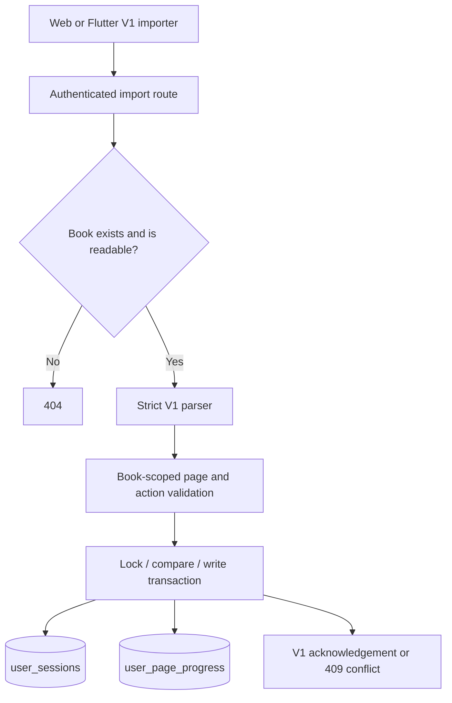

# Guest Progress Import Architecture

> Living architecture document · Twistloom Backend · 2026-10-23
> Scope: one authenticated V1 command for importing a browser or device guest journey into account reading progress.
> Status: **Implemented** · source paths and contract reviewed in the working tree; automated checks and live PostgreSQL concurrency are **Not claimed**.
> Anchor contract: source comments may cite `§N`; update the Section Anchor Map atomically when renumbering.
> Companions: [Flutter client](../../../Twistloom-flutter/docs/architecture/GUEST_PROGRESS_MIGRATION_ARCHITECTURE.md) · [Web client](../../../Twistloom-web/docs/architecture/GUEST_READING_PROGRESS_MIGRATION_ARCHITECTURE.md)

## Contents

- [1. Summary and Design Rationale](#1-summary-and-design-rationale)
- [2. System Boundaries](#2-system-boundaries)
- [3. Invariants](#3-invariants)
- [4. Request Flow and Data](#4-request-flow-and-data)
- [5. Failure and Recovery](#5-failure-and-recovery)
- [6. Industry Comparison](#6-industry-comparison)
- [7. File Map](#7-file-map)
- [8. Verification and Evidence](#8-verification-and-evidence)
- [9. FAQ](#9-faq)
- [10. Known Gaps](#10-known-gaps)
- [11. Section Anchor Map and Related Documents](#11-section-anchor-map-and-related-documents)

---

## 1. Summary and Design Rationale

### 1.1 Summary

Guest Progress Import V1 is a single conditional command: `POST /api/books/:identifier/guest-progress/import`. The caller supplies canonical page and action references, a current/frontier cursor, an immutable operation UUID, and the exact account-session snapshot it reviewed. The backend checks book access, validates the graph against pages belonging to that book, rebuilds action metadata from database rows, and commits actions plus session in one transaction. The latest operation ID and fingerprint live on the existing `(user_id, book_id)` session row; there is no import receipt history.

The backend advertises `guestProgressImportVersion: 1` from the shared enriched-book select. Old unversioned, V2/V4, migrate, and adopt contracts are removed. The canonical contract is documented in [the V1 cleanup roadmap](../roadmap/GUEST_PROGRESS_V1_CLEANUP_ROADMAP.md).

### 1.2 Decisions

| Element | Decision | Alternative considered | Cost accepted |
|---|---|---|---|
| Route and verb | One authenticated POST import command | Separate migrate/adopt methods | Client consent must be represented in `expectedSession` |
| Session policy | Compare-and-set against `expectedSession` | Boolean replace flag | A stale review returns conflict and requires review again |
| Page/action authority | Resolve all IDs inside the requested book; rebuild selected action from stored page actions | Trust client metadata | Missing or changed ancestry is rejected |
| Replay | Latest UUID plus SHA-256 normalized-request fingerprint on session row | Permanent operation receipt table | Only the latest command can be confirmed after a lost response |
| Database evolution | Keep marker columns already declared in `src/db/schema.ts` | Hand-edit generated SQL | No database generation or migration is part of this change |
| HTTP body ingestion | Read parsed body via `c.get("body")` (populated by `parseJsonBody`) | Raw stream `c.req.raw.clone()` | Avoids disturbed stream exceptions under standard fetch pipeline |
| Client legacy deprecation | Clean canonical V1 cutover: legacy /migrate and /adopt endpoints removed across backend, web, and Flutter | Maintain backward-compatibility polyfill shims | Deployment paused allows direct canonical rollout without shims or polyfills |

---

## 2. System Boundaries



The clients own local source preservation, consent UI, operation persistence, and local activation. The backend owns authorization, canonical graph validation, compare-and-set, transaction atomicity, and the response contract. PostgreSQL is authoritative for page ancestry and account progress.

---

## 3. Invariants

1. The only route is authenticated `POST /:identifier/guest-progress/import` in `src/routes/books.ts`.
2. A request is V1 only when `importVersion` is exactly `1`, with a UUID `operationId`; unknown and legacy fields are rejected.
3. The supplied `pageIds` list is bounded to 512 and action references to 50. Every referenced page is looked up with the resolved `bookId` predicate.
4. Client action text, type, hint, page number, and ancestry are never stored as canonical facts. The server resolves an action from its source page and destination edge.
5. The current page must be on the frontier ancestry; the server derives frontier page number and ancestor IDs from the canonical parent chain.
6. `expectedSession: null` authorizes creation only when no session exists. A non-null value must match current page, exact `updatedAt`, and latest import marker.
7. A session row lock serializes existing-session consent checks. The unique `(user_id, book_id)` key serializes competing first inserts.
8. Session and selected-action changes are committed in one transaction; a rejected canonical graph performs no writes.
9. The latest successful operation UUID and fingerprint are stored on the session row. A matching retry returns current canonical progress; a changed request with the same UUID returns conflict.
10. Reset and other guest-progress mutations clear the latest marker so stale intent cannot be confirmed as current.

---

## 4. Request Flow and Data

### 4.1 Contract

```json
{
  "importVersion": 1,
  "operationId": "<uuid>",
  "pageIds": ["<page-uuid>"],
  "actions": [{ "actionedPageId": "<page-uuid>", "nextPageId": "<child-page-uuid>", "actionId": "<canonical-action-id>" }],
  "session": { "pageId": "<current-page-uuid>", "frontierPageId": "<frontier-page-uuid>" },
  "expectedSession": null
}
```

`expectedSession` may instead contain `{ pageId, updatedAt, lastGuestImportId }` from the account session shown during client review. A successful response contains `importVersion`, the same `operationId`, `sessionApplied: true`, `alreadyApplied`, `actionsImported`, and the canonical session. A stale comparison returns HTTP 409 with `reason: conflict`; reusing the operation UUID with another normalized payload returns `reason: operation_mismatch`.

### 4.2 Processing sequence

1. Route resolves a slug or UUID and runs the shared `getBookDetailAccessError` authorization gate.
2. `parseGuestProgressImport` validates exact V1 fields, UUIDs, bounds, and the expected-session structure.
3. `importGuestProgress` fingerprints the normalized request and starts a database transaction.
4. The transaction locks the user's session row when it exists and calls `resolveGuestImport`. An exact replay is acknowledged; stale consent stops with conflict.
5. The service loads referenced pages filtered by `pages.bookId = bookId`. `canonicalGuestProgress` validates the complete path and selected edges.
6. The service updates or creates the session row and upserts canonical selected actions. Both writes commit atomically.

### 4.3 Ownership

| Layer | Owns | Must not own |
|---|---|---|
| Route | Resolve identifier, auth, book access, HTTP status | Graph policy or client consent inference |
| Utility | Strict parse, deterministic graph validation, fingerprint and replay comparison | Database reads/writes |
| Service | Transaction, row lock, marker, canonical persistence | Trusting browser action metadata |
| `user_sessions` | Current account cursor and one latest import marker | Import history or guest-source data |
| Clients | Source retention, user consent, durable operation and local activation | Canonical action metadata or server success inference |

---

## 5. Failure and Recovery

| # | Failure | Detection / status | Recovery |
|---|---|---|---|
| 1 | Missing or inaccessible book | Route returns **404** | Preserve the local journey; verify book/account access |
| 2 | Malformed, unsupported, oversized, cross-book, or non-canonical request | `cValidationError` returns **400** | Preserve source; unchanged invalid data should not be retried |
| 3 | Session changed since user review | Response includes conflict reason and HTTP **409** | Preserve source and refresh comparison before creating a new command |
| 4 | Same operation ID with a different payload | `operation_mismatch`, HTTP **409** | Treat operation as terminal conflict; preserve source |
| 5 | Network loses a successful response | Client has no acknowledgement | Retry the exact immutable request; matching marker returns current session |
| 6 | Transaction/database error | Request fails; transaction rollback protects both tables | Client retains intent and source for retry or review |

---

## 6. Industry Comparison

### The standard

The transaction uses PostgreSQL's [explicit row locking](https://www.postgresql.org/docs/current/explicit-locking.html) and [`INSERT ... ON CONFLICT`](https://www.postgresql.org/docs/current/sql-insert.html) primitives for mutable-row preconditions and concurrent first creation.

### Comparison

| Aspect | Recognized practice | V1 implementation | Alignment |
|---|---|---|---|
| Existing mutable row | Lock before validating a write precondition | `user_sessions` row `FOR UPDATE` | Aligned |
| First insert race | Unique key and conflict-safe retry | Unique `(user_id, book_id)` plus `ON CONFLICT DO NOTHING` and winner recheck | Aligned |
| Untrusted client references | Validate at the authoritative boundary | Rebuild action/session data from DB pages | Aligned |
| Idempotency retention | Store enough state for promised retries | One latest marker only | Deliberately bounded; no historical receipts |

### Assessment

V1 applies standard database concurrency controls and server-side canonicalization. Typechecking cannot prove real concurrent PostgreSQL behavior; that remains **Not claimed** until the normal database verification stage is run.

---

## 7. File Map

| File | Responsibility |
|---|---|
| `src/routes/books.ts` | Single V1 route, book resolution, access check, status mapping |
| `src/services/guest-progress.ts` | Transaction, session compare-and-set, action/session writes |
| `src/utils/guest-progress.ts` | Strict parser, canonical graph logic, fingerprint and replay result |
| `src/services/book-controller.ts` | Emits `guestProgressImportVersion: 1` in shared enriched book data |
| `src/types/book.ts` | Enriched book capability type |
| `src/db/schema.ts` | Declares the two existing bounded session marker columns |
| `../Twistloom-flutter/lib/shared/journeys/guest_progress_importer.dart` | Flutter immutable V1 command/recovery and guarded local activation |
| `../Twistloom-web/src/lib/utils/guest-migration.ts` | Web V1 command and source reconciliation |

---

## 8. Verification and Evidence

| Layer | Status | Evidence |
|---|---|---|
| Source trace | **Implemented** | Current route, service, utility, and client call sites reviewed |
| Typecheck / lint | **Not claimed** | Not run for this implementation turn |
| Unit/integration tests | **Not claimed** | Test fixtures were aligned; suites were not run |
| Live PostgreSQL race/rollback | **Not claimed** | No database test or migration was run |
| Database generation/migration | **Skipped by request** | `schema.ts` is the source of truth; no generated SQL edited |

---

## 9. FAQ

### FAQ 1. Why is import a POST instead of separate migrate/adopt routes?

Both operations apply the same conditional command. `expectedSession` captures whether the user approved an empty account session or reviewed a specific existing snapshot, so a second route and overwrite boolean would duplicate policy.

### FAQ 2. Does the server accept a missing version or the old `version` field?

No. The parser requires `importVersion: 1` and rejects fields outside the V1 allowlist. The old unversioned, V2, and V4 shapes are not aliases.

### FAQ 3. Why are markers kept on `user_sessions`?

The marker applies to one user's one book session and must be updated atomically with that session. It stores only the latest UUID/hash pair, not a history of import receipts.

### FAQ 4. What if the user's session advances after consent?

The exact page, timestamp, and prior marker no longer match, so the route returns HTTP 409. The client retains the guest source and requests a new review.

---

## 10. Known Gaps

| # | Gap | Why it matters | Entry gate | Status |
|---|---|---|---|---|
| 1 | Web local guest/account records still originate from shared legacy stores | Explicit consent is present, but source ownership is not yet encoded in every reader writer | Web roadmap storage ownership steps | Planned |
| 2 | Web client identity is not atomically bound to the HttpOnly cookie across tabs | A client-side account ID cannot prove which cookie principal receives the request | Backend expected-principal roadmap decision | Planned |
| 3 | PostgreSQL concurrency and rollback are not exercised here | Source checks do not establish production database behavior | Database verification step in the V1 roadmap | Not claimed |

---

## 11. Section Anchor Map and Related Documents

### Section Anchor Map

| Anchor | Section | Cited by |
|---|---|---|
| §1 | Summary and Design Rationale | Route/service comments may cite the contract |
| §2 | System Boundaries | Companion client architecture docs |
| §3 | Invariants | Backend route and service implementation |
| §4 | Request Flow and Data | API consumers |
| §5 | Failure and Recovery | Client recovery behavior |

### Related Documents

| Document | Role |
|---|---|
| [Guest Progress V1 Cleanup Roadmap](../roadmap/GUEST_PROGRESS_V1_CLEANUP_ROADMAP.md) | Cross-project implementation plan |
| [Flutter Guest Progress Architecture](../../../Twistloom-flutter/docs/architecture/GUEST_PROGRESS_MIGRATION_ARCHITECTURE.md) | Mobile request, journal, and local activation |
| [Web Guest Progress Architecture](../../../Twistloom-web/docs/architecture/GUEST_READING_PROGRESS_MIGRATION_ARCHITECTURE.md) | Browser consent, intent, and source reconciliation |
| [Book Access and Moderation](./BOOK_ACCESS_AND_MODERATION_ARCHITECTURE.md) | Shared access boundary |
| [Architecture Doc Audit Skill](../../.agents/skills/architecture-doc-audit/SKILL.md) | Architecture verification procedure |
| [Doc Sync Audit Skill](../../.agents/skills/doc-sync-audit/SKILL.md) | Source/document drift procedure |
