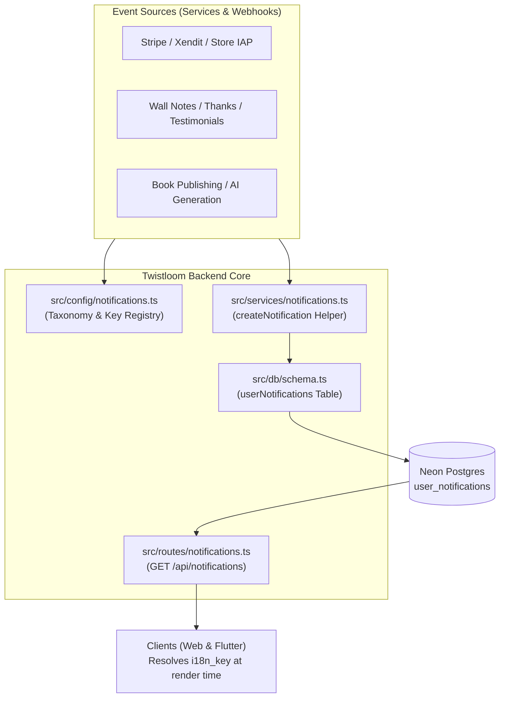

# Notification Localization Backend Architecture

> Living architecture document · Twistloom Backend · 2026-10-24
> Scope: End-to-end notification persistence, machine taxonomy keys, and structured parameter payload pipeline.
> Status: **Implemented & verified** · last verified against the working tree on 2026-10-24
> Anchor contract: source files cite this document's `§N` sections in their doc comments — see the Section Anchor Map at the end. Renumbering requires updating those comments in the same change.
> Companion: [NOTIFICATION_LOCALIZATION_ROADMAP](../roadmap/NOTIFICATION_LOCALIZATION_ROADMAP.md) · [BROADCAST_ARCHITECTURE](./BROADCAST_ARCHITECTURE.md) · [PAYMENTS_ARCHITECTURE_BACKEND](./PAYMENTS_ARCHITECTURE_BACKEND.md)

---

## Table of Contents
- [1. Executive Summary & Design Rationale](#1-executive-summary--design-rationale)
- [2. System Boundaries & Overview Diagram](#2-system-boundaries--overview-diagram)
- [3. Key Architectural Invariants](#3-key-architectural-invariants)
- [4. Deep Dive: Notification Persistence Pipeline](#4-deep-dive-notification-persistence-pipeline)
- [5. Failure Modes & Recovery Matrix](#5-failure-modes--recovery-matrix)
- [6. Industry Standard Comparison](#6-industry-standard-comparison)
- [7. File Map & Ownership](#7-file-map--ownership)
- [8. Verification & Evidence](#8-verification--evidence)
- [9. FAQ](#9-faq)
- [10. Known Gaps & Future Enhancements](#10-known-gaps--future-enhancements)
- [11. Section Anchor Map & Related Documents](#11-section-anchor-map--related-documents)

---

## 1. Executive Summary & Design Rationale

### 1a. Summary
The user notification system delivers in-app activity notifications across web and native mobile clients for platform events including payment settlements, refunds, credit bonuses, referral awards, followed author publications, AI story generation terminal states, review likes, reader tips, and wall note interactions. This subsystem enforces a code-driven internationalization architecture: the backend persists a machine-readable translation key (`i18n_key`) and structured parameter dictionary (`i18n_params`) alongside resilient fallback prose (`title` and `message`). Storing pre-translated prose is strictly forbidden; dynamic presentation localization is owned by the client applications based on the user's active locale.

### 1b. Design Rationale

| Element | Expectation |
|---------|-------------|
| **Decision** | **Machine key (`i18n_key`) and parameter storage (`i18n_params`)** on `user_notifications`. |
| **Alternatives considered** | Translating strings into the user's `preferred_locale` at write time. |
| **Why it wins here** | Resolves the "frozen history" defect. If a user switches account language from English to Indonesian tomorrow, historical notifications render reactively in Indonesian. Eliminates catalog duplication on the server. |
| **Cost accepted** | Consumer applications (web and mobile) must maintain localization catalog entries for all supported notification types. |

---

## 2. System Boundaries & Overview Diagram



---

## 3. Key Architectural Invariants

1. **Non-Breaking Prose Fallback (§3.1):** Every notification row written to `user_notifications` must have non-empty, human-readable English `title` and `message` strings. Clients encountering an unmapped `i18n_key` gracefully render these strings.
2. **Scalar Parameter Values (§3.2):** `i18n_params` values must be primitive scalars (strings or numbers). Nested prose or translated snippets must never be embedded in parameters.
3. **Immutability of Intent Taxonomy (§3.3):** The `type` column represents the domain categorization (e.g. `referral_bonus`, `payment_success`) for indexing and filtering. Copy variance within a domain is expressed exclusively via `i18n_key`.
4. **Fire-and-Forget Safety (§3.4):** In-app notification creation must never break primary business transactions (e.g. AI story persistence or auto-refund).

---

## 4. Deep Dive: Notification Persistence Pipeline

### 4.1 Taxonomy & Key Vocabulary
All keys are centralized in `src/config/notifications.ts`. The 17 supported machine codes map directly to domain actions:

```ts
export const NOTIFICATION_I18N_KEYS = {
  PAYMENT_SUCCESS: 'notification.paymentSuccess',
  REFUND_PROCESSED: 'notification.refundProcessed',
  FIRST_PURCHASE_BONUS: 'notification.firstPurchaseBonus',
  REFERRAL_VIP_BONUS: 'notification.referralVipBonus',
  REFERRAL_STANDARD_BONUS: 'notification.referralStandardBonus',
  REFERRAL_WELCOME_BONUS: 'notification.referralWelcomeBonus',
  TRIAL_ENDING_SOON: 'notification.trialEndingSoon',
  STORY_PUBLISHED: 'notification.storyPublished',
  AI_STORY_COMPLETED: 'notification.aiStoryCompleted',
  AI_STORY_FAILED: 'notification.aiStoryFailed',
  TESTIMONIAL_LIKE_SINGLE: 'notification.testimonialLikeSingle',
  TESTIMONIAL_LIKE_MULTIPLE: 'notification.testimonialLikeMultiple',
  THANKS_RECEIVED: 'notification.thanksReceived',
  THANKS_REPLY: 'notification.thanksReply',
  WALL_POST_REACTION: 'notification.wallPostReaction',
  WALL_POST_REPLY: 'notification.wallPostReply',
  WALL_POST_INCOMING: 'notification.wallPostIncoming',
} as const;
```

### 4.2 Write Site Retrofit Pattern
Services write machine keys during event dispatch:
- **Credit Grants (`src/services/credits.ts`):** `awardCredits()` accepts `notificationI18nKey` and `notificationI18nParams`, persisting them in the database transaction.
- **AI Story Synthesis (`src/services/ai-generation-notification.ts`):** `buildGenerationOutcomeRow()` generates typed envelopes with `notification.aiStoryCompleted` or `notification.aiStoryFailed`.
- **Wall Social Feed (`src/services/wall-mutations.ts`):** Deduplicated reactions update `i18n_key` and `i18n_params` in-place alongside updated fallback text.

### 4.3 Read Projection API
`GET /api/notifications` in `src/routes/notifications.ts` projects `i18nKey` and `i18nParams` directly to authenticated clients:
```ts
.select({
  id: userNotifications.id,
  userId: userNotifications.userId,
  type: userNotifications.type,
  title: userNotifications.title,
  message: userNotifications.message,
  i18nKey: userNotifications.i18nKey,
  i18nParams: userNotifications.i18nParams,
  data: userNotifications.data,
  read: userNotifications.read,
  createdAt: userNotifications.createdAt,
  updatedAt: userNotifications.updatedAt,
})
```

---

## 5. Failure Modes & Recovery Matrix

| # | Failure | Detection / Error | Recovery / Client Behavior |
|---|---------|-------------------|----------------------------|
| 1 | Client lacks translation for `i18n_key` | Key miss in client catalog | Client renders server-provided English `title` and `message` without crashing. |
| 2 | Legacy row has `i18n_key = null` | Null check in resolver | Client runs legacy type-bridge or renders stored fallback text. |
| 3 | Concurrent reaction deduplication race | `user_notifications_unread_group_unique` conflict | Catches conflict; coalescing update refreshes parameters in place. |
| 4 | Notification write fails during AI synthesis | Caught and logged in `ai-generation-notification.ts` | Best-effort boundary: swallows error so story completion is not aborted. |

---

## 6. Industry Standard Comparison

### The Standard
- **FCM / APNs Remote Alerts:** Utilizes `loc-key` and `loc-args` arrays to defer string resolution to the client device.
- **Meta / Slack Notification Engines:** Event bus stores structured entity IDs and template codes; rendering layer translates using the viewer's active session locale.

### How This Design Compares
- **Matches:** Implements client-side evaluation of machine keys with structured parameter interpolation.
- **Ahead:** Stores fallback English prose directly on the notification row, enabling zero-downtime client releases when new notification types are introduced.

| Aspect | Industry Practice | Twistloom Design | Alignment |
|--------|-------------------|------------------|-----------|
| Storage | Event payload + key | `i18n_key` + `i18n_params` + fallback | Aligned |
| Client Fallback | Missing key shows raw identifier | English prose fallback | Ahead |
| Translation Locus | Client display time | Client display time | Aligned |

---

## 7. File Map & Ownership

| Path | Layer | Responsibility |
|------|-------|----------------|
| `src/db/schema.ts` | Schema | Defines `userNotifications` table with `i18n_key` and `i18n_params` |
| `src/config/notifications.ts` | Config | SSOT for notification types and translation machine keys |
| `src/services/notifications.ts` | Service | Unified insertion helper `createNotification()` |
| `src/routes/notifications.ts` | Route | Read API projecting `i18nKey` and `i18nParams` to clients |
| `src/services/credits.ts` | Service | Credit purchase and first purchase bonus notifications |
| `src/services/user-controller.ts` | Service | Referral program bonus notifications |
| `src/services/gateways/stripe-webhook-handlers.ts` | Service | Stripe checkout and refund notifications |
| `src/services/xendit.ts` | Service | Xendit invoice settlement notifications |
| `src/services/store-verification/grant.ts` | Service | Mobile in-app purchase notifications |
| `src/services/subscription.ts` | Service | VIP trial expiration notifications |
| `src/services/book-publish-notification.ts` | Service | Followed author book publication direct fan-out |
| `src/services/email-campaigns.ts` | Service | Followed author book publication cursor fan-out |
| `src/services/ai-generation-notification.ts` | Service | AI generation outcome notifications |
| `src/services/testimonial-notifications.ts` | Service | Testimonial review like notifications |
| `src/services/thanks.ts` | Service | Reader Thanks tip notifications |
| `src/services/wallet.ts` | Service | Author Thanks reply notifications |
| `src/services/wall-mutations.ts` | Service | Wall note social interaction notifications |

---

## 8. Verification & Evidence

| Layer | Status | Evidence |
|-------|--------|----------|
| Static Check | **Implemented & verified** | `bun run typecheck` passed with 0 errors on 2026-10-24 |
| Schema Consistency | **Implemented & verified** | `user_notifications` schema compiles with typed `Record<string, string \| number>` |
| Service Retrofits | **Implemented & verified** | All 15 write call-sites compile cleanly with typed `NOTIFICATION_I18N_KEYS` |

---

## 9. FAQ

### FAQ 1. Why does the server still write English title and message strings?
They serve as a resilient last-resort fallback. If an older client version or third-party consumer encounters a newly added notification type without bundled localizations, it displays the English prose instead of an empty box or raw code.

### FAQ 2. What happens when a user switches their preferred language?
All notifications (historical and new) immediately render in the newly selected language upon client refresh, because text resolution occurs dynamically on the client.

### FAQ 3. How are numeric amounts and currency formatted?
Parameters carry raw numerical values (e.g. `{ credits: 100 }`). The consumer application formats numbers and dates according to the reader's active locale conventions.

---

## 10. Known Gaps & Future Enhancements

| # | Gap / Enhancement | Why It Matters | Entry Gate | Status |
|---|-------------------|----------------|------------|--------|
| 1 | FCM/APNs push localization | Remote push notifications when app is backgrounded | Push notifications epic | Planned |
| 2 | Outbound transactional email template unification | Emails currently use independent template maps | Email refactor roadmap | Planned |

---

## 11. Section Anchor Map & Related Documents

### Section Anchor Map
| Anchor | Section | Cited By |
|--------|---------|----------|
| §3.1 | Non-Breaking Prose Fallback | `src/services/notifications.ts` |
| §3.2 | Scalar Parameter Values | `src/config/notifications.ts` |
| §4.2 | Write Site Retrofit Pattern | `src/services/credits.ts`, `src/services/wall-mutations.ts` |

### Related Documents
| Document | Role |
|----------|------|
| [NOTIFICATION_LOCALIZATION_ROADMAP.md](../roadmap/NOTIFICATION_LOCALIZATION_ROADMAP.md) | Implementation roadmap and completion tracking |
| [BROADCAST_ARCHITECTURE.md](./BROADCAST_ARCHITECTURE.md) | Precedent for `messageKey` and `messageParams` |
| [PAYMENTS_ARCHITECTURE_BACKEND.md](./PAYMENTS_ARCHITECTURE_BACKEND.md) | Transactional credit awards and webhook delivery |
