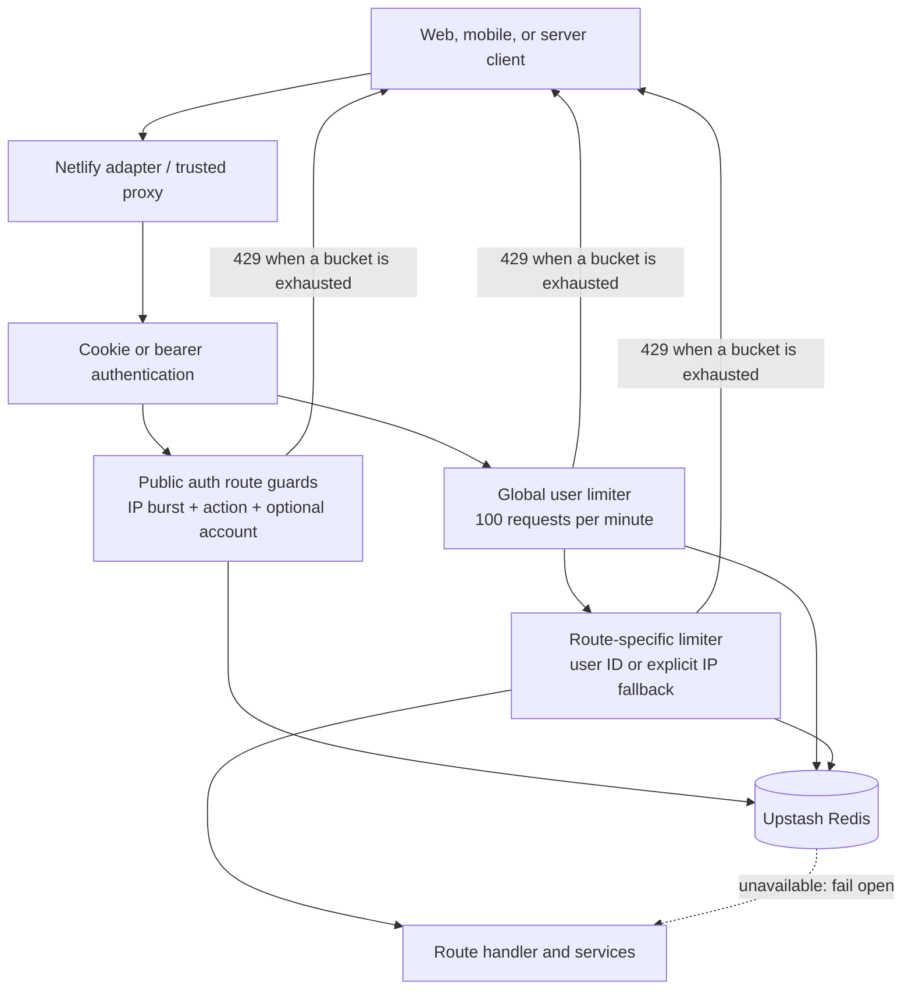
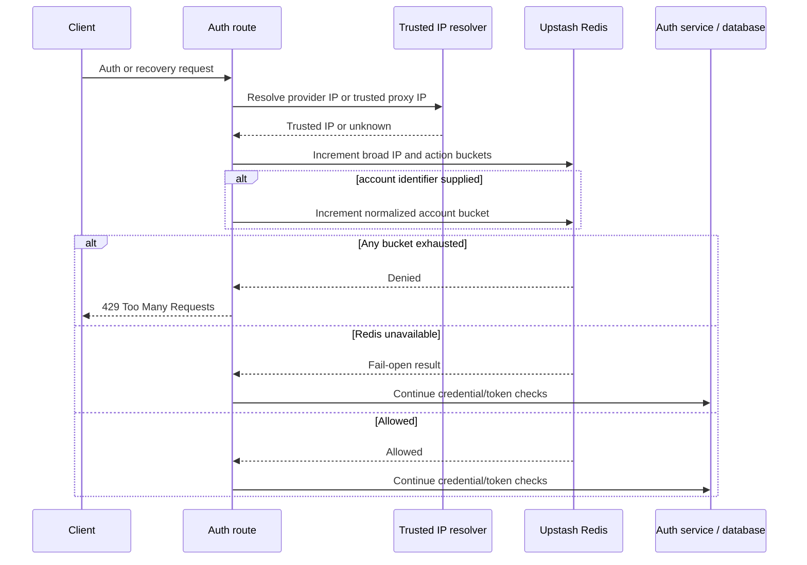

# Rate Limiting Architecture

> Living architecture document · Twistloom Backend · 2026-10-22
> Scope: distributed request throttling in the Hono backend, including authenticated route limits, anonymous IP fallback, authentication abuse controls, Redis behavior, and the trusted client-IP boundary.
> Status: **Implemented & verified** · behavior and file references checked against the working tree on 2026-10-22; verification limits are recorded in §11.
> Anchor contract: source files may cite this document's `§N` sections in their comments — see the Section Anchor Map at the end. Renumbering requires updating those comments in the same change.
> Companion: [MIDDLEWARE_ARCHITECTURE.md](./MIDDLEWARE_ARCHITECTURE.md) · [DUAL_AUTH_ARCHITECTURE.md](./DUAL_AUTH_ARCHITECTURE.md) · [PAYMENTS_ARCHITECTURE_BACKEND.md](./PAYMENTS_ARCHITECTURE_BACKEND.md)

---

## Table of Contents

1. [Executive Summary & Design Rationale](#1-executive-summary--design-rationale)
2. [System Boundaries & Overview Diagram](#2-system-boundaries--overview-diagram)
3. [Key Architectural Invariants](#3-key-architectural-invariants)
4. [Deep Dive — Rate-Limit Layers and Identity Keys](#4-deep-dive--rate-limit-layers-and-identity-keys)
5. [Deep Dive — Authentication and Recovery Admission](#5-deep-dive--authentication-and-recovery-admission)
6. [Deep Dive — Redis State, Algorithms, and Headers](#6-deep-dive--redis-state-algorithms-and-headers)
7. [Client-IP Trust Boundary](#7-client-ip-trust-boundary)
8. [Failure Modes & Recovery Matrix](#8-failure-modes--recovery-matrix)
9. [Industry Standard Comparison](#9-industry-standard-comparison)
10. [File Map & Ownership](#10-file-map--ownership)
11. [Verification & Evidence](#11-verification--evidence)
12. [FAQ](#12-faq)
13. [Known Gaps & Future Enhancements](#13-known-gaps--future-enhancements)
14. [Section Anchor Map & Related Documents](#14-section-anchor-map--related-documents)

---

## 1. Executive Summary & Design Rationale

### 1a. Summary

Twistloom uses **Redis-backed distributed limits** across serverless instances, with Upstash Redis as the shared counter store. Authenticated API traffic is primarily keyed by the canonical `userId`; selected anonymous routes use a trusted source IP as a fallback; and public authentication routes combine a broad IP burst ceiling with tighter per-action and, where useful, per-account buckets. The design is implemented across Hono middleware, route-level guards, and authentication helpers. Its IP controls are deliberately secondary controls: an IP can be shared by many people or change for one person, so it is not treated as a durable individual identity. Redis failures follow the backend's documented fail-open availability policy. This document covers request-rate controls, not AI-provider throttling, database quotas, or network-layer DDoS mitigation.

### 1b. Design Rationale

| Element | Decision | Alternatives considered | Why it wins here | Cost accepted |
|---|---|---|---|---|
| Distributed state | **Upstash Redis** for cross-instance counters | Process-local memory; Postgres counters | `AGENTS.md` §3.2 requires distributed Redis for rate limits and serverless instances do not share memory. Redis scripts provide atomic counters with TTL. | Every check adds Redis work and depends on the configured Redis service. |
| Primary authenticated key | **Canonical user ID** for global and endpoint-specific throttles | IP-only; user-agent or device fingerprint | Identity is available after cookie/bearer auth and corresponds more closely to the account consuming resources. It avoids penalizing unrelated users behind the same NAT. | A user can create multiple accounts; account-level limits do not stop all Sybil behavior. |
| Anonymous fallback | **Trusted IP with endpoint-specific limits**, only where configured | Skip all public requests; require an account for every read | Anonymous product entry points remain usable while expensive or high-frequency public paths still have a coarse abuse control. | NAT users share a bucket, and address changes can evade it. Thresholds must account for this. |
| Auth admission | **Broad source-IP burst bucket plus per-action IP bucket, optionally per-account** | One tight shared IP bucket; account-only throttling | A broad ceiling catches source bursts while per-action buckets avoid making unrelated auth routes consume a single five-request allowance. Account buckets bind recovery/verification attempts across IP changes. | Attackers with distributed IPs can still spread broad traffic; account limits must avoid account-lockout denial of service. |
| Redis outage policy | **Fail open** for rate-limit storage failures | Fail closed | `AGENTS.md` §3.2 explicitly accepts availability-first behavior for Redis rate checks. Authentication still independently verifies credentials and account standing. | Throttling is unavailable during an outage; monitoring and edge controls remain important. |

---

## 2. System Boundaries & Overview Diagram

The rate-limit surface owns request-frequency admission and response metadata. It does not own identity verification, account authorization, credit accounting, generation concurrency, bot detection, or upstream provider quota enforcement. Auth middleware resolves `userId`; routes select endpoint-specific controls; Upstash stores shared counters; the deployment adapter supplies a trusted source IP.

The `rateLimit()` factory is in `src/middleware/rate-limit.ts`; global placement is in `src/app.ts`; route composition is owned by each route module. The auth-specific helper uses the atomic `checkRateLimit()` function in `src/utils/redis.ts`. The wall creation policy has its own middleware and tier-specific configuration in `src/middleware/wall-rate-limit.ts`.

---

## 3. Key Architectural Invariants

1. **Distributed counters are shared across serverless instances.** Rate-limit state must use Redis rather than an in-process map (`AGENTS.md` §3.2; `src/utils/redis.ts:95-127`).
2. **Authenticated limits key on `userId`.** The standard middleware does not substitute IP for an authenticated identity (`src/middleware/rate-limit.ts:114-120`).
3. **IP fallback is opt-in.** Anonymous callers are limited by IP only on routes explicitly configured with `ipFallback: true`; unknown IPs skip that middleware limit (`src/middleware/rate-limit.ts:114-121`).
4. **Auth IP buckets use only server-defined action scopes.** Request parameters never choose the scope namespace (`src/middleware/rate-limit.ts:221-257`).
5. **Application-generated IP and account bucket identifiers are hashed before they reach Redis.** The standard anonymous fallback, auth admission, username availability, mobile issuance, and refresh paths do not write raw IPs as counter identifiers (`src/middleware/rate-limit.ts:115-136`, `249-271`; `src/routes/auth.ts:502-512`, `884-900`, `1076-1085`).
6. **Admission dependency failures fail open; downstream route errors do not.** The generic and Wall limiters keep `next()` outside their dependency catches and invoke it once (`src/middleware/rate-limit.ts:132-165`; `src/middleware/wall-rate-limit.ts:19-88`).
7. **Client IP comes from a trusted platform binding or explicitly enabled proxy configuration.** Arbitrary `X-Forwarded-For` is not authoritative by default, and the `unknown` sentinel is never used as a shared IP bucket (`src/hono/express-shim.ts:32-42`; `netlify/functions/api.mts:44`).
8. **Rate-limit headers report the Upstash response values.** `X-RateLimit-Remaining` represents `remaining`, and rejected responses include `Retry-After` (`src/middleware/rate-limit.ts:137-160`).

---

## 4. Deep Dive — Rate-Limit Layers and Identity Keys

### 4a. Global authenticated ceiling

`src/app.ts:156-157` attaches `rateLimitByUser` to `/api/*` after cookie/bearer identity middleware and body parsing. The default is 100 requests per 60 seconds. Requests without `userId` pass through; public endpoints therefore need a route-level limit or another guard if they consume meaningful resources. This global ceiling is a broad safety net, not a replacement for tighter endpoint policy.

### 4b. Per-route middleware

Routes call `rateLimit(config)` with a unique prefix to keep their counters isolated. Authenticated callers use `userId`. A route may pass `{ ipFallback: true }`; then authenticated callers still use `userId`, while anonymous callers use `getClientIp(c)` hashed with SHA-256 before it becomes the Upstash identifier. If that value is `unknown`, the middleware skips enforcement because it cannot safely identify a bucket.

Examples include `GET /api/books/prompt`, which is optional-auth and uses an IP fallback for anonymous requests (`src/routes/books.ts:1631`), and optional-auth Wall reads in `src/routes/wall.ts:64-85`. Most AI write/generation routes require authentication and apply a tighter per-user limit from `src/config/ai-rate-limits.ts`.

### 4c. Wall creation policy

Wall creation chooses a one-hour per-user window based on account age and active subscription: new accounts receive 3/hour, established free accounts 10/hour, and active VIP accounts 30/hour (`src/middleware/wall-rate-limit.ts:11-73`). It reads the user tier and creation timestamp, then uses a separately prefixed Upstash sliding-window limiter. Missing user identity or Redis causes the request to continue; the route's own auth requirements and business checks remain responsible for authorization.

---

## 5. Deep Dive — Authentication and Recovery Admission

### 5a. Public auth IP and account buckets

`checkRateLimitByIP(ip, scope, account?)` applies up to three separate fixed-window counters:

| Bucket | Default | Key shape | Purpose |
|---|---:|---|---|
| Broad auth IP burst | 60 / 60 seconds | `auth:ip:<sha256(ip)>` | Broad source-level burst bound across helper-protected auth actions; skipped when the resolver returns `unknown`. |
| Per-action IP | 5 / 60 seconds | `auth:ip-scope:<scope>:<sha256(ip)>` | Tight control for one action without coupling unrelated auth routes; skipped when IP is unknown. |
| Optional account | 5 / 15 minutes | `auth:account:<scope>:<sha256(normalized account)>` | Binds attempts for one action/account across source IPs without coupling unrelated actions; still applied when IP is unknown. |

Configured actions include web password login, Google login, signup, password recovery/reset, email verification/resend, and authenticated email/password/username changes (`src/routes/auth.ts:117-134`, `222-227`, `359-364`, `570-573`, `612-616`, `681-686`, `735-739`, `1608-1615`, `1723-1730`, `1824-1831`). Account buckets are used where an account identifier is available and useful. Password login also uses persisted account lockout keyed by canonical `userId` after user lookup (`src/routes/auth.ts:235-261`; `src/utils/account-lockout.ts:68-119`).

`username-available` uses its own higher-volume 60/minute IP counter because it is keystroke-driven; its key hashes the source IP (`src/routes/auth.ts:502-511`). Signed web exchanges use `allowWebExchange()` with a purpose/body-bound proof and separate egress/account budgets (`src/services/web-control.ts`); those do not consume the small unsigned per-action IP bucket.

### 5b. Mobile credentials and token refresh

Password, Google, and Apple mobile issuance use a shared hashed-IP ceiling of 60/minute plus a per-flow 10/minute hashed-IP bucket (`src/routes/auth.ts:816-820`, `884-903`, `917-983`). Failed password logins also pass through account lockout. Refresh requests have a hashed-IP 30/minute counter and a second counter keyed by refresh family when known, otherwise by presented-token hash (`src/routes/auth.ts:1072-1104`). These controls serve different identifiers: a source-level ceiling catches bursts; the family/token counter constrains repeated operations on one credential.

### 5c. Auth request sequence

---

## 6. Deep Dive — Redis State, Algorithms, and Headers

### 6a. Two counter mechanisms

The standard middleware constructs `@upstash/ratelimit` with a sliding-window algorithm. The fixed-window auth helper and other direct counters use `checkRateLimit()` in `src/utils/redis.ts:95-127`: one Redis Lua script increments the key and repairs/sets an expiry if missing. The fixed-window helper is atomic for concurrent requests but can allow a burst across adjacent window boundaries; auth account lockout and per-action limits are additional controls, not a claim of a strict rolling window.

Limiter prefixes isolate counters. `rateLimit()` per-route configurations are expected to provide unique prefixes; the global user limiter uses the library default prefix. Wall creation has separate prefixes for new/free/VIP tiers (`src/middleware/rate-limit.ts:93-111`; `src/middleware/wall-rate-limit.ts:14-16`).

### 6b. Configuration

| Environment variable | Default | Applies to |
|---|---:|---|
| `AUTH_RATE_LIMIT_IP_MAX_REQUESTS` | 60 | Shared source-IP ceiling for `checkRateLimitByIP`. |
| `AUTH_RATE_LIMIT_IP_WINDOW_MS` | 60000 | Window for the shared source-IP ceiling. |
| `AUTH_RATE_LIMIT_MAX_ATTEMPTS` | 5 | Per-action IP ceiling and optional account ceiling. |
| `AUTH_RATE_LIMIT_WINDOW_MS` | 60000 | Per-action IP window; account bucket remains 15 minutes. |
| `TRUST_PROXY_HEADERS` | `false` | Enables first-hop `X-Forwarded-For` only when the deployment proxy strips/replaces client-supplied forwarding headers. |

Invalid/nonpositive integer settings fall back to code defaults (`src/middleware/rate-limit.ts:211-220`). The same auth settings are read at module initialization, so changing deployment variables requires a new function instance/deployment.

SHA-256 prevents plaintext IP/account values from appearing in Redis keys; it is pseudonymization, not encryption or irreversible anonymization. Low-entropy account values may be guessable if a Redis key dump is exposed. A keyed digest would strengthen that property but needs a stable shared secret and key-rotation plan.

### 6c. Response contract

The generic `rateLimit()` middleware sets `X-RateLimit-Limit`, `X-RateLimit-Remaining`, and ISO `X-RateLimit-Reset` for allowed requests. Denials add `Retry-After` and throw an Hono 429 `HTTPException`, which the app error handler serializes. `checkRateLimitByIP()` callers return their established 429 error shape; they do not currently expose the generic middleware headers. Upstash defines `remaining` as the number of requests left and `limit` as the maximum.

---

## 7. Client-IP Trust Boundary

`getClientIp()` reads `c.env.trustedClientIp` first. Netlify's adapter populates that binding from platform-owned `context.ip` (`netlify/functions/api.mts:44`). Only if that binding is absent and `TRUST_PROXY_HEADERS=true` does it read the leftmost `X-Forwarded-For` entry (`src/hono/express-shim.ts:32-42`). The environment example keeps the flag disabled and documents that a proxy must strip and rewrite forwarding headers (`.env.example:80-86`).

The Express-compatible request adapter now calls the same resolver for `req.ip` and `req.socket.remoteAddress`, so helper code cannot accidentally trust a forged forwarding header while the Hono limiter does not (`src/hono/express-shim.ts:65-112`). A self-reported header is never a safe rate-limit identity. When no trusted address exists, the resolver returns `unknown`; callers should not convert that sentinel into a strict shared-user bucket in production.

When the resolver returns `unknown`, generic IP-fallback middleware skips its IP limiter; auth helper IP buckets, username availability, mobile issuance, and mobile refresh also skip their IP-only counters. An available account bucket or refresh family/token bucket still applies. This avoids placing all local or misconfigured requests into one artificial shared-IP bucket.

An IP may represent many people behind NAT, or may change for one person due to carrier routing, VPNs, DHCP, or privacy relays. Geo-IP databases estimate location and do not turn an address into a person identifier. These are reasons to use IP as a coarse source signal and combine it with account/user identity, not reasons to remove IP safeguards from anonymous abuse paths.

---

## 8. Failure Modes & Recovery Matrix

| Failure / condition | Current behavior | User-visible result | Recovery / owner |
|---|---|---|---|
| Redis environment absent | Generic and fixed-window helpers allow traffic. | Request proceeds to auth/business checks. | Configure Upstash for production; availability policy is explicit in `AGENTS.md` §3.2. |
| Redis request fails | Limiter logs and fails open. The generic middleware invokes downstream once; route exceptions propagate. | Request proceeds unless a later auth or business check rejects it. | Restore Redis; monitor limiter error logs. |
| Wall account lookup fails | The entitlement/account-age read fails open and continues to the route; route exceptions are outside this catch. | Request proceeds under normal route authorization. | Restore database read availability; monitor the Wall limiter log. |
| No trusted IP on anonymous `ipFallback` route | Generic route middleware skips its limit for `unknown`. | Request proceeds. | Verify the adapter supplies trusted IP; do not accept arbitrary forwarding headers as a workaround. |
| Many users share one public IP | They share broad and per-action IP buckets. Account/user buckets remain independent where available. | A 429 can affect multiple people if IP thresholds are exhausted. | Tune broad/per-action thresholds from measured traffic; retain per-account and per-user controls. |
| Client rotates IPs | IP counters may be bypassed. | No IP 429 across distinct source keys. | Account limits, persisted login lockout, token-family limits, and authenticated user limits provide separate controls. |
| An auth bucket is exhausted | Auth helper returns `false`; route emits 429. | Existing route-specific error body; retry after the relevant window. | Wait for expiry or use a legitimate recovery path; there is no manual reset endpoint documented here. |
| Downstream handler throws under generic limiter | Exception is no longer caught by limiter; `next()` is not retried. | Normal app error handling applies. | Fix the downstream error; limiter state is unaffected. |

---

## 9. Industry Standard Comparison

| Reference | Relevant guidance | Twistloom alignment / difference |
|---|---|---|
| [OWASP Authentication Cheat Sheet](https://cheatsheetseries.owasp.org/cheatsheets/Authentication_Cheat_Sheet.html) | Associate failed-login counters with accounts rather than only source IP; consider usability and lockout denial-of-service risks. | Password login has persisted `userId` lockout plus source IP throttling. Account lockout and IP caps are distinct controls. |
| [OWASP Bot Management and Anti-Automation Cheat Sheet](https://cheatsheetseries.owasp.org/cheatsheets/Bot_Management_and_Anti-Automation_Cheat_Sheet.html) | Use independent per-username and per-IP buckets for login; a combined `IP+username` key alone is insufficient. | The helper checks source IP and optional account as separate keys, rather than forming one pair key. Signed web exchanges have independent egress/account buckets. |
| [OWASP API4:2023](https://api-security.owasp.org/editions/2023/en/0xa4-unrestricted-resource-consumption/) | Tune request/resource limits to endpoint costs and bound expensive operations. | AI routes have per-user endpoint limits and credit/concurrency controls beyond the global 100/minute ceiling. The generic limiter alone does not model request cost. |
| [Cloudflare rate-limit parameters](https://developers.cloudflare.com/waf/rate-limiting-rules/parameters/) | Documents shared-NAT false positives and a cookie-assisted NAT-aware option, with gaps for users who clear/decline cookies. | Twistloom uses app account/user identity when available and a trusted IP for anonymous server-side APIs. It does not rely on a proxy-specific visitor cookie. |
| [Upstash Ratelimit methods](https://upstash.com/docs/redis/sdks/ratelimit-ts/methods) | The response distinguishes maximum `limit` from available `remaining`; sliding-window limits are supported. | Generic middleware reports the documented fields and uses sliding windows; direct auth counters use fixed-window Lua increments for atomicity. |

This comparison is about control shape, not a claim of full bot defense. IP/account limits do not replace credential-stuffing detection, adaptive challenges, edge volumetric protection, or operational spend monitoring.

---

## 10. File Map & Ownership

| File | Responsibility |
|---|---|
| `src/middleware/rate-limit.ts` | `rateLimit()` factory, global default, fixed-window auth admission policy, hash/key construction. |
| `src/utils/redis.ts` | Redis client and atomic increment-with-expiry helper; fail-open fallback. |
| `src/hono/express-shim.ts` | Trusted client-IP resolver and Express-compatible request metadata. |
| `netlify/functions/api.mts` | Supplies Netlify-owned `context.ip` to Hono bindings. |
| `src/app.ts` | Middleware ordering and global `/api/*` per-user limiter registration. |
| `src/routes/auth.ts` | Applies auth scopes and owns mobile issuance/refresh and username availability throttles. |
| `src/utils/account-lockout.ts` | Persistent failed-login escalation keyed by canonical user ID. |
| `src/middleware/wall-rate-limit.ts` | New/free/VIP Wall creation sliding windows. |
| `src/config/ai-rate-limits.ts` | Endpoint-specific AI caps and tunable configuration. |
| `.env.example` | Auth limiter defaults and proxy trust guidance. |
| `tests/auth-abuse-control.test.ts` | Existing auth abuse and trusted-IP tests; it does not currently assert all rate-limit counter combinations. |

---

## 11. Verification & Evidence

| Evidence | Status | Details |
|---|---|---|
| Source inspection | **Implemented** | Reviewed the limiter middleware, Redis helper, Hono app ordering, auth callers, Netlify adapter, and existing abuse-control test. |
| Typecheck | **Implemented** | `node node_modules/typescript/bin/tsc --noEmit` completed without diagnostics. |
| Lint / import lint | **Implemented** | ESLint passed on the four changed TypeScript files; `node scripts/check-import-extensions.js src` passed (367 files). |
| Unit/integration tests | **Not claimed** | Existing `tests/auth-abuse-control.test.ts` was inspected but not run. It does not assert the new action buckets or downstream-exception behavior. |
| Manual / E2E | **Not claimed** | No deployed Redis or production proxy exercise was performed. |
| Architecture/doc-sync audit | **Implemented** | Required structure, Mermaid blocks, relative links, source file/line references, and affected middleware/auth docs were checked; stale references were updated. |

`bun run check` could not start in this execution environment (`CouldntReadCurrentDirectory`); the equivalent TypeScript, targeted ESLint, and import-extension checks above were invoked directly with Node.

---

## 12. FAQ

### FAQ 1. Is an IP one person or one city?

Neither. The IP is a network address. Multiple people can share one public address through NAT, and one person can use different addresses over time. A city is only an approximate geolocation attribute sometimes inferred from an IP; this implementation does not rate limit by city.

### FAQ 2. Why keep IP limits if they can penalize shared networks?

Anonymous requests need some coarse source signal before a stable account exists. The implementation uses a broader shared burst ceiling plus tighter action scopes, and it prefers user/account IDs once available. Thresholds still need monitoring because unrelated users behind one NAT share IP buckets.

### FAQ 3. Can I trust `X-Forwarded-For`?

Only when the request passed through a proxy that strips incoming client-provided forwarding headers and writes its own trusted value. Netlify supplies platform-owned `context.ip`; local/self-hosted deployments ignore the header by default. Do not enable `TRUST_PROXY_HEADERS` without a verified proxy boundary (`src/hono/express-shim.ts:32-42`).

### FAQ 4. What happens if Redis is down?

The limiter fails open, so the request proceeds to credential, authorization, validation, and business logic. This is an intentional availability policy documented in `AGENTS.md` §3.2, not a guarantee that abuse controls remain effective during an outage.

### FAQ 5. Are all API calls limited by IP?

No. Authenticated global and route limits key on `userId`. Anonymous requests are IP-limited only where a route explicitly configures `ipFallback` or applies an auth-specific IP guard. Public routes without either remain outside these application-level limits.

### FAQ 6. Does the global 100/minute limit protect costly AI work sufficiently?

No. It is a broad per-user ceiling. AI endpoints apply tighter route-specific limits and may also have credits, quotas, or concurrency controls. Each expensive route should be reviewed for the cost of one request, not only request frequency.

### FAQ 7. Are fixed windows fully smooth at the boundary?

No. The atomic auth helper uses a fixed window, so adjacent windows can permit a short burst around a boundary. The generic `rateLimit()` and Wall creation limits use Upstash sliding windows. A future auth-specific migration to a sliding/token-bucket policy should be driven by observed abuse and a tested account-recovery contract.

### FAQ 8. Does a rate-limit middleware retry a handler after a route error?

No. The generic middleware catches only identity hashing and the Upstash call; the Wall limiter catches its account lookup and Upstash call. Once admission succeeds, downstream exceptions propagate to Hono's normal error handler, and `next()` is called once.

### FAQ 9. Does this rate-limit system provide a waiting room or cap active visitors?

No. The implemented controls count requests against identity and time-window buckets; they do not reserve a fixed number of active visitor slots or queue excess visitors. A managed edge waiting room could be considered for a specific high-demand event, while asynchronous backend work should use a bounded job queue or concurrency limit instead.

---

## 13. Known Gaps & Future Enhancements

| # | Gap / enhancement | Why it matters | Entry gate | Status |
|---|---|---|---|---|
| 1 | Tune shared-IP and per-action thresholds from production telemetry | Static thresholds can still produce NAT false positives or leave overly broad abuse windows. | Observe 429 rates by action and deployment source; adjust only with product/SRE review. | **Implemented** controls; tuning evidence not yet claimed. |
| 2 | Add structured metrics identifying which bucket denied a request | Current logs focus on Redis errors; route-level 429 attribution is limited, which makes safe threshold tuning harder. | Select a privacy-preserving metric schema that excludes raw IP/account identifiers. | **Planned (gated)** |
| 3 | Revisit fail-open policy for high-cost endpoints during Redis outages | Availability wins today, but unrestricted paid provider calls can raise cost. | Define an explicit outage budget and degraded mode for each costly route. | **Planned (gated)** |
| 4 | Review every public route for explicit admission policy | The global limiter intentionally skips anonymous callers; omissions leave routes without an application request ceiling. | Route inventory and cost classification review. | **Planned (gated)** |
| 5 | Add focused behavioral assertions for limit headers, three-bucket auth admission, and downstream exception propagation | Existing abuse-control tests cover trust-boundary and account-lockout behavior but not these changed paths. | Add tests in the backend's normal test workflow. | **Planned (gated)** |
| 6 | Consider keyed digests for Redis identifiers | Plain SHA-256 hides literal values but is vulnerable to offline guessing for low-entropy account identifiers. | Define a stable shared key source and rotation/versioning policy before changing key derivation. | **Planned (gated)** |
| 7 | Consider an edge waiting room for exceptional high-demand events | A request-rate limiter does not cap concurrent active visitors or smooth a sudden influx. A waiting room can queue visitors and admit them as capacity becomes available; this is separate from per-user/IP request limits and from a backend job queue. | Only if a scheduled launch or promotion is expected to exceed tested origin capacity: identify the protected routes, define active-user and admission-rate targets, choose the edge owner, load-test the origin, and require a bypass-resistant admission/session token. Keep backend rate and cost controls in place. | **Planned (gated)** |

This is a conditional enhancement, not a general replacement for API throttling. For example, Cloudflare Waiting Room uses active-user and new-user-per-minute thresholds to decide when to queue visitors ([overview](https://developers.cloudflare.com/waiting-room/about/)). If the bottleneck is expensive asynchronous work such as generation, use a bounded worker queue or concurrency control instead; queue-based load leveling is designed to buffer work and process it at a controlled pace ([Azure Architecture Center](https://learn.microsoft.com/en-us/azure/architecture/patterns/queue-based-load-leveling)).

---

## 14. Section Anchor Map & Related Documents

### Section Anchor Map

No source comments currently cite this document's section numbers. Keep the anchor contract if future source comments add `§N` references.

### Related Documents

| Document | Role |
|---|---|
| [MIDDLEWARE_ARCHITECTURE.md](./MIDDLEWARE_ARCHITECTURE.md) | Hono middleware ordering and route gate composition. |
| [DUAL_AUTH_ARCHITECTURE.md](./DUAL_AUTH_ARCHITECTURE.md) | Cookie and bearer identity; auth exchange controls. |
| [PAYMENTS_ARCHITECTURE_BACKEND.md](./PAYMENTS_ARCHITECTURE_BACKEND.md) | Credits and payment-side request controls. |
| [AGENTS.md](../../AGENTS.md) | Architectural invariants this document elaborates. |
| [architecture-doc-audit skill](../../.agents/skills/architecture-doc-audit/SKILL.md) | Required architecture document audit procedure. |
| [doc-sync-audit skill](../../.agents/skills/doc-sync-audit/SKILL.md) | Documentation drift review after source changes. |
