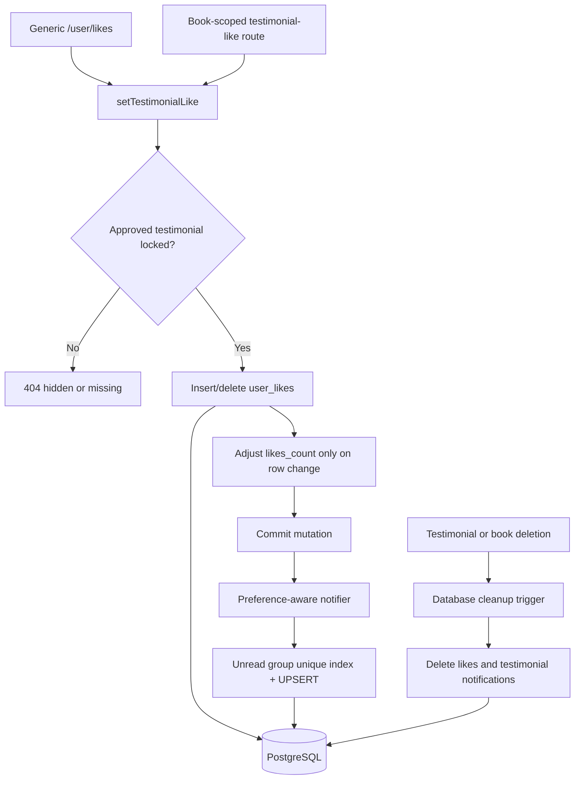

# Testimonial Likes & Notifications Architecture

> Living architecture document · Twistloom Backend · 2026-10-23
> Scope: Authenticated book-testimonial likes, counters, visibility checks, coalesced notifications, and deletion cleanup.
> Status: **Implemented** · source, migration generation, and backend typecheck verified against the working tree on 2026-10-23; no live database migration or concurrency test is claimed.
> Anchor contract: source files may cite this document's `§N` sections; see the Section Anchor Map at the end. Renumbering requires updating those comments in the same change.
> Companion: [Guest progress import](./GUEST_PROGRESS_IMPORT_ARCHITECTURE.md) · [Book access and moderation](./BOOK_ACCESS_AND_MODERATION_ARCHITECTURE.md)

---

## 1. Executive Summary & Design Rationale

### 1.1 Summary

Testimonial likes live in polymorphic `user_likes` and are reflected in `book_testimonials.likes_count`. Generic and book-scoped endpoints delegate mutations to one service that locks the testimonial first, accepts only approved testimonials, and changes the counter only when the like row changes. New non-self likes trigger a preference-aware notification after commit; a partial unique index and upsert allow at most one unread group per recipient/testimonial. A database delete trigger removes matching likes and notifications, including on book cascades. Notification delivery remains best-effort after commit; no outbox guarantee is claimed.

### 1.2 Design rationale

| Element | Decision | Alternatives considered | Why it wins here | Cost accepted |
|---|---|---|---|---|
| Mutation owner | **One testimonial-like service** | Separate generic and dedicated logic | AGENTS.md §1.7 makes duplication a data-integrity risk; one lock order prevents drift | Generic endpoint delegates this type |
| Concurrency | **Lock testimonial, then mutate like and counter** | Route-specific order or advisory locks | Testimonial owns the denormalized counter; PostgreSQL row locking serializes aggregate updates | Popular testimonial updates serialize for correctness |
| Notification group | **Typed group key + unread partial unique index** | Check-then-insert on JSON or recipient-wide lock | Unique index/upsert enforces coalescing under concurrent writers | Additive migration and one-time normalization |
| Polymorphic cleanup | **Delete trigger on testimonial** | Rely on every route to clean | `target_id` cannot reference multiple target tables with a normal FK; trigger covers direct and cascade deletion | Integrity rule lives in SQL migration |

---

## 2. System Boundaries & Overview Diagram

Routes own request/response contracts. `setTestimonialLike` owns visibility, lock order, row mutation, and counter consistency. Notification service owns preferences and coalescing. PostgreSQL enforces unique grouping and deletion cleanup.

---

## 3. Key Architectural Invariants

1. A like/unlike mutation requires an existing `approved` testimonial.
2. Every HTTP like/unlike path locks the testimonial before changing `user_likes` or `likes_count`.
3. Counters change only when a like row is inserted or deleted.
4. Both API surfaces notify after a newly inserted non-self like; an idempotent retry only backfills when no notification history exists, so legacy missing notices are repaired without reopening a read group.
5. At most one unread `testimonial_like` group exists per `(user_id, type, group_key)`.
6. Deleting a testimonial removes polymorphic testimonial likes and matching notifications in the same transaction, including book cascades.
7. Notification failures do not roll back committed likes and are logged; no durable outbox is implemented.
8. The notification dispatcher verifies that the actor still actively likes the testimonial in `user_likes` within its serialized transaction before creating or updating the recipient's notification. Rapid unlike requests committed prior to notification delivery cleanly abort without emitting phantom alerts.
9. Polymorphic consistency on deletion is enforced via database trigger `book_testimonial_cleanup_references` (defined in `src/db/triggers.ts` and created in migration 0109). Because backend deployment is paused, database state remains pristine and counters begin cleanly from zero without historical backfill scripts.

---

## 4. How It Works

### 4.1 Like mutation and lock order

Generic `/user/likes` and dedicated `/books/:identifier/testimonials/:id/like` handlers call `setTestimonialLike`. It locks the testimonial with `FOR UPDATE`, optionally constrains it to the resolved book, and requires status `approved`. It then inserts/deletes `user_likes` and updates `likes_count` only when `RETURNING` shows a row changed (`src/services/testimonial-likes.ts:23`, `src/routes/user.ts:1494`, `src/routes/books.ts:9743`).

This replaces the former inverse lock order. A duplicate like is idempotent; generic unlike reports 404 for no matching like, while the dedicated route preserves its `liked: false` response.

### 4.2 Visibility

Public testimonial listing and detail routes expose only approved records to non-privileged viewers (`src/routes/books.ts:5444`, `src/routes/books.ts:9573`). The shared mutation service applies the same approval predicate to generic and dedicated operations, so pending/rejected IDs cannot receive likes or author notifications.

### 4.3 Notification coalescing

After a successful non-self like request commits, the route calls `notifyTestimonialLike`. New likes UPSERT `user_notifications` with `group_key = testimonial:<id>`. Idempotent retries check for any prior matching notification and insert only when missing, repairing likes created before all paths notified. The notifier checks the author's `likes` preference, resolves the actor name, and locks/rechecks the testimonial. The `user_notifications_unread_group_unique` partial unique index is the concurrency authority (`src/services/testimonial-notifications.ts:22`, `src/db/schema.ts:1713`, `drizzle/0109_amazing_fabian_cortez.sql`).

The notifier's testimonial lock serializes it against deletion. If notification insertion commits first, the deletion trigger removes it; if deletion commits first, the notifier finds no approved testimonial and skips it.

### 4.4 Deletion cleanup

Migration `0109` cleans existing orphaned testimonial likes/notifications and normalizes duplicate unread testimonial notifications, preserving duplicate records as read. An `AFTER DELETE` trigger removes related `user_likes` and testimonial-like notifications for every deleted testimonial row, including rows removed by a book FK cascade (`drizzle/0109_amazing_fabian_cortez.sql`). The standalone trigger installer recreates the same trigger after its full-schema trigger reset (`src/db/triggers.ts`).

A dedicated `testimonial_likes` table could provide a normal FK cascade, but requires coordinated migration of generic liked-item reads/writes. The trigger is the scoped integrity mechanism for the current polymorphic model.

---

## 5. Failure Modes & Recovery Matrix

| # | Failure | Detection / error | Recovery / client behavior |
|---|---|---|---|
| 1 | Invalid generic target/missing ID | Generic route returns **400** | Correct request fields |
| 2 | Missing, hidden, or cross-book testimonial | Shared service returns `not-found`; route returns **404** | Refresh/hide item; no hidden-state details returned |
| 3 | Duplicate like | Unique like key inserts no row; counter unchanged | Treat as idempotent success |
| 4 | Unlike of absent like | Generic **404**; dedicated **200** with `liked: false` | Client remains unliked |
| 5 | Self-like or preference disabled | Notification skipped | Like still succeeds |
| 6 | Idempotent retry for a legacy like without notification | Notifier backfills only when no matching notification history exists | A missing old notification is repaired; read history is not reopened |
| 7 | Notification write fails after like commit | Error logged; generic like remains **201**, dedicated remains **200** | Like remains; retries can repair absent notification history |
| 8 | Delete races with like/notification | Testimonial row lock serializes; later operation sees missing row | Delete trigger cleans likes and notifications |
| 9 | Non-owner deletes testimonial | Route returns **403** | Only owner may delete |

---

## 6. Industry Standard Comparison

### The standard

PostgreSQL documents row-level locking in [Explicit Locking](https://www.postgresql.org/docs/18/explicit-locking.html), atomic `ON CONFLICT` in [`INSERT`](https://www.postgresql.org/docs/current/sql-insert.html), and trigger functions in [PL/pgSQL Trigger Functions](https://www.postgresql.org/docs/current/plpgsql-trigger.html).

### How this design compares

- **Matches the standard:** the aggregate row is locked before like mutation; unique partial index plus UPSERT makes coalescing atomic.
- **Deliberately divergent:** a trigger maintains cleanup for polymorphic IDs that cannot use a normal FK.
- **Gap:** reliable notification delivery after process failure needs an outbox.

| Aspect | Industry practice | This design | Alignment / rationale |
|---|---|---|---|
| Aggregate counter | Serialize changes on owner row | Testimonial lock before like/counter | Aligned; shared lock order avoids deadlocks |
| Idempotent like | Unique key and conflict-safe insert | Composite like key + `ON CONFLICT DO NOTHING` | Aligned |
| Concurrent coalescing | Unique constraint and UPSERT | Partial unread group index + UPSERT | Aligned; removes check-then-insert race |
| Referential cleanup | FK `ON DELETE CASCADE` | Trigger for polymorphic target | Divergent due to schema; trigger covers all delete paths |
| Durable side effect | Transactional outbox | Post-commit direct notifier | Gap; failure can lose notification |

### Assessment

Like/counter integrity and unread coalescing are database-enforced. The main gap is notification durability: delivery is best-effort after the like transaction commits.

---

## 7. File Map & Ownership

| File | Layer | Responsibility |
|---|---|---|
| `src/routes/user.ts` | Generic route | Delegate testimonial likes/unlikes and notify after new likes |
| `src/routes/books.ts` | Scoped route | Delegate book-scoped mutations and preserve owner-delete behavior |
| `src/routes/notifications.ts` | Notification API | Keep internal `group_key` out of the client response projection |
| `src/services/testimonial-likes.ts` | Mutation service | Approved-only gate, testimonial-first lock, row/counter transaction |
| `src/services/testimonial-notifications.ts` | Notification | Preferences, actor label, testimonial recheck, atomic group UPSERT |
| `src/db/schema.ts` | Schema | Typed notification `group_key` and unread uniqueness |
| `src/db/triggers.ts` | Trigger installer | Recreates the testimonial reference-cleanup trigger during explicit trigger setup |
| `drizzle/0109_amazing_fabian_cortez.sql` | Migration | Backfill/dedupe, orphan cleanup, unique index, delete trigger |

---

## 8. Verification & Evidence

| Layer | Status | Evidence |
|---|---|---|
| Backend static check | **Implemented & verified** | `node node_modules/typescript/bin/tsc --noEmit` passed on 2026-10-23 |
| Migration generation | **Implemented & verified** | Drizzle generated `0109`; cleanup SQL/trigger added; migration not applied |
| Focused tests | **Not claimed** | Focused testimonial-like tests were not run for this implementation |
| Live migration/concurrency | **Not claimed** | No PostgreSQL migration, index-race, trigger, or deadlock test was run |
| Durable delivery | **Not claimed** | No notification outbox exists |

---

## 9. FAQ

### FAQ 1. Why keep likes in `user_likes`?
Existing generic liked-item reads and writes use the polymorphic table. A dedicated table improves FK enforcement but requires a broader data/API migration. The trigger closes deletion cleanup for the current model.

### FAQ 2. Why must the generic endpoint resolve the testimonial?
A client-supplied target ID is not authority. The shared service validates status, locks the row, maintains the counter, and returns notification context.

### FAQ 3. Can a pending/rejected author receive a like notification?
No. The mutation rejects hidden records and the notifier rechecks existence, author, and approved status under a row lock.

### FAQ 4. Can a later like notify after the user reads the grouped notification?
Yes. The unique index covers unread rows only, so a read notification no longer blocks a later unread group.

### FAQ 5. Do duplicate POST retries reopen read notifications?
No. An idempotent retry only creates a notification if no matching notification history exists. A real unlike followed by a new like is a changed mutation and can create a new unread group.

### FAQ 6. Are notifications guaranteed?
No. The notifier is awaited and errors are logged, but a post-commit failure cannot roll back the like. An outbox is the follow-up if delivery must be durable.

---

## 10. Known Gaps & Future Enhancements

| # | Gap / enhancement | Why it matters | Entry gate | Status |
|---|---|---|---|---|
| 1 | Transactional notification outbox | Prevents loss after committed likes | Product requirement and worker ownership | Planned (gated) |
| 2 | Live concurrency verification | Typecheck does not prove DB lock/upsert/trigger races | Isolated PostgreSQL checks before production rollout | Planned (gated) |
| 3 | Dedicated testimonial likes table | Enables normal FK cascade and removes polymorphic cleanup | Approve broader like-model migration across all API/read paths | Deferred / Superseded |

---

## 11. Section Anchor Map & Related Documents

### Section Anchor Map

No source files currently cite numbered sections in this document. Keep this map synchronized if source comments begin citing it.

### Related Documents

| Document | Role |
|---|---|
| [Guest progress import](./GUEST_PROGRESS_IMPORT_ARCHITECTURE.md) | Adjacent authenticated import surface |
| [Book access and moderation](./BOOK_ACCESS_AND_MODERATION_ARCHITECTURE.md) | Shared book access rules |
| [AGENTS.md](../../AGENTS.md) | Backend architectural invariants |
| [architecture-doc-audit skill](../../.agents/skills/architecture-doc-audit/SKILL.md) | Architecture doc audit procedure |
| [doc-sync-audit skill](../../.agents/skills/doc-sync-audit/SKILL.md) | Documentation synchronization procedure |
