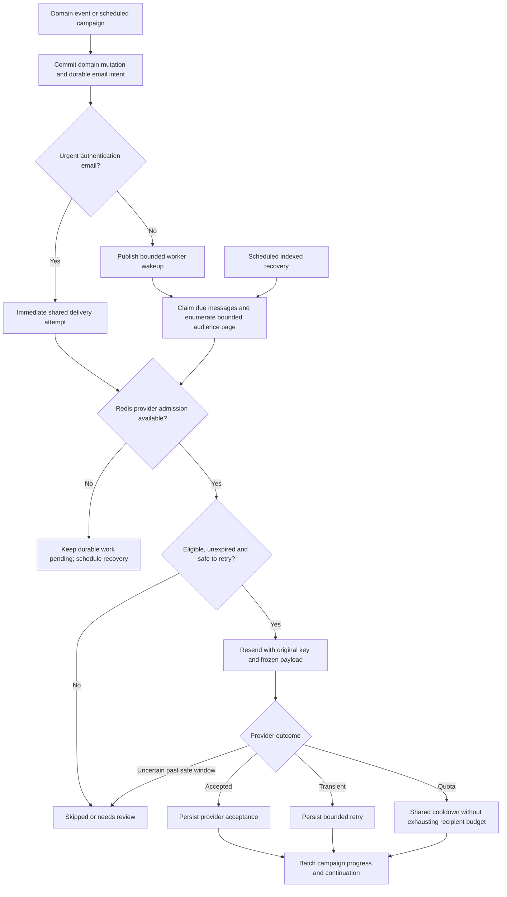

# Shared Email Delivery Roadmap

> **Status:** Completed — working-tree implementation and final cleanup; deployment gated
> **Date:** 2026-10-13
> **Owner:** Twistloom Backend

---

## 1. Summary Table

| # | Item | Priority | Status |
|---|------|----------|--------|
| 1 | Shared contract, policies, and two-table schema | P0 | ✅ Completed |
| 2 | Provider admission, durable workers, recovery, and tests | P0 | ✅ Completed |
| 3 | Announcement campaign compatibility | P0 | ✅ Completed |
| 4 | Authentication and security producers | P0 | ✅ Completed |
| 5 | Billing, lifecycle, and support producers | P1 | ✅ Completed |
| 6 | Resumable digests and publication fan-out | P1 | ✅ Completed |
| 7 | Operational checks, documentation, and bypass removal | P1 | ✅ Completed |
| 8 | Database deployment and real contention/load verification | P0 | ⏩ Skipped |
| 9 | Remove announcement forwarding wrappers and duplicate contracts | P1 | ✅ Completed |
| 10 | Centralize campaign creation and cron orchestration | P1 | ✅ Completed |
| 11 | Verify category parity and document the final boundaries | P1 | ✅ Completed |

---

## 2. Problem Statement

### Current State

The completed working-tree implementation uses two shared tables at
`src/db/schema.ts:3408`, sixteen exhaustive policies, and one provider adapter.
All existing producers use durable shared intent when enabled. See the
[as-built architecture](../architecture/EMAIL_DELIVERY_ARCHITECTURE.md) for the
current behavior and live-validation gaps. Delivery remains disabled until the
shared schema/configuration rollout is performed.

**Final cleanup baseline:** Announcement configuration, dispatch, and provider
files forwarded to their shared counterparts. The announcement producer
duplicated campaign insertion defaults and exposed legacy worker orchestration.
Its admin type duplicated shared state unions. Completed steps 9–11 removed
these leftovers without adding tables or recipient writes.

**Baseline at roadmap creation:** Most senders in `src/utils/email.ts` called
Resend directly and used a fire-and-forget wrapper. Announcements alone had a
separate durable path backed by three feature-specific tables. Digest scripts
used offset scans without durable period deduplication and issued monthly
aggregations per recipient. The following pain points describe that baseline,
rather than claiming the completed code still has those behaviors.

### Pain Points

1. A completed domain action can lose its email before queue publication or
   during serverless teardown.
2. Announcements alone have persistent retries, immutable payloads, and
   ambiguity protection. Other features bypass provider capacity coordination.
3. The announcement success path has roughly twelve SQL statements in four
   transactions, excluding enumeration and pacing retries. Shared campaign and
   provider rows are locked repeatedly per recipient.
4. Feature-specific tables and workers encourage duplication for future emails.
5. Offset scans, unbounded follower arrays, and per-user aggregation queries do
   not satisfy the repository's bounded-work and scale requirements.
6. Boolean send results obscure queued versus provider-accepted outcomes.
7. Security credentials, old-address alerts, and deletion confirmations require
   different eligibility/expiry semantics from optional engagement mail.

### Goal

Use one durable, typed email delivery pipeline for all existing and future
email features, with two shared tables, bounded work, explicit retry guarantees,
and no SQL provider-permission transactions.

---

## 3. Intended Design & Rationale

### Design Alternatives

**A: Direct Resend calls plus fire-and-forget.** Lowest write count, but no
durable handoff or crash recovery; unsuitable for security/billing events.

**B: QStash-only email storage.** Avoids local message rows, but publishing after
a domain commit leaves a dual-write gap and provider idempotency has a bounded
retention period. Adding Redis receipts does not repair the domain transaction.

**C: Shared PostgreSQL outbox plus QStash and Redis.** Durable atomic intent,
indexed recovery, one recipient state machine, and existing serverless stack.
Costs one message row and bounded state transitions per logical email.

**D: Resend Broadcasts for marketing.** Delegates campaign delivery and reduces
local recipient writes, but needs contact, topic, locale, deletion, and preference
synchronization. It does not replace personalized transactional mail.

### Recommended: Alternative C

Use **email_messages** as both outbox and delivery ledger, and **email_campaigns**
for durable audience cursors, shared content, scheduling, and progress. Do not add
separate attempt, provider-state, or per-feature delivery tables. Prefer atomic
claims and batch result persistence. Message state belongs to PostgreSQL;
provider rate/cooldown coordination belongs to Redis; QStash owns invocation
delivery. QStash retries and SQL recipient retries must not become competing
state machines.

The normal background success path targets an insert, sending-intent claim, and
result update. SQL statement count and physical writes are different metrics:
eligibility reads, campaign metadata, failures, webhooks, and cleanup remain.
Measure rather than claim a universal fixed count.

### Final Cleanup and Category Parity

Keep feature code only where it owns a domain decision: announcement validation,
sanitization, preview, intentional resends and the safe admin job projection;
digest period selection; publication event snapshots; transactional auth,
billing, lifecycle and support mutations. These producers all use shared
policies, persistence, provider admission, dispatch and recovery.

Remove the announcement-only config/provider/dispatch forwarding files and
unused state/template aliases. Use the shared campaign status in the admin
projection. Route both `/api/cron/emails` and the retained
`/api/cron/announcement-emails` URI to one handler, with the shared worker JSON
response; admin job lookup remains the progress API. Remove the extra
oldest-announcement lookup from cron processing.

Use one campaign creation helper for announcements, weekly/monthly digests and
publication. Return the persisted campaign snapshot so announcement admin
responses require no extra read after insertion. Allow a producer-supplied
content fingerprint for announcement's sanitized source comparison; otherwise
derive it from the audience/title/templates. Period/event replays keep the first
snapshot. Announcement manual request replays continue rejecting changed
content. Reject request-key reuse across campaign categories or linked
announcements. Domain locks and validation remain in the producer transaction;
dispatch remains after commit.

| Categories | Producer identity and transaction boundary | Shared parity |
|------------|--------------------------------------------|---------------|
| Verification, password reset | Credential generation/proof with intent in one transaction | Priority, expiry, supersession, frozen payload, immediate attempt or uniform recovery wakeup |
| Password/email change, account deletion | Security/lifecycle event with intent in the mutation transaction | Mandatory policy; explicit old/deleted address where required |
| Welcome | Stable onboarding identity with completion transaction | Explicit lifecycle policy and shared retries; no engagement toggle |
| Trial ending, payment failure, refund, cancellation | Trial boundary or gateway event identity with subscription/ledger transaction | Mandatory policy, expiry and event replay protection |
| Feedback acknowledgement/internal | Feedback identifier with feedback insert transaction | Shared persistence and transport; explicit internal destination |
| Weekly/monthly | UTC week/month identity; frozen campaign snapshot | Bounded audience, consent, common campaign creation and worker |
| Announcement | Announcement/request identity; validation and locks in creation transaction | Shared campaign creation, localized snapshot, progress and delivery |
| Story published | Book publication identity with visibility transaction | Common campaign creation; bounded email and independent in-app fan-out |

Future single-recipient features add a policy/template and a transactional
producer call. Future bulk features add an audience variant and bounded
enumeration/rendering where necessary. Neither requires another provider,
dispatcher, recipient table or worker. Consistency means common delivery
guarantees with explicit domain policy, rather than matching file bundles.

### Reliability and Privacy Contract

- Insert intent inside the transaction causing the email wherever a database
  mutation exists; perform external calls only after commit.
- Freeze the destination and effective provider payload; use a stable logical
  request key. Retries do not regenerate content or silently change addresses.
- Record uncertain outcomes and stop automatic replay before Resend's 24-hour
  idempotency protection expires. Exactly-once inbox delivery is not claimed.
- Optional messages recheck preferences on the primary. Security/billing bypass
  engagement toggles. Old-address/deletion mail retains explicit recipients.
- Credentials expire and superseded credentials invalidate pending messages.
- Encrypt recipient-bearing payloads using the existing encryption utility;
  do not log addresses, credential URLs, or provider error text.
- Clear retained payloads during bounded retention cleanup; preserve small
  deduplication receipts long enough for the producer's replay horizon.
- Redis outage defers sending rather than failing open. Bulk admission leaves
  capacity for urgent messages. Provider quota exhaustion is a shared pause.

### Non-Breaking Guarantees

| Surface | Preserved behavior | Change |
|---------|--------------------|--------|
| Templates | Existing locale resolution, HTML layout, and copy | Delivery ownership moves to shared services |
| Announcement admin | Existing job projection and completion marker | Shared campaign storage |
| Auth | Existing account result and anti-enumeration behavior | Durable intent; immediate signup/change attempts and uniform recovery wakeups |
| Send booleans | True continues to mean provider accepted | Queued state is explicit where exposed |
| Optional preferences | Existing category toggles and unsubscribe routes | Primary recheck before delivery |
| Account deletion | Explicit confirmation destination survives deletion | Snapshot committed with deletion |

---

## 4. Feasibility Analysis

| Dimension | Assessment |
|-----------|------------|
| Effort | High: cross-cutting producers, transaction propagation, worker and documentation changes |
| Risk | High without failure tests; duplicates, stale tokens, and lost intent are primary hazards |
| Backend changes | Significant; existing templates and provider remain |
| Dependencies | Neon/Drizzle, Upstash Redis/rate-limit SDK, QStash, Resend, encryption key |
| Reversibility | Working-tree code is reversible; schema/data deployment requires a reviewed rollout |
| Deployment boundary | User explicitly excludes database generation/migration and commits |
| Evidence boundary | Mocked failure tests and static checks are possible; live schema, contention, delivery and throughput are not claimed |

---

## 5. Flow Diagram (Mermaid)

---

## 6. Implementation Plan

### Step 1: Shared contract, policies, and schema — ✅ Completed

**Files:** `src/types/email-delivery.ts` (new), `src/config/email-delivery.ts`
(new), `src/db/schema.ts:3408`, `src/utils/email.ts:68`.
**Effort:** High.

Define exhaustive email types, priority/preference/expiry policy, immutable
payload boundaries, and the two shared tables. Add unique logical-request keys,
partial due/lease indexes, and nullable campaign associations. Keep queried state
in typed columns; JSON holds frozen rendering data only.

**Non-breaking:** Existing templates and announcement response projection remain.

---

### Step 2: Provider, execution, and recovery — ✅ Completed

**Files:** shared provider, gate, dispatch and delivery services; `src/routes/cron.ts:230`;
`src/cron/ensure-qstash-schedules.ts`; `.env.example`; meaningful delivery tests.
**Effort:** High.

Implement conditional leased claims, immutable Resend idempotency, shared rate
admission/cooldowns, typed outcomes, bounded retries, result persistence, and
indexed recovery. Stop recipient work during provider outages/quota pauses.
Use authenticated cron routes and bounded QStash continuations. Database intent
recovers even if wakeup publication fails.

**Non-breaking:** Do not contact external providers from open domain transactions.

---

### Step 3: Announcement compatibility — ✅ Completed

**Files:** `src/services/announcement-email.ts`, announcement admin routes,
announcement tests and old architecture links.
**Effort:** Medium.

Retain validation, snapshot content, explicit resend keys, progress projection,
and announcement-first completion lock order. Replace announcement recipient
execution and the SQL provider singleton with shared infrastructure.

**Non-breaking:** Provider acceptance is still distinct from inbox delivery.

---

### Step 4: Authentication and security — ✅ Completed

**Files:** `src/routes/auth.ts`, `src/utils/password-reset.ts`,
`src/utils/email-verification.ts`, `src/utils/email.ts`.
**Effort:** High.

Persist token state and email intent atomically. Introduce immediate attempts
through the shared worker path; enforce token expiry and supersession. Propagate
transactions for password/email-change notifications. Preserve anti-enumeration
and account-creation result semantics, and distinguish queued from accepted.

**Non-breaking:** Never replace existing accepted booleans with queued booleans.

---

### Step 5: Billing, lifecycle, and support — ✅ Completed

**Files:** `src/routes/user.ts`, subscription and payment webhook services,
`src/utils/email.ts`.
**Effort:** High.

Commit outbox intent with relevant mutations. Use billing event identifiers,
feedback identifiers, and lifecycle events for deduplication. Snapshot deletion
and old-address recipients and preserve mandatory-category policy.

**Non-breaking:** Existing payment idempotency and credit transaction boundaries remain authoritative.

---

### Step 6: Digests and follower fan-out — ✅ Completed

**Files:** weekly/monthly cron producers, publication notification service,
campaign enumeration and rendering services, cron schedule definitions.
**Effort:** High.

Persist campaign requests with period/event keys; enumerate through bounded
keyset pages; insert messages and advance cursor together. Aggregate monthly
activity for the selected page. Recheck optional preferences and use bounded
in-app fan-out without collecting all followers into one request.

**Non-breaking:** Existing category toggles and localized content remain.

---

### Step 7: Operations, documentation, and bypass removal — ✅ Completed

**Files:** shared email tests; docs/architecture; affected API docs; old wrappers.
**Effort:** Medium.

Remove direct Resend/fire-and-forget paths. Run `bun run check`, focused tests,
and the full test suite. Audit documentation links, anchor claims, and source
references. Record honest limits, retention, failure recovery, and how to add a
new email. Review every provider call and every producer await/transaction.

**Non-breaking:** Keep old endpoint aliases where existing schedules may call them.

---

### Step 8: Database deployment and live validation — ⏩ Skipped

**Files:** future reviewed migration and operational configuration.
**Effort:** Medium.

Explicitly excluded by the user: do not generate/apply migrations, register live
schedules, send live test emails, or commit. A future rollout must inspect any
already provisioned announcement data, provision the shared schema, configure
Redis/encryption/QStash/Resend, and run real contention, EXPLAIN, restart, and
throughput checks before enabling delivery. A feature flag is not proof of a
deployment being production-ready.

**Non-breaking:** Preserve current working-tree changes unrelated to email.

---

### Step 9: Remove forwarding wrappers and duplicate contracts — ✅ Completed

**Files:** announcement-only config/provider/dispatch forwarding files;
`src/types/announcement-email.ts:1`; shared provider and dispatcher tests.
**Effort:** Low.

Delete the three forwarding files, switch callers to shared exports, rename
their tests for shared ownership, remove unused announcement state/template
aliases and the unused retry-limit alias. Keep the admin projection with the
shared status type. Remove obsolete test mocks for the deleted direct-send API.

**Non-breaking:** Announcement admin job shape and domain validation remain.

---

### Step 10: Centralize creation and orchestration — ✅ Completed

**Files:** `src/services/email-campaigns.ts:27`,
`src/services/announcement-email.ts:66`, `src/routes/cron.ts:230`,
`src/services/email-delivery.ts:178`.
**Effort:** Medium.

Return the campaign record from the common insertion/replay helper and delegate
announcement creation to it. Preserve sanitized-content replay checks and
producer transactions; protect campaign identity from cross-category reuse.
Remove worker execution from the announcement producer. Register both cron
delivery URIs against one handler and remove the extra announcement status read.
Simplify leftover single-campaign dispatch code where it adds no scheduling value.

**Non-breaking:** Old cron URI and authentication remain; its result body becomes
the shared worker result. Admin progress continues through its existing API.

---

### Step 11: Category parity, regression checks and final docs — ✅ Completed

**Files:** all email producers, shared delivery tests, roadmap,
`docs/architecture/EMAIL_DELIVERY_ARCHITECTURE.md`, announcement compatibility
and transactional-template companion docs.
**Effort:** Medium.

Audit every category for stable identity, transaction propagation, payload
snapshot, policy/expiry and shared transport ownership. Add meaningful campaign
replay and cron-alias regressions, then run static checks and the full suite.
Update architecture ownership/file maps, adding-new-category guidance and
verification evidence; audit relative links and section/source references.

**Non-breaking:** No new schema, live send, schedule registration or commit.

---

## 7. Open Questions

### Q1. Managed marketing transport — ⏩ Deferred

- **(A)** Shared application-owned recipient ledger: current preference and
  audience semantics; recipient rows remain proportional to campaign size.
- **(B)** Resend Broadcasts: fewer local delivery writes; contact/topic/locale
  synchronization and provider plan constraints become prerequisites.

**Recommendation:** A for this consolidation. Evaluate B separately before
massive marketing volumes; do not add hidden contact replication here.

---

### Q2. Native batch sending — ⏩ Deferred

- **(A)** Per-message provider keys: simplest independent retries and opt-out handling.
- **(B)** Immutable provider batches: fewer HTTP requests, but exact batch
  membership/payload must survive crash and retry, including opt-out races.

**Recommendation:** A initially, database batching immediately. B requires a
tested immutable-batch contract and measured provider-capacity need.

---

## 8. References & File Touch List

| Area | Files | Change |
|------|-------|--------|
| Schema | `src/db/schema.ts:3408` | Replace feature-specific tables with shared messages/campaigns |
| Contract/config | `src/types/email-delivery.ts`, `src/config/email-delivery.ts` | NEW typed policy and operational settings |
| Execution | shared email services and provider utility | NEW durable shared pipeline |
| Templates | `src/utils/email.ts`, `src/config/emails/` | Retain rendering; remove provider bypass |
| Auth | `src/routes/auth.ts`, token utilities | Atomic intent and immediate attempt |
| Lifecycle/support | `src/routes/user.ts` | Atomic lifecycle and feedback intent |
| Billing | subscription and gateway webhook services | Atomic event-based intent |
| Bulk | announcement, digest, publication producers | Shared resumable campaign enumeration |
| Scheduling | `src/routes/cron.ts`, `src/cron/ensure-qstash-schedules.ts` | Shared supervisor and scheduled producers |
| Tests | shared delivery and producer tests | Crash, replay, policy, quota and outage behavior |
| Documentation | `docs/architecture/EMAIL_DELIVERY_ARCHITECTURE.md` | NEW as-built record, verification and gaps |
| Final cleanup | announcement producer/admin type; shared campaign service and cron routes | Producer-only feature code; common creation and orchestration |
| Wrapper removal | announcement-only config/provider/dispatch forwarders | Delete redundant aliases; rename tests to shared ownership |
| Shared regressions | `tests/email-campaigns.test.ts`, `tests/email-cron.test.ts` | NEW rollback, immutable replay, identity and worker URI parity coverage |
| Transport regressions | `tests/email-provider.test.ts`, `tests/email-dispatch.test.ts` | Renamed from announcement ownership; exercise shared implementations |
| Mock isolation | `tests/email-delivery.test.ts`, `tests/announcement-email.test.ts`, `tests/auth-signup-pair.test.ts` | Restore frozen namespaces; remove obsolete direct-send mock |
| Companion docs | `docs/architecture/ANNOUNCEMENT_EMAIL_JOBS.md`, `docs/architecture/TRANSACTIONAL_EMAILS.md` | Shared boundaries and cron response contract |

### Codebase Findings

The baseline has two provider implementations and incomplete account-wide
admission. Auth tokens are hashed in the auth table; queuing their effective
email must not reintroduce plaintext secrets into operational logs. The existing
AES-GCM utility can protect retained delivery payloads. The runtime is Node.js
in production, so Bun-only APIs are restricted to scripts/tests.

### Primary References

- [AWS transactional outbox](https://docs.aws.amazon.com/prescriptive-guidance/latest/cloud-design-patterns/transactional-outbox.html)
- [PostgreSQL queue claims](https://www.postgresql.org/docs/current/sql-select.html)
- [QStash flow control](https://upstash.com/docs/qstash/features/flowcontrol)
- [Upstash rate-limit timeout behavior](https://upstash.com/docs/redis/sdks/ratelimit-ts/features)
- [Resend idempotency](https://resend.com/docs/dashboard/emails/idempotency-keys)
- [Resend limits](https://resend.com/docs/api-reference/rate-limit)
- [Resend Broadcasts](https://resend.com/docs/dashboard/broadcasts/introduction)
- [Resend batches](https://resend.com/docs/api-reference/emails/send-batch-emails)

---

## 9. Completion Status

Legend: ✅ Implemented & verified · ⏳ Partial · ⬜ Future work · ⏩ Deferred

### Completed

- ✅ Step 1: shared types, exhaustive policies and two-table schema.
- ✅ Step 2: maintained Redis admission, conditional claims, batch results,
  bounded continuations, fair campaign rotation, retry and retention recovery.
- ✅ Step 3: existing announcement admin projection/request identity retained.
- ✅ Step 4: atomic credential intent, supersession/expiry checks and
  post-commit signup/change attempts; uniform recovery wakeups.
- ✅ Step 5: transactional billing, lifecycle and support intent; explicit
  payment-failure events own alerts instead of status-sync webhooks.
- ✅ Step 6: resumable digest/follower pages and page-level monthly aggregates.
- ✅ Step 7: shared bypass removal, regression/static checks, architecture
  documentation and related-document sync audits.
- ✅ Step 9: deleted config/provider/dispatch forwarding files; shared admin
  status; renamed shared provider/dispatch tests and removed obsolete mocks.
- ✅ Step 10: common campaign record insertion/replay, identity collision guard,
  producer-only announcement service and one handler for both worker URIs;
  simplified single-campaign page selection without changing fair rotation.
- ✅ Step 11: all sixteen categories traced through common delivery; campaign
  rollback/period replay and cron-alias regressions; final ownership, category
  policy, future-feature guidance and companion documentation synchronized.

### Future / Deferred

- ⏩ Step 8: database deployment/live validation excluded by the user.
- ⏩ Managed Broadcasts and native provider batches require separate contracts.

Completion means verified working-tree code, not a provisioned production schema
or measured capacity. Live database/Redis/provider tests are not claimed.

### Verification and accepted limits

- `bun run check`: lint, import extensions and TypeScript checks.
- `bun test`: **563 pass, 0 fail**, 50 files; 2026-10-13.
- Delivery tests cover mutation rollback, event identity, provider replay,
  superseded credentials, quota attempts, stale-worker fencing, optional consent,
  fair campaign rotation and transactional progress.
- Common campaign tests cover identity collisions, transaction rollback,
  first-snapshot replay and UTC period deduplication. Both cron URIs exercise the
  same authenticated worker, rollout rejection and provider-pause behavior.
- Cross-file mocked namespaces restore frozen export snapshots, so subsequent
  provider/dispatcher tests run their real implementations.
- Probe/rate tests use mocked infrastructure; no live Lua, PostgreSQL contention,
  execution-plan or production throughput proof is claimed.
- Publication uses one durable fan-out per book identity, including asynchronous
  in-app delivery. Republish event versioning remains a separate gate.
- Bulk reserves request-rate headroom, not daily/monthly quota. Compact campaign
  keys are retained; archival and verified provider webhooks remain gated work.
- No DB generation/migration, scheduler registration, live send or commit occurred.

Documentation audits checked the canonical structure, relative links, source
references, source section anchors, producer ownership and companion-document
drift, including deletion/rename references and the final shared cron contract.
No unresolved Critical or Major
documentation findings remain in the edited email documents; live system evidence
is explicitly excluded from that assessment.
