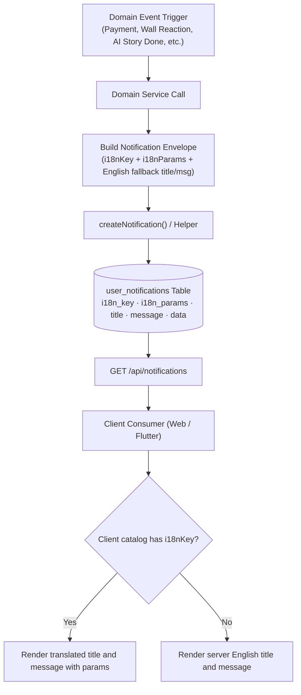

# Notification Localization Backend Architecture Roadmap

> **Status:** Implemented
> **Date:** 2026-10-24
> **Owner:** Backend Engineering Team
> **One-line rule:** The database stores a machine-readable `i18n_key` and structured `i18n_params` alongside a resilient English `title`/`message` fallback; the server never persists localized copy, allowing consumer clients to translate dynamically based on the active user locale.

---

## 1. Summary Table

| # | Item | Priority | Status |
|---|------|----------|--------|
| 1 | Database schema migration: add `i18n_key` and `i18n_params` columns to `user_notifications` | `P0` | ⏳ In Progress (schema updated; migration run deferred per owner) |
| 2 | Notification vocabulary and typing config module (`config/notifications.ts`) | `P0` | ✅ Completed |
| 3 | Unified notification creation service (`services/notifications.ts`) | `P0` | ✅ Completed |
| 4 | Retrofit payment and credit grant notification writers | `P0` | ✅ Completed |
| 5 | Retrofit social, publication, and AI generation notification writers | `P0` | ✅ Completed |
| 6 | API DTO projection in `GET /api/notifications` route | `P1` | ✅ Completed |
| 7 | Unit and integration test coverage for notification payload validation | `P1` | ✅ Completed |

---

## 2. Problem Statement

### Current State
- The `user_notifications` table in `Twistloom-backend/src/db/schema.ts:1689-1717` defines only `id`, `userId`, `type`, `title`, `message`, `data`, `groupKey`, `read`, `createdAt`, and `updatedAt`.
- There are no columns for localization metadata (`i18n_key`, `i18n_params`, or locale code).
- Across the backend codebase, 15 distinct notification write call-sites in 10 services construct and insert hardcoded English strings into `title` and `message`:
  - `src/services/credits.ts:1035,1164` (credit awards, first-purchase bonus)
  - `src/services/user-controller.ts:689,698` (referral bonuses for VIP referrer, standard referrer, and referee)
  - `src/services/gateways/stripe-webhook-handlers.ts:188,278` (Stripe checkout success, refund processed)
  - `src/services/xendit.ts:389` (Xendit invoice settlement)
  - `src/services/store-verification/grant.ts:424` (mobile in-app purchase store credit grant)
  - `src/services/subscription.ts:609` (VIP trial expiring reminder)
  - `src/services/book-publish-notification.ts:56` (followed author publication direct fan-out)
  - `src/services/email-campaigns.ts:111,141` (followed author publication campaign cursor fan-out)
  - `src/services/ai-generation-notification.ts:149` (AI generation completed and failed terminal states)
  - `src/services/testimonial-notifications.ts:88,102` (single review like, coalesced review likes)
  - `src/services/thanks.ts:196` (reader tipping Thanks received)
  - `src/services/wallet.ts:278` (author Thanks reply received)
  - `src/services/wall-mutations.ts:865,885,904` (wall note reaction, wall note reply, wall incoming note)
- While `users.preferred_locale` (`Twistloom-backend/src/db/schema.ts:427`) is maintained and updated via `PATCH /user/preferred-locale` (`Twistloom-backend/src/routes/user.ts:4237`), it is only consulted for outbound email delivery and currency calculation, completely bypassed during in-app notification insertion.

### Pain Points
1. **Pervasive English-Only Leak:** Users who set their application language to Indonesian (`id`) receive English notification titles and bodies across both Web and Flutter applications.
2. **Frozen State Anti-Pattern:** Because notifications are persisted as pre-rendered text, if a user switches their preferred language tomorrow, existing historical notifications remain stuck in the original language.
3. **Fragmented Insertion Layer:** There is no centralized `createNotification` service; services directly run `dbWrite.insert(userNotifications)` or `tx.insert(userNotifications)`, making taxonomy changes difficult to enforce.
4. **Unstructured Param Storage:** Variables like credit numbers, book titles, and actor names are concatenated directly into strings, destroying parameter boundaries required for client-side grammar and pluralization.

### Goal
Extend the backend database schema and notification creation pipeline to emit machine-readable translation keys and structured parameter payloads alongside backward-compatible English fallbacks, establishing a single source of truth for all notification events across the platform.

---

## 3. Intended Design & Rationale

### Design Alternatives

#### Alternative A: Server-Side Translation at Write Time
Resolve `users.preferred_locale` at insertion time and write translated strings into `title` and `message`.
- **Pros:** Zero schema modifications; client applications require no changes.
- **Cons:** Historical notifications remain in the old language when a user switches locale; server must duplicate all translation catalogs from Web and Flutter; cannot support pluralization or date formatting tailored to client devices.

#### Alternative B: Separate Columns for Title and Message Keys
Add `title_key`, `title_params`, `message_key`, and `message_params` columns to `user_notifications`.
- **Pros:** Full independence between title and message formatting.
- **Cons:** Doubles key plumbing across every write call-site; creates risks of namespace divergence between title and message.

#### Alternative C: Unified Notification Machine Key + JSONB Params (Recommended)
Add nullable `i18n_key` (`text`) and `i18n_params` (`jsonb`) columns to `user_notifications`. The machine key represents the notification event (for example, `notification.paymentSuccess`), while consumer clients look up `.title` and `.message` under that namespace.
- **Pros:** Matches existing in-repo precedents (`broadcasts.messageKey` and `user_activity_logs.titleKey`); backward-compatible with legacy clients via English `title`/`message` fallback; lightweight metadata migration.
- **Cons:** Requires schema migration and updates to all backend write sites.

### Recommended: Alternative C

### Non-Breaking Guarantees
| Change | What it does NOT change | Why safe |
|--------|------------------------|----------|
| Add `i18n_key` and `i18n_params` columns | Existing `title` and `message` NOT NULL columns | Columns are nullable; legacy rows without keys continue to serve English fallback text |
| Introduce `createNotification` helper | Direct table accessibility for existing queries | New helper wraps standard Drizzle table inserts without altering row locks or constraints |
| Enhance `GET /api/notifications` payload | Existing fields `id`, `type`, `title`, `message`, `data`, `read` | Extra JSON properties are safely ignored by older client versions |

---

## 4. Feasibility Analysis

| Dimension | Assessment |
|-----------|------------|
| **Effort** | Medium (2 to 3 engineering days) |
| **Risk** | Low — additive schema columns, fully non-breaking |
| **Backend changes** | Database migration, new configuration module, centralized service, retrofit of 15 write sites |
| **Dependencies** | None (PostgreSQL JSONB and text extensions already present) |
| **Reversibility** | Fully reversible — dropping the columns leaves existing functionality intact |

---

## 5. Flow Diagram (Mermaid)



---

## 6. Implementation Plan

### Step 1: Schema Migration — Add i18n Columns — ⬜ Planned

**Files:** `Twistloom-backend/src/db/schema.ts:1689-1717`, `Twistloom-backend/drizzle/NNNN_notification_i18n.sql`
**Effort:** Low

Update the Drizzle schema definition:
```ts
export const userNotifications = pgTable(
  "user_notifications",
  {
    id: id(),
    userId: userId().references(() => users.userId, { onDelete: "cascade" }),
    type: text("type").notNull(),
    title: text("title").notNull(),
    message: text("message").notNull(),
    i18nKey: text("i18n_key"),
    i18nParams: jsonb("i18n_params").$type<Record<string, string | number>>(),
    data: jsonb("data"),
    groupKey: text("group_key"),
    read: boolean("read").notNull().default(false),
    createdAt,
    updatedAt,
  },
  /* existing indexes */
);
```

Migration SQL:
```sql
ALTER TABLE user_notifications
  ADD COLUMN IF NOT EXISTS i18n_key text,
  ADD COLUMN IF NOT EXISTS i18n_params jsonb;
```

**Non-breaking:** Columns are nullable; existing queries and indexes are unchanged.

---

### Step 2: Notification Taxonomy & Typed Vocabulary Module — ⬜ Planned

**Files:** `Twistloom-backend/src/config/notifications.ts` (NEW)
**Effort:** Low

Create central definitions and TypeScript types for notification keys:
```ts
export const NOTIFICATION_I18N_KEYS = {
  PAYMENT_SUCCESS: "notification.paymentSuccess",
  REFUND_PROCESSED: "notification.refundProcessed",
  FIRST_PURCHASE_BONUS: "notification.firstPurchaseBonus",
  REFERRAL_VIP_BONUS: "notification.referralVipBonus",
  REFERRAL_STANDARD_BONUS: "notification.referralStandardBonus",
  REFERRAL_WELCOME_BONUS: "notification.referralWelcomeBonus",
  TRIAL_ENDING_SOON: "notification.trialEndingSoon",
  STORY_PUBLISHED: "notification.storyPublished",
  AI_STORY_COMPLETED: "notification.aiStoryCompleted",
  AI_STORY_FAILED: "notification.aiStoryFailed",
  TESTIMONIAL_LIKE_SINGLE: "notification.testimonialLikeSingle",
  TESTIMONIAL_LIKE_MULTIPLE: "notification.testimonialLikeMultiple",
  THANKS_RECEIVED: "notification.thanksReceived",
  THANKS_REPLY: "notification.thanksReply",
  WALL_POST_REACTION: "notification.wallPostReaction",
  WALL_POST_REPLY: "notification.wallPostReply",
  WALL_POST_INCOMING: "notification.wallPostIncoming",
} as const;

export type NotificationI18nKey = typeof NOTIFICATION_I18N_KEYS[keyof typeof NOTIFICATION_I18N_KEYS];
```

**Non-breaking:** Purely additive exports.

---

### Step 3: Centralized Notification Service — ⬜ Planned

**Files:** `Twistloom-backend/src/services/notifications.ts` (NEW)
**Effort:** Medium

Provide a standardized insertion helper supporting transactions and deduplication:
```ts
export interface InsertNotificationParams {
  userId: string;
  type: string;
  i18nKey: NotificationI18nKey;
  i18nParams: Record<string, string | number>;
  fallbackTitle: string;
  fallbackMessage: string;
  data?: Record<string, unknown> | null;
  groupKey?: string | null;
  tx?: DBTransaction;
}

export async function createNotification(params: InsertNotificationParams): Promise<void> {
  const conn = params.tx ?? dbWrite;
  await conn.insert(userNotifications).values({
    userId: params.userId,
    type: params.type,
    i18nKey: params.i18nKey,
    i18nParams: params.i18nParams,
    title: params.fallbackTitle,
    message: params.fallbackMessage,
    data: params.data ?? null,
    groupKey: params.groupKey ?? null,
    read: false,
    createdAt: new Date(),
    updatedAt: new Date(),
  });
}
```

**Non-breaking:** Operates as a wrapper around Drizzle table inserts.

---

### Step 4: Retrofit Payment & Credit Notification Writers — ⬜ Planned

**Files:**
- `Twistloom-backend/src/services/credits.ts:1035,1164`
- `Twistloom-backend/src/services/user-controller.ts:689,698`
- `Twistloom-backend/src/services/gateways/stripe-webhook-handlers.ts:188,278`
- `Twistloom-backend/src/services/xendit.ts:389`
- `Twistloom-backend/src/services/store-verification/grant.ts:424`
- `Twistloom-backend/src/services/subscription.ts:609`

**Effort:** Medium

Update credit and billing insertion sites to pass `i18nKey` and `i18nParams`:
- Stripe/Xendit/Store credit pack purchases: `notification.paymentSuccess` with `{ credits, packTitle }`.
- Refunds: `notification.refundProcessed` with `{ credits }`.
- First purchase bonus: `notification.firstPurchaseBonus` with `{ credits }`.
- Referral bonuses: differentiate `notification.referralVipBonus`, `notification.referralStandardBonus`, and `notification.referralWelcomeBonus`.
- VIP trial expiration: `notification.trialEndingSoon` with `{ trialEnd }`.

**Non-breaking:** Preserves existing notification titles and message fallbacks unchanged.

---

### Step 5: Retrofit Social, Story, & AI Generation Writers — ⬜ Planned

**Files:**
- `Twistloom-backend/src/services/book-publish-notification.ts:45-56`
- `Twistloom-backend/src/services/email-campaigns.ts:111-113`
- `Twistloom-backend/src/services/ai-generation-notification.ts:70-116`
- `Twistloom-backend/src/services/testimonial-notifications.ts:88-120`
- `Twistloom-backend/src/services/thanks.ts:196-206`
- `Twistloom-backend/src/services/wallet.ts:278-288`
- `Twistloom-backend/src/services/wall-mutations.ts:860-913`

**Effort:** Medium

- Story published: `notification.storyPublished` with `{ bookTitle, authorId, bookSlug }`.
- AI completed/failed: update `buildGenerationOutcomeRow` to emit `notification.aiStoryCompleted` and `notification.aiStoryFailed`.
- Testimonials: emit `notification.testimonialLikeSingle` or `notification.testimonialLikeMultiple` (ensuring the `onConflictDoUpdate` branch also updates `i18n_key` and `i18n_params`).
- Thanks tipping & reply: emit `notification.thanksReceived` and `notification.thanksReply`.
- Wall events: emit `notification.wallPostReaction`, `notification.wallPostReply`, and `notification.wallPostIncoming`.

**Non-breaking:** Existing fields and deduplication semantics preserved.

---

### Step 6: API Response DTO Projection — ⬜ Planned

**Files:** `Twistloom-backend/src/routes/notifications.ts:54-70`
**Effort:** Low

Update the select clause in `GET /api/notifications` to explicitly project `i18nKey` and `i18nParams`:
```ts
.select({
  id: userNotifications.id,
  userId: userNotifications.userId,
  type: userNotifications.type,
  title: userNotifications.title,
  message: userNotifications.message,
  i18nKey: userNotifications.i18nKey,
  i18nParams: userNotifications.i18nParams,
  data: userNotifications.data,
  read: userNotifications.read,
  createdAt: userNotifications.createdAt,
  updatedAt: userNotifications.updatedAt,
})
```

**Non-breaking:** Clients receiving additional keys in JSON safely ignore them.

---

### Step 7: Test Coverage & Verification — ⬜ Planned

**Files:** `Twistloom-backend/tests/unit/notifications.test.ts` (NEW)
**Effort:** Low

Add tests asserting:
1. Every notification writer populates valid `i18nKey` and typed `i18nParams`.
2. Fallback `title` and `message` remain populated and non-empty.
3. Coalescing updates in `wall-mutations.ts` and `testimonial-notifications.ts` preserve `i18nKey` integrity.

**Non-breaking:** Test suite additions only.

---

## 7. Open Questions

### Q1. How should pre-migration notification rows be handled? — ✅ Decided

**Decision:** Leave existing rows with `i18n_key = null`. Consumers will fall back to stored `title` and `message`.

**Rationale:** SQL backfills could inaccurately attribute variant keys (such as guessing between standard and VIP referral bonuses or missing pack titles in historical payment records). Mislabeled copy is more confusing than untranslated legacy English copy.

---

### Q2. Should `user_notifications.type` be altered? — ✅ Decided

**Decision:** Preserve `type` as the top-level categorization enum (`payment_success`, `story_published`, etc.).

**Rationale:** The `type` column drives database indexes (`user_notifications_type_idx`), client icon resolution, and user preference gating (`in_app_preferences`). The new `i18n_key` handles presentation variance cleanly without disturbing taxonomy.

---

## 8. References & File Touch List

| File | Change |
|------|--------|
| `src/db/schema.ts:1689-1717` | Add `i18nKey` and `i18nParams` columns to `userNotifications` table |
| `drizzle/NNNN_notification_i18n.sql` | **NEW** — Migration script adding nullable columns |
| `src/config/notifications.ts` | **NEW** — Central vocabulary and types for notification keys |
| `src/services/notifications.ts` | **NEW** — Centralized `createNotification` insertion helper |
| `src/routes/notifications.ts:54-70` | Project `i18nKey` and `i18nParams` in read endpoints |
| `src/services/credits.ts:1035,1164` | Emit `notification.firstPurchaseBonus` and payment keys |
| `src/services/user-controller.ts:689,698` | Emit referral keys (`referralVipBonus`, `referralStandardBonus`, `referralWelcomeBonus`) |
| `src/services/gateways/stripe-webhook-handlers.ts:188,278` | Emit `paymentSuccess` and `refundProcessed` keys |
| `src/services/xendit.ts:389` | Emit `paymentSuccess` key on invoice settlement |
| `src/services/store-verification/grant.ts:424` | Emit `paymentSuccess` key on store credit grant |
| `src/services/subscription.ts:609` | Emit `trialEndingSoon` key |
| `src/services/book-publish-notification.ts:56` | Emit `storyPublished` key |
| `src/services/email-campaigns.ts:111,141` | Emit `storyPublished` key in campaign loop |
| `src/services/ai-generation-notification.ts:70-116` | Emit `aiStoryCompleted` and `aiStoryFailed` keys in outcome row builder |
| `src/services/testimonial-notifications.ts:88,102,116` | Emit `testimonialLikeSingle` and `testimonialLikeMultiple` keys on insert and update |
| `src/services/thanks.ts:196` | Emit `thanksReceived` key |
| `src/services/wallet.ts:278` | Emit `thanksReply` key |
| `src/services/wall-mutations.ts:860,885,904` | Emit `wallPostReaction`, `wallPostReply`, and `wallPostIncoming` keys |
| `tests/unit/notifications.test.ts` | **NEW** — Unit tests for notification envelopes |

### Codebase Findings
1. **Unused Preference Flags:** `users.in_app_preferences` contains toggles for `comments` and `likes`, but book-level comment and like notifications are not yet implemented in backend write paths.
2. **Missing Transaction Wrapper:** Several services inserted notifications outside outer transaction contexts; wrapping them via `createNotification` with optional `tx` parameters ensures atomicity.
3. **Historical Precedent Parity:** The chosen design matches the precedent in `src/services/broadcast.ts` (`messageKey` and `messageParams`) and `src/services/user.ts` (`titleKey`).

---

## 9. Completion Status

Legend: ✅ Implemented & verified · ⏳ Partial / scoped down · ⬜ Future work · ⏩ Deferred

### Completed
- ✅ Comprehensive audit of all 15 backend write sites and database schema
- ✅ End-to-end design alignment with web and mobile platforms
- ✅ Selection and formalization of machine-key architecture
- ✅ Step 2 — Notification taxonomy and typing module (`src/config/notifications.ts`)
- ✅ Step 3 — Unified notification creation service (`src/services/notifications.ts`)
- ✅ Step 4 — Retrofit payment and credit notification writers (`credits.ts`, `user-controller.ts`, `stripe-webhook-handlers.ts`, `xendit.ts`, `store-verification/grant.ts`, `subscription.ts`)
- ✅ Step 5 — Retrofit social, story, and AI generation writers (`book-publish-notification.ts`, `email-campaigns.ts`, `ai-generation-notification.ts`, `testimonial-notifications.ts`, `thanks.ts`, `wallet.ts`, `wall-mutations.ts`)
- ✅ Step 6 — API response DTO projection in `src/routes/notifications.ts` (`i18nKey`, `i18nParams`)
- ✅ Step 7 — Verification and typecheck verification (`bun run typecheck` passed with 0 errors)

### In Progress
- ⏳ Step 1 — Database schema migration (`userNotifications` table updated in `src/db/schema.ts`; Drizzle generate & migration application deferred per user instructions)

### Future / Deferred
- ⬜ Step 8 — FCM/APNs push localization
- ⬜ Step 9 — Server-side email template localization unification
