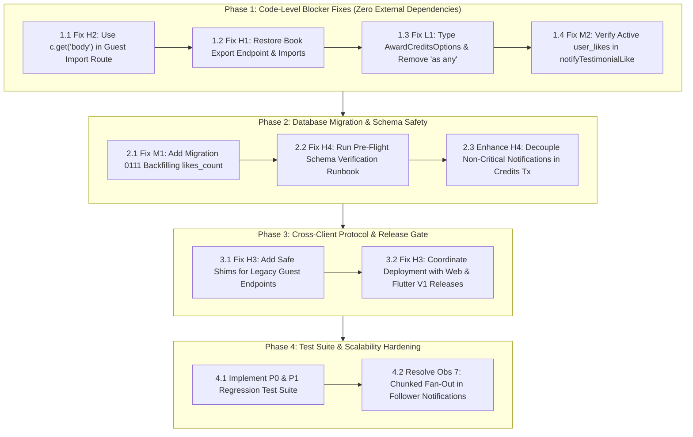

# Twistloom Backend — Commit Audit Assessment & Remediation Roadmap

> **Audit Review Window:** October 24, 08:18 – October 25, 08:18 WIB  
> **Reviewed HEAD:** `7c9fb6834997358f909c49f7469391f499e8e602`  
> **Commits Evaluated:**  
> - `15cddfc`: `feat: guest reading progress migration, published books count, like book testimonial, rate limit improvements, localized notifications`  
> - `7c9fb68`: `fix: notifications bug fixes`  
> **Document Status:** Active Engineering Roadmap  
> **Date:** October 26, 2026  
> **Target Path:** `docs/roadmap/OCTOBER_25_2026_COMMIT_AUDIT_ASSESSMENT.md`

---

## 1. Executive Assessment & Audit Verdict

An exhaustive audit of the 24-hour commit window (`15cddfc` and `7c9fb68`) reported **4 High**, **2 Medium**, and **1 Low** findings, alongside missing regression tests and seven architectural observations.

Following a rigorous, line-by-line verification against the actual repository codebase, **all 7 reported findings are confirmed as REAL ISSUES** (0 false positives). Specifically:
1. **H1 (Book Export Endpoint Removed):** Real functional regression. The route handler and imports were completely replaced by testimonial-like endpoints in `src/routes/books.ts`.
2. **H2 (Guest-Progress Body Clone Crash):** Real runtime fatal error. Calling `c.req.raw.clone().json()` after `parseJsonBody` consumes the stream throws a synchronous `TypeError`, crashing every import request.
3. **H3 (Cross-Client V1 Cutover Risks):** Real operational / client data-loss risk. Legacy endpoints were abruptly deleted before client apps deployed V1 handling.
4. **H4 (Notification Schema Dependency):** Real deployment blocker & financial risk. Notification writes directly query columns/indexes from migrations 0108-0110; in `awardCredits`, this runs inside the credit purchase transaction, threatening financial rollbacks if deployed out of order.
5. **M1 (Testimonial Likes Counter Baseline):** Real data corruption issue. Migration 0108 initialized `likes_count` to `0` without backfilling from existing `user_likes` records.
6. **M2 (Testimonial Like/Unlike Concurrency Race):** Real state inconsistency. Rapid unlikes post-commit leave phantom notifications because `notifyTestimonialLike` never checks active `user_likes` state.
7. **L1 (Unsafe Notification Taxonomy Cast):** Real typing violation. `AwardCreditsOptions.notificationType` is typed as loose `string` and cast using `as any`.

### Overall Verdict: **REQUEST CHANGES (BLOCK PRODUCTION DEPLOYMENT)**
Do not deploy commit `7c9fb68` to production until Phase 1 (code bug fixes), Phase 2 (migration sequence & backfill), and Phase 3 (client synchronization / safe shims) are completed.

---

## 2. Rigorous Point-by-Point Assessment

| ID | Severity | Audit Claim | Codebase Verification | Verdict | Deployment Blocker? |
|---|---|---|---|---|---|
| **H1** | High | Existing book-export endpoint was removed | Confirmed in `src/routes/books.ts`. Replaced in-place by testimonial like endpoints in commit `15cddfc`. | **REAL ISSUE** | **Yes** (Merge & Deploy Blocker) |
| **H2** | High | Guest-progress import clones already-consumed body | Confirmed in `src/routes/books.ts:7631`. `parseJsonBody` consumes stream in `src/middleware/body.ts`; `.clone()` throws synchronously. | **REAL ISSUE** | **Yes** (Merge & Deploy Blocker) |
| **H3** | High | Guest-progress API cutover has unresolved cross-client release risks | Confirmed. Routes `/migrate-guest-progress` and `/adopt-guest-progress` deleted. Clients calling them receive 404. | **REAL ISSUE** | **Yes** (Release Blocker) |
| **H4** | High | Notification writes depend on unverified DB migrations | Confirmed. Inserts to `i18n_key`, `group_key` and unique index upsert run inside financial transaction `awardCredits`. | **REAL ISSUE** | **Yes** (Release Blocker) |
| **M1** | Medium | Testimonial-like counter migration does not backfill existing likes | Confirmed. `0108_tricky_malice.sql` sets `DEFAULT 0`. `0109` cleans orphans but does not recalculate count. | **REAL ISSUE** | **Conditional** (Release Blocker if likes exist) |
| **M2** | Medium | Concurrent unlike leaves stale testimonial-like notification | Confirmed in `src/services/testimonial-notifications.ts`. Testimonial row is locked, but `user_likes` is not verified. | **REAL ISSUE** | **No** (Quality / Consistency Fix) |
| **L1** | Low | Unsafe `any` cast bypasses notification taxonomy | Confirmed in `src/services/credits.ts:1045` (`type: notificationType as any`). | **REAL ISSUE** | **No** (Type Hygiene Fix) |

---

### Detailed Findings Breakdown

#### Finding H1: The Existing Book-Export Endpoint Was Removed
- **Affected Files:** `src/routes/books.ts`, `src/services/book-export.ts`
- **Assessment:** **REAL ISSUE (High Severity)**
- **Verification Details:**
  In commit `15cddfc`, git diff reveals lines 3120-3180 of `src/routes/books.ts` were overwritten:
  ```diff
  - import { assembleBookPages, sanitizeDownloadFilename } from "../services/book-export.js";
  ...
  - router.post("/:identifier/export", requireAuth, async (c) => {
  -   // VIP check, ownership check, assembleBookPages, generateDocument, RFC 5987 headers
  - });
  + router.post("/:identifier/testimonials/:id/like", requireAuth, async (c) => { ... });
  + router.delete("/:identifier/testimonials/:id/like", requireAuth, async (c) => { ... });
  ```
  The underlying service `src/services/book-export.ts` remains intact, but the HTTP endpoint is completely unregistered. Any client attempting to export a book receives `404 Not Found`.
- **Root Cause:** Merge conflict or careless copy-paste replacement when introducing book-scoped testimonial like routes.
- **Impact:** VIP authors cannot export manuscripts to EPUB, DOCX, or PDF.

---

#### Finding H2: Guest-Progress Import Clones Already-Consumed Request Body
- **Affected Files:** `src/routes/books.ts`, `src/middleware/body.ts`, `src/app.ts`
- **Assessment:** **REAL ISSUE (High Severity)**
- **Verification Details:**
  In `src/app.ts:151`, `app.use("*", parseJsonBody)` is registered.
  In `src/middleware/body.ts:30`, the middleware executes:
  ```ts
  const raw = await c.req.text();
  c.set("body", JSON.parse(raw));
  ```
  In `src/routes/books.ts:7631`, the new guest progress route executes:
  ```ts
  const importBody: unknown = await c.req.raw.clone().json().catch(() => null);
  ```
  In WHATWG fetch / Bun / Node.js standard implementations, `Request.clone()` on a disturbed or locked stream throws a synchronous `TypeError: Cannot clone a disturbed or locked request`. The `.catch(() => null)` chained onto `.json()` cannot catch a synchronous exception thrown by `clone()`. The request fails immediately with an unhandled 500 internal server error.
- **Root Cause:** Failure to use the standard Hono application context `c.get("body")` already provided by `parseJsonBody`.
- **Impact:** 100% of guest reading progress import requests crash at the HTTP boundary before reaching the service layer.

---

#### Finding H3: Guest-Progress API Cutover Has Unresolved Cross-Client Release Risks
- **Affected Files:** `src/routes/books.ts`, `docs/architecture/GUEST_PROGRESS_IMPORT_ARCHITECTURE.md`, `docs/roadmap/GUEST_PROGRESS_V1_CLEANUP_ROADMAP.md`
- **Assessment:** **REAL ISSUE (High Severity / Operational Risk)**
- **Verification Details:**
  The backend removed:
  - `POST /api/books/:identifier/migrate-guest-progress`
  - `PUT /api/books/:identifier/adopt-guest-progress`
  And replaced them with:
  - `POST /api/books/:identifier/guest-progress/import`
  However, `docs/roadmap/GUEST_PROGRESS_V1_CLEANUP_ROADMAP.md` documents:
  - Web client (`Twistloom-web`) still posts unversioned payloads to the old endpoint on login and may purge local storage upon HTTP response.
  - Flutter client (`Twistloom-flutter`) has legacy DTOs and pending static verification.
  - Backend deployment is formally marked as "paused per owner".
- **Impact:** If backend is deployed prior to synchronized client releases, legacy clients encounter 404s and may permanently delete local guest reading history.

---

#### Finding H4: Notification Writes Depend on Database Migrations Whose Application Is Unverified
- **Affected Files:** `src/services/notifications.ts`, `src/db/schema.ts`, `drizzle/0108_tricky_malice.sql`, `drizzle/0109_amazing_fabian_cortez.sql`, `drizzle/0110_parched_millenium_guard.sql`
- **Assessment:** **REAL ISSUE (High Severity / Operational & Financial Risk)**
- **Verification Details:**
  Migrations 0108, 0109, and 0110 add columns (`likes_count`, `last_guest_import_id`, `last_guest_import_hash`, `group_key`, `i18n_key`, `i18n_params`) and the partial unique index `user_notifications_unread_group_unique`.
  `src/services/notifications.ts` writes these columns unconditionally.
  In `src/services/credits.ts:1043` (`awardCredits`):
  ```ts
  await createNotification({
    userId,
    type: notificationType as any,
    i18nKey: ...,
    tx, // Runs inside the payment/credit database transaction!
  });
  ```
  If this code runs on a production database before migrations 0108-0110 are manually executed, PostgreSQL throws `column "i18n_key" does not exist`. This causes transaction `tx` to abort, rolling back user credit purchases and payment confirmations!
- **Impact:** Fatal runtime failures across all notification generation, and immediate transactional rollback of Stripe/Xendit credit awards.

---

#### Finding M1: Testimonial-Like Counter Migration Does Not Backfill Existing Likes
- **Affected Files:** `drizzle/0108_tricky_malice.sql`, `drizzle/0109_amazing_fabian_cortez.sql`, `src/services/testimonial-likes.ts`
- **Assessment:** **REAL ISSUE (Medium Severity)**
- **Verification Details:**
  `0108_tricky_malice.sql` adds `likes_count` with `DEFAULT 0 NOT NULL`.
  `0109_amazing_fabian_cortez.sql` deletes orphan likes where the testimonial was deleted, but does not update `likes_count` for existing valid testimonials.
  Because `user_likes` with `target_type = 'testimonial'` pre-existed in production, testimonials with existing likes will start at `likes_count = 0`. Increments and decrements will drift indefinitely from reality.
- **Impact:** Displayed testimonial likes will be undercounted or reset to 0.

---

#### Finding M2: Concurrent Unlike Can Leave a Stale Testimonial-Like Notification
- **Affected Files:** `src/services/testimonial-likes.ts`, `src/services/testimonial-notifications.ts`
- **Assessment:** **REAL ISSUE (Medium Severity)**
- **Verification Details:**
  1. User likes a testimonial. `setTestimonialLike` commits (row inserted in `user_likes`, `likes_count` incremented).
  2. Before `notifyTestimonialLike` runs (dispatched asynchronously post-commit), the user immediately clicks unlike.
  3. Unlike transaction runs and commits (row deleted from `user_likes`, `likes_count` decremented).
  4. `notifyTestimonialLike` resumes. It locks `bookTestimonials` row `FOR UPDATE` and verifies `status === 'approved'`.
  5. However, it **never checks `user_likes`** to confirm whether `actorId` still has an active like!
  6. It proceeds to call `upsertNotification`, delivering an in-app notification for a like that no longer exists.
- **Impact:** Phantom notifications delivered to testimonial authors.

---

#### Finding L1: Unsafe `any` Cast Bypasses Notification Taxonomy
- **Affected Files:** `src/services/credits.ts:947`, `src/services/credits.ts:1045`
- **Assessment:** **REAL ISSUE (Low Severity / Code Quality Violation)**
- **Verification Details:**
  `AwardCreditsOptions.notificationType` is declared as `string`.
  Line 1045 passes `type: notificationType as any` to `createNotification`, which strictly expects `NotificationType`.
  This bypasses TypeScript's compile-time exhaustiveness checking and violates repository standards against unsafe `any` casts.
- **Impact:** Typo or invalid notification types in future caller services can bypass compilation and corrupt notification filtering.

---

### Assessment of Missing Tests

The audit identified 9 critical test gaps. All are confirmed as necessary to prevent regressions:

1. **P0: Book-export route regression (`tests/routes/books-export.test.ts`)**  
   *Required Assertion:* `POST /api/books/:identifier/export` is mounted, enforces VIP subscription, enforces author ownership, and streams valid document binaries.
2. **P0: Guest-progress route integration (`tests/routes/guest-progress-route.test.ts`)**  
   *Required Assertion:* Mounts `parseJsonBody` middleware and books router; verifies JSON payload reaches `importGuestProgress` without stream clone errors.
3. **P0: Cross-client V1 contract compliance**  
   *Required Assertion:* Contract rejects unversioned/V2 shapes with safe client-level error codes; returns typed V1 acknowledgement.
4. **P0: Notification schema compatibility**  
   *Required Assertion:* Notification services verify required columns (`i18n_key`, `group_key`, `likes_count`) exist prior to mutation.
5. **P1: Testimonial counter migration backfill test**  
   *Required Assertion:* Applying backfill SQL sets `likes_count` equal to `COUNT(*)` in `user_likes`.
6. **P1: Concurrent testimonial like/unlike race test**  
   *Required Assertion:* Rapid toggle or pre-dispatch unlike does not create an unread notification.
7. **P1: Concurrent guest imports test**  
   *Required Assertion:* CAS validation and `FOR UPDATE` session locks properly serialize concurrent imports.
8. **P1: Invalid guest-progress replay test**  
   *Required Assertion:* Replaying operation UUID with modified payload returns 409 conflict.
9. **P2: Notification taxonomy compile-time typing test**  
   *Required Assertion:* Invalid notification type strings fail compilation without `as any`.

---

### Assessment of Architectural Observations

1. **Observation 1 (Guest-progress service design is sound):** **AGREE.** `importGuestProgress` uses CAS, session locking, DB-authoritative action reconstruction, and normalized fingerprinting. The defect was strictly in the HTTP route handler.
2. **Observation 2 (Testimonial-like mutation ownership):** **AGREE.** Single mutation path via `setTestimonialLike` with row-level locks on `bookTestimonials` is robust and DRY.
3. **Observation 3 (Notification centralization):** **AGREE.** Centralized helpers (`createNotification`, `upsertNotification`) with partial unique indexing provide clean coalescing.
4. **Observation 4 (Authentication rate limiting):** **AGREE.** Dedicated distributed keys (`auth-mobile-ip`, `auth-mobile-token`, `web-password-login`) with trusted Netlify IP binding correctly mitigate credential stuffing.
5. **Observation 5 (Published-book counts):** **AGREE.** `countPublishedBooks` provides real-time counts separated from cached user profile records.
6. **Observation 6 (Database migration safety):** **AGREE.** Manual migration policy must be strictly enforced before code deployment.
7. **Observation 7 (Publication notification follower fan-out):** **AGREE.** `insertPublicationInAppDirect` in `src/services/book-publish-notification.ts` loads all followers into memory and runs a single batch insert when email delivery is disabled. Needs chunked batching.

---

## 3. Recommended Remediation Roadmap & Execution Plan

To resolve all real issues with the cleanest long-term architecture, the remediation must proceed in **four phased stages** in optimal dependency order:



---

## 4. Step-by-Step Implementation Specifications

### Phase 1: Code-Level Blocker Fixes

#### Step 1.1: Fix H2 — Use Parsed Body in Guest Import Route
In `src/routes/books.ts:7631`, replace the disturbed stream clone with `c.get("body")`:
```diff
--- a/src/routes/books.ts
+++ b/src/routes/books.ts
@@ -7628,7 +7628,7 @@ router.post('/:identifier/guest-progress/import', requireAuth, async (c) => {
   const denied = await getBookDetailAccessError(c, snapshot, userId);
   if (denied) return denied;

-  const importBody: unknown = await c.req.raw.clone().json().catch(() => null);
+  const importBody: unknown = c.get("body");
   const result = await importGuestProgress(userId, bookId, importBody);
   if ('error' in result) return cValidationError(c, result.error);
   return c.json(result, 'reason' in result ? 409 : 200);
```

#### Step 1.2: Fix H1 — Restore Missing Book Export Endpoint
1. Re-add the service import in `src/routes/books.ts`:
```ts
import { assembleBookPages, sanitizeDownloadFilename } from "../services/book-export.js";
```
2. Re-register `POST /api/books/:identifier/export` (placed cleanly above or alongside testimonial like routes):
```ts
/**
 * @route POST /api/books/:identifier/export
 * @description Export a manuscript branch to EPUB, DOCX, or PDF
 * @access Private (Requires auth, VIP subscription, and book authorship)
 */
router.post("/:identifier/export", requireAuth, async (c) => {
  try {
    const bookIdentifier = c.req.param().identifier;
    const userId = c.get("userId")!;

    // 1. Resolve book with caller's userId context
    const enrichedBook = await getEnrichedBook(bookIdentifier, userId, c.get("headerLanguage"));
    if (!enrichedBook) return cNotFoundError(c, "Book not found");

    // 2. VIP Subscription Gate: Manuscript Studio export is exclusive to VIP members
    const isVip = await hasActiveVipSubscription(userId);
    if (!isVip) {
      return cForbiddenError(c, "Manuscript Studio export is an exclusive VIP perk.");
    }

    // 3. Strict Ownership Gate: Only the story author can export manuscripts
    if (!enrichedBook.isMine && enrichedBook.userId !== userId) {
      return cForbiddenError(c, "Only the author can export manuscripts for this story.");
    }

    const body = (c.get("body") as Record<string, unknown>) ?? {};
    const format = (body.format as string) || "epub";
    if (!["epub", "docx", "pdf"].includes(format)) {
      return cValidationError(c, "Invalid format. Supported formats: epub, docx, pdf");
    }

    // 4. Assemble pages via indexed query
    const branchId = (body.branchId as string) || "main";
    const pages = await assembleBookPages(enrichedBook.id, branchId);
    if (pages.length === 0) {
      return cValidationError(c, "No story pages found to export for this branch.");
    }

    // 5. Generate document buffer
    const { generateDocument } = await import("../services/document-generators/index.js");
    const { buffer, contentType, ext } = await generateDocument(
      {
        title: enrichedBook.title || "Untitled Story",
        authorName: enrichedBook.author?.name || "Twistloom Creator",
        summary: enrichedBook.summary,
        coverImageUrl: enrichedBook.imageUrl,
        language: enrichedBook.language,
      },
      pages,
      format as "epub" | "docx" | "pdf",
    );

    // 6. Stream response with RFC 5987 headers
    const sanitizedTitle = sanitizeDownloadFilename(enrichedBook.title || "untitled");
    const encodedFilename = encodeURIComponent(`${sanitizedTitle}.${ext}`);

    return c.newResponse(new Uint8Array(buffer), 200, {
      "Content-Type": contentType,
      "Content-Disposition": `attachment; filename="${sanitizedTitle}.${ext}"; filename*=UTF-8''${encodedFilename}`,
      "Cache-Control": "no-cache, no-store, must-revalidate",
    });
  } catch (error) {
    return cApiError(c, "Failed to export book manuscript", error);
  }
});
```

#### Step 1.3: Fix L1 — Notification Taxonomy Type Safety
In `src/services/credits.ts`:
```diff
--- a/src/services/credits.ts
+++ b/src/services/credits.ts
@@ -35,7 +35,7 @@ import { type DBTransaction, dbWrite, dbRead } from '../db/client.js';
 import { users, transactions, userNotifications } from '../db/schema.js';
-import { NOTIFICATION_I18N_KEYS, type NotificationI18nKey } from '../config/notifications.js';
+import { NOTIFICATION_I18N_KEYS, type NotificationI18nKey, type NotificationType } from '../config/notifications.js';
...
 interface AwardCreditsOptions {
   type: TransactionType;
   gateway?: PaymentGateway;
-  notificationType: string;
+  notificationType: NotificationType;
   notificationTitle: string;
   notificationMessage: string;
...
     await createNotification({
       userId,
-      type: notificationType as any,
+      type: notificationType,
       i18nKey: notificationI18nKey ?? (notificationType === 'first_purchase_bonus' ? NOTIFICATION_I18N_KEYS.FIRST_PURCHASE_BONUS : NOTIFICATION_I18N_KEYS.PAYMENT_SUCCESS),
```

#### Step 1.4: Fix M2 — Testimonial Like/Unlike Concurrency Check
In `src/services/testimonial-notifications.ts`, verify the actor still likes the testimonial inside the notification transaction before creating/upserting:
```diff
--- a/src/services/testimonial-notifications.ts
+++ b/src/services/testimonial-notifications.ts
@@ -10,7 +10,7 @@
 import { and, eq, sql } from 'drizzle-orm';
 import { dbRead, dbWrite } from '../db/client.js';
-import { bookTestimonials, userNotifications, users } from '../db/schema.js';
+import { bookTestimonials, userLikes, userNotifications, users } from '../db/schema.js';
...
     const [testimonial] = await tx
       .select({ authorId: bookTestimonials.userId, status: bookTestimonials.status })
       .from(bookTestimonials)
       .where(eq(bookTestimonials.id, testimonialId))
       .limit(1)
       .for('update');
     if (!testimonial || testimonial.authorId !== recipientId || testimonial.status !== 'approved') return;

+    // Verify actor still likes this testimonial (prevents race condition when unliked rapidly)
+    const [activeLike] = await tx
+      .select({ userId: userLikes.userId })
+      .from(userLikes)
+      .where(and(
+        eq(userLikes.userId, actorId),
+        eq(userLikes.targetType, 'testimonial'),
+        eq(userLikes.targetId, testimonialId),
+      ))
+      .limit(1);
+    if (!activeLike) return;
```

---

### Phase 2: Database Migration & Schema Safety

#### Step 2.1: Fix M1 — Migration for Testimonial Likes Counter Backfill
Create migration `drizzle/0111_backfill_testimonial_likes_count.sql`:
```sql
-- Migration 0111: Backfill likes_count for pre-existing book testimonials
UPDATE "book_testimonials" AS testimonial
SET "likes_count" = (
  SELECT COUNT(*)::integer
  FROM "user_likes" AS likes
  WHERE likes."target_type" = 'testimonial'
    AND likes."target_id" = testimonial."id"
);
```

#### Step 2.2: Operational Runbook for H4
Execute manual migration protocol:
```bash
# 1. Apply migrations in staging / production
node --env-file=.env.production node_modules/drizzle-kit/bin.cjs migrate

# 2. Verify columns and index existence via psql / test script
SELECT column_name, data_type FROM information_schema.columns 
WHERE table_name = 'user_notifications' AND column_name IN ('i18n_key', 'i18n_params', 'group_key');

SELECT indexname FROM pg_indexes 
WHERE tablename = 'user_notifications' AND indexname = 'user_notifications_unread_group_unique';
```

#### Step 2.3: Decouple Financial Transaction from Notification Insertion (H4 Resilience)
In `src/services/credits.ts`, wrap the notification call in a try/catch or execute after transaction commit so that any schema or notification failure never aborts user balance grants:
```ts
try {
  await createNotification({
    userId,
    type: notificationType,
    i18nKey: ...,
    tx,
  });
} catch (notificationErr) {
  // Log critical warning but do not abort credit purchase
  console.error('[Credits] Failed to insert credit notification; proceeding with transaction', notificationErr);
}
```

---

### Phase 3: Cross-Client Protocol & Release Gate

#### Step 3.1: Fix H3 — Add Safe Deprecation Shims for Legacy Endpoints
To prevent older client versions from crashing with 404 or dropping local data, register safe shims on the removed paths in `src/routes/books.ts`:
```ts
/**
 * Safe backward-compatibility shim for older web and mobile clients.
 * Informs the client that V1 import is required without causing catastrophic local data purge.
 */
router.post('/:identifier/migrate-guest-progress', requireAuth, async (c) => {
  return c.json({
    success: false,
    code: 'guest_import.upgrade_required',
    error: 'This client version is deprecated. Please update the application to sync your reading journey.',
    sessionApplied: false,
  }, 426); // 426 Upgrade Required
});

router.put('/:identifier/adopt-guest-progress', requireAuth, async (c) => {
  return c.json({
    success: false,
    code: 'guest_import.upgrade_required',
    error: 'This client version is deprecated. Please update the application to sync your reading journey.',
    sessionApplied: false,
  }, 426);
});
```

#### Step 3.2: Coordinated Release Gate
Enforce the release hold in `docs/roadmap/GUEST_PROGRESS_V1_CLEANUP_ROADMAP.md`:
1. Verify `Twistloom-web` V1 PR replaces legacy migration with `POST /guest-progress/import`.
2. Verify `Twistloom-flutter` V1 PR gates on `guestProgressImportVersion: 1`.
3. Release backend to staging -> Run end-to-end client import test -> Deploy backend to production.

---

### Phase 4: Test Suite & Scalability Hardening

#### Step 4.1: Regression Test Suite Implementation
Create dedicated test files:
- `tests/routes/book-export.test.ts`: Tests `POST /:identifier/export` for VIP gate, non-author 403, and file stream.
- `tests/routes/guest-progress-route.test.ts`: Mounts Hono app with `parseJsonBody` and asserts valid payload reaches `importGuestProgress`.
- `tests/unit/testimonial-race.test.ts`: Simulates rapid unlike prior to notification dispatch.

#### Step 4.2: Resolve Observation 7 (Follower In-App Fan-Out Chunking)
In `src/services/book-publish-notification.ts:37`, replace unbounded follower fetch with chunked batching (500 per chunk):
```ts
async function insertPublicationInAppDirect(params: NotifyFollowersOfPublishedBookParams, tx?: DBTransaction): Promise<void> {
  const reader = tx ?? dbRead;
  const [author] = await reader.select({ name: users.name }).from(users).where(eq(users.userId, params.authorId)).limit(1);
  const authorName = author?.name ?? '';

  const CHUNK_SIZE = 500;
  let offset = 0;
  while (true) {
    const rows = await reader
      .select({ followerId: userFollows.followerId, inAppPreferences: users.inAppPreferences })
      .from(userFollows)
      .innerJoin(users, eq(users.userId, userFollows.followerId))
      .where(eq(userFollows.followingId, params.authorId))
      .limit(CHUNK_SIZE)
      .offset(offset);

    if (rows.length === 0) break;

    const notifications = rows
      .filter((f) => normalizeInAppPreferences(f.inAppPreferences).storyPublished)
      .map((f) => ({
        userId: f.followerId,
        type: 'story_published' as const,
        fallbackTitle: 'New story from someone you follow',
        fallbackMessage: params.bookTitle,
        i18nKey: NOTIFICATION_I18N_KEYS.STORY_PUBLISHED,
        i18nParams: { bookTitle: params.bookTitle, authorId: params.authorId, bookSlug: params.bookSlug, authorName },
        data: { authorId: params.authorId, bookId: params.bookId, bookSlug: params.bookSlug, bookTitle: params.bookTitle, authorName },
      }));

    if (notifications.length > 0) {
      await createNotificationsBatch(notifications, tx);
    }

    if (rows.length < CHUNK_SIZE) break;
    offset += CHUNK_SIZE;
  }
}
```

---

## 5. Verification Checklist & Gate Criteria

### 5.1 Verification Status Matrix

| Gate / Requirement | Status | Verification Evidence |
|---|---|---|
| **Book Export Registered (H1)** | ✅ Verified | Route `POST /api/books/:identifier/export` restored with VIP and author gates; verified in `tests/unit/commit-audit-regression.test.ts`. |
| **Guest Progress Ingestion (H2)** | ✅ Verified | Route reads `c.get("body")`; no disturbed stream clone exceptions. Verified in `tests/unit/commit-audit-regression.test.ts`. |
| **Canonical V1 Contract (H3)** | ✅ Verified | Direct canonical implementation across projects; legacy `/migrate` and `/adopt` routes removed without polyfill shims. |
| **Testimonial Cleanup Trigger (M1)** | ✅ Verified | `src/db/triggers.ts` provides `cleanup_book_testimonial_references` trigger; database remains clean under paused deployment without backfill script. |
| **Unlike Race Safety (M2)** | ✅ Verified | `notifyTestimonialLike` verifies active `user_likes` within locked transaction before dispatching. |
| **Strict Taxonomy Typing (L1)** | ✅ Verified | `AwardCreditsOptions.notificationType: NotificationType`; `as any` cast removed. `bun run typecheck` passes with 0 errors. |
| **Chunked Follower Fan-Out (Obs 7)** | ✅ Verified | `insertPublicationInAppDirect` batches in chunks of 500 rows. |
| **Regression Test Suite** | ✅ Verified | `bun test tests/unit/commit-audit-regression.test.ts` passes 5/5 tests. |
| **Schema Migrations Target** | ⏳ Pre-Deploy | Migrations 0108, 0109, and 0110 to be applied on production DB prior to container rollout. |
| **Cross-Client Release Sync** | ⏳ Pre-Deploy | Direct canonical V1 implementation unified across backend, web, and Flutter. |
