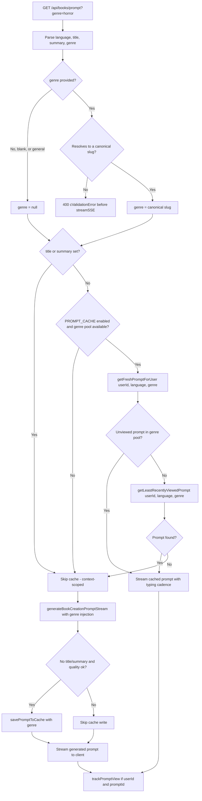
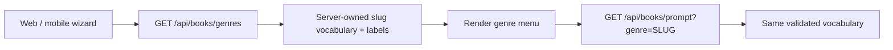

# Genre-Scoped "Surprise Me" Prompts Roadmap

> **Status:** Proposed
> **Date:** 2026-10-18
> **Owner:** Twistloom Backend

This roadmap specifies an additive, backward-compatible enhancement to the
"Surprise me" prompt generator (`GET /api/books/prompt`): an optional `genre`
query parameter that steers the AI-generated story concept toward a chosen
genre while preserving the existing hybrid cache. It also fixes the parameter
contract itself — a closed, server-owned **slug enum** (not free text) — and adds
a discovery endpoint so web and mobile consumers can render the genre menu
without hardcoding values.

The genre taxonomy is reused from the platform's existing genre-detection SSOT
rather than reinvented.

All backend `src/` paths are relative to `Twistloom-backend`. Line numbers are
discovery anchors captured on 2026-10-18 and may drift. **NEW** denotes proposed
files. No code, schema, or migration was executed for this roadmap.

---

## 1. Summary Table

| # | Item | Priority | Status |
|---|------|----------|--------|
| 1 | Query-param contract (closed slug enum) and resolver | `P0` | ⬜ Planned |
| 2 | Genre menu discovery endpoint (`GET /api/books/genres`) | `P0` | ⬜ Planned |
| 3 | Genre prompt injection in `getBookCreationPrompts` | `P0` | ⬜ Planned |
| 4 | `story_prompts.genre` column, index, and migration SQL | `P0` | ⬜ Planned |
| 5 | Genre-aware cache service (lookup, availability, save) | `P0` | ⬜ Planned |
| 6 | Route wiring and pre-stream validation | `P0` | ⬜ Planned |
| 7 | Cron per-genre pool top-up | `P2` | ⬜ Planned |
| 8 | Tests and documentation alignment | `P1` | ⬜ Planned |

---

## 2. Problem Statement

### Current State

The "surprise me" endpoint is `GET /api/books/prompt` (`src/routes/books.ts:1628`),
an SSE route with `optionalAuth` and a `BOOK_PROMPT_RATE_LIMIT` of 10 requests
per 60 seconds (`src/config/ai-rate-limits.ts:137`). Inside `streamSSE` it:

- Reads `language`, `title`, and `summary` query params (`src/routes/books.ts:1635`).
- Uses the prompt cache only when `title` and `summary` are both absent
  (`src/routes/books.ts:1649`), because the cache is keyed by user plus language:

  ```ts
  // src/routes/books.ts:1649
  if (!titleContext && !summaryContext && PROMPT_CACHE_CONFIG.enabled && await shouldUseCache()) {
    if (userId) {
      const cachedPrompt = await getFreshPromptForUser(userId, language); // src/routes/books.ts:1652
    }
  }
  ```

- On a miss, generates via `generateBookCreationPromptStream({ signal, language, title, summary })`
  (`src/routes/books.ts:1671`) and persists with `savePromptToCache({ content, userId, language, aiProvider, aiModel })`
  (`src/routes/books.ts:1708`).

The generator `generateBookCreationPromptStream` (`src/utils/prompt.ts:6294`)
delegates prompt construction to `getBookCreationPrompts(language, title, summary)`
(`src/utils/prompt.ts:6189`), which injects optional `titleContext`
(`src/utils/prompt.ts:6191`) and `summaryContext` (`src/utils/prompt.ts:6197`)
blocks into an otherwise fixed thriller/horror system prompt
(`src/utils/prompt.ts:6204`). There is **no genre concept** anywhere in the
generation path.

The cache lives in the `story_prompts` table (`src/db/schema.ts:2115`). It stores
`content`, `aiProvider`, `aiModel`, `qualityScore`, `usageCount`, `uniqueUserCount`,
`userId`, `language` (`src/db/schema.ts:2134`), `isActive`, `expiresAt`, and
`lastServedAt` — but **no genre dimension**. The service layer
(`src/services/prompt-cache.ts`) filters only by `isActive` and `language`:
`getFreshPromptForUser(userId, language)` (`src/services/prompt-cache.ts:116`)
random-orders unviewed rows and falls back to
`getLeastRecentlyViewedPrompt(userId, language)` (`src/services/prompt-cache.ts:78`).
`shouldUseCache()` (`src/services/prompt-cache.ts:153`) gates on the global
`getActivePromptCount()` (`src/services/prompt-cache.ts:31`). The weekly cron
(`src/cron/generate-prompts.ts:64`) also generates and saves only generic
(`language: 'en'`) prompts.

A canonical genre taxonomy already exists in `src/utils/genre-detection.ts`:
`GenreCategory = 'fantasy' | 'scifi' | 'horror' | 'thriller' | 'drama' | 'general'`
(`src/utils/genre-detection.ts:33`), a weighted `GENRE_KEYWORD_MAP`
(`src/utils/genre-detection.ts:119`), `detectGenre()` (`src/utils/genre-detection.ts:571`),
and prompt-facing `GENRE_CONTEXT_CONFIGS` (`src/utils/genre-detection.ts:650`). It
is currently used for content moderation and custom-action evaluation, not for
prompt generation. No endpoint exposes this vocabulary to API consumers, and no
genre value is defined on any request contract today.

### Pain Points

1. **The "Surprise me" flow is genre-blind.** Every generated concept defaults to
   the fixed thriller/horror framing, so a reader who wants fantasy, sci-fi, or
   drama has no way to steer the very first creative touchpoint.
2. **Two mechanisms with divergent cache behavior.** `title`/`summary` already
   act as generation context, but they bypass the cache entirely
   (`src/routes/books.ts:1649`). Adding `genre` naively the same way would force
   every genre-scoped request to hit a paid AI provider — the wrong outcome at
   the 10M-concurrent-user target (AGENTS.md §1).
3. **The cache has no genre key.** Even if a horror prompt were generated once,
   it cannot be reliably served back to a later horror request, nor prevented
   from leaking into a generic request, because `story_prompts` and all lookup
   functions are keyed only by user plus language.
4. **The global cache gate misleads genre logic.** `shouldUseCache()` counts the
   entire active pool. A mature generic pool would let the route "use the cache"
   even when the requested genre pool is empty, inviting either an empty result
   or a cross-genre fallback that violates the user's selection.
5. **No server-owned genre vocabulary exists on the API surface.** A client
   cannot discover valid genre values, and an ad-hoc free-text scheme would
   fragment the cache, corrupt analytics, and open a prompt-injection path.

### Goal

Add an optional, enum-validated `genre` query parameter (closed slug vocabulary)
plus a discovery endpoint, so `GET /api/books/prompt` can steer generation into a
validated genre, honor it across the cache and database lookup path, and behave
byte-for-byte as today when `genre` is absent.

---

## 3. Intended Design & Rationale

### Design Alternatives (cache keying)

**A: Treat `genre` exactly like `title`/`summary` — bypass the cache when set.**

Add `genreContext` in `getBookCreationPrompts` and extend the cache guard to
`!titleContext && !summaryContext && !genre`. No schema change.

- **Pros:** Smallest possible diff; zero migration risk.
- **Cons:** Every genre-scoped request becomes a full LLM generation. At scale a
  popular "horror" button directly multiplies provider cost, latency, and rate
  pressure. Defeats the purpose of the hybrid cache for the new feature.

**B: Dedicated `story_prompts.genre` column with genre-aware cache keying.**

Add a nullable `genre` column, index it for the lookup shape, and thread the
resolved genre through every cache read/write. Genre requests join the cache
instead of bypassing it.

- **Pros:** Genre prompts are cached and reused; cost scales the same way as the
  existing generic pool; no cross-genre leakage; `null` preserves all legacy rows.
- **Cons:** Requires a forward migration and touching the cache service, route,
  and cron.

**C: A separate table (or Redis namespace) per genre.**

- **Pros:** Conceptual isolation.
- **Cons:** Multiplies schema/serving surface fivefold for no functional gain,
  duplicates every selection/tracking/cleanup routine, and fights the existing
  single-table design.

### Recommended: Alternative B

Adopt **Alternative B**. It reuses the existing single-table cache and its
selection/freshness/expiry machinery rather than duplicating them per genre
(AGENTS.md §1.7), and it reuses the platform's genre SSOT instead of inventing
a parallel taxonomy. The `genre` column is nullable so legacy rows remain the
generic pool: a request with no genre resolves to `genre IS NULL` and behaves
byte-for-byte as today.

The genre value is resolved through a fixed allowlist and is never interpolated
as raw user text, which closes the prompt-injection vector that a free-form
genre string would otherwise open (AGENTS.md §3.8; the same discipline as
`validateCompanionQuestion`).

Genre-aware caching follows the same freshness discipline as today: viewed
prompts are excluded within the requested genre pool, and the least-recently-viewed
fallback is restricted to the same pool so a "horror" request can never be
answered with a drama prompt.

### Query Parameter Contract: Enum vs Free Text

**Decision: `genre` is a closed, server-owned enum of stable slugs — not free
text.** A value such as `genre=Psychological+Thriller` (`+` is a URL-encoded
space) is rejected.

Free text is rejected for four concrete reasons:

1. **Cache and cardinality blow-up.** The genre becomes a cache key and a
   persisted column value. Unbounded spellings create unbounded pools,
   near-zero hit rate, and a return to per-request AI cost.
2. **Prompt-injection surface.** Any raw string reaching the generation prompt
   must be neutralized first; an enum removes the vector entirely.
3. **No canonical analytics.** `sci-fi`, `scifi`, `sci fi`, and `science
   fiction` would fragment every metric.
4. **No contract to validate against.** Two clients can invent two vocabularies,
   and the server cannot tell a typo from a new category.

#### Industry Convention

Verified 2026-10-18. Platforms that let users *steer* content use a fixed
vocabulary (numeric IDs or slugs) and expose a discovery surface for labels.
Free-form tags, where they exist, sit *alongside* a fixed category enum.

| Platform | Filter shape | Value vocabulary | Discovery |
|----------|--------------|------------------|-----------|
| IMDb | genre facet in advanced title search | fixed curated list (~28 genres, "may add more in the future") | facet list rendered from the vocabulary |
| TMDB | `with_genres` (comma = AND, pipe = OR) | fixed global numeric genre IDs | `GET /3/genre/movie/list?language=` |
| Wattpad | `categories` + `tags` | fixed numeric `categories` enum + free-form `tags` string array | published category taxonomy |
| Google API design (AIP-126) | enum guidance | enums for sets that change roughly once a year or less; otherwise a documented string | enumerated in the API surface |
| Azure REST guidelines | extensible enums | model as extensible (`x-ms-enum modelAsString`) unless provably frozen | enumerated in the API surface |

Conclusion: a genre/facet selector is a **fixed, extensible enum**, and its
human-readable labels come from a **server-owned discovery endpoint**. That is
the convention to adopt — and it matches the platform's existing `GenreCategory`
union, so no parallel taxonomy is introduced.

#### Recommended Wire Convention

- **Param name:** `genre` (singular), a single value.
- **Vocabulary:** canonical slugs = `GenreCategory` minus `general`:
  `fantasy`, `scifi`, `horror`, `thriller`, `drama`. Lowercase ASCII `[a-z0-9-]`.
  These strings are identical to the internal TypeScript union and to the value
  stored in `story_prompts.genre`, so there is zero mapping drift (SSOT).
- **"No preference":** omitted, blank, or `general` resolves to `null` and
  reproduces today's behavior; documented so clients can offer a bare
  "Surprise me" option.
- **Aliases:** accepted as input convenience and normalized server-side
  (`sci-fi`, `science-fiction` -> `scifi`; `psychological-thriller` -> `thriller`),
  but only the canonical slug is ever stored or cached. Aliases are not part of
  the contract.
- **Extensibility (append-only):** new slugs may be added over time; clients
  MUST tolerate unknown slugs gracefully (ignore/degrade, never crash). Never
  rename or remove a slug — it is both a cache key and a persisted column value,
  so renaming orphans cached rows. The enum is documented as open/extensible.
- **Invalid value:** `400` with the allowed list (Google AIP "clear error
  messages"); `general`/blank is a no-op, not an error.
- **Single-select now:** deliberately not comma/pipe multi-select yet. A
  multi-genre cache key grows `2^n`, so multi-select is deferred to a future,
  versioned extension (see Open Questions).

### Genre Menu Discovery Endpoint

A client needs the list to render the menu. Following the TMDB `/genre/list`
and Tyk "dynamic enum" patterns, expose the server-owned vocabulary:

`GET /api/books/genres` (registered **before** the dynamic `/:identifier` route):

```json
{
  "genres": [
    { "id": "fantasy",  "name": "Fantasy"  },
    { "id": "scifi",    "name": "Sci-Fi"   },
    { "id": "horror",   "name": "Horror"   },
    { "id": "thriller", "name": "Thriller" },
    { "id": "drama",    "name": "Drama"    }
  ]
}
```

- `id` is the stable wire slug (the exact `genre` param value); `name` is the
  canonical English display label.
- Public, no auth, and safe to cache as `Cache-Control: public, max-age=86400`
  — the payload is not per-user (contrast AGENTS.md §3.3 rule 13, which governs
  per-user *mutable* payloads).
- Optional future: `?language=` for localized names (TMDB precedent); until
  then clients localize by `id` via their own i18n.

### Non-Breaking Guarantees

| Change | What it does NOT change | Why safe |
|--------|------------------------|----------|
| Add nullable `genre` column | Existing rows keep `genre = NULL` | Nullable, no default backfill needed |
| No-genre lookup filters `genre IS NULL` | All pre-existing rows match exactly once | Generic pool is unchanged |
| Genre-scoped cache read/write | The no-genre cache path and its user+freshness semantics | Genre is an additive filter |
| `genreContext` injection | The system prompt when `genre` is absent | Context string is empty when unset |
| `generateBookCreationPromptStream` signature | Existing callers (`generateBookCreationPrompt*`, cron) | `genre` is optional, defaults to `null` |
| New `GET /api/books/genres` route | Existing routes | Static path registered before `/:identifier` |
| Closed slug enum | Any future slug additions | Append-only; clients tolerate unknown slugs |

---

## 4. Feasibility Analysis

| Dimension | Assessment |
|-----------|------------|
| **Effort** | Medium (~2–3 days including the menu endpoint, tests, and migration review) |
| **Risk** | Low — additive param and endpoint, nullable column, enum-validated input; no change to the no-genre path |
| **Backend changes** | Minimal -> Moderate: one schema column + index, resolver/label exports, one static route, cache service signatures, route wiring, prompt injection |
| **Dependencies** | Schema migration must be reviewed and run manually by the developer (AGENTS.md §3.5); no `db:generate`/`db:migrate` executed by tooling. Confirm the wizard's genre list matches the canonical slugs. |
| **Reversibility** | Fully reversible — dropping the route param/endpoint and ignoring the column restores prior behavior; the column is inert without reads/writes |

---

## 5. Flow Diagrams

### Surprise-me request



### Genre menu discovery



---

## 6. Implementation Plan

### Step 1: Query-Param Contract, Resolver, and Labels — ⬜ Planned

**Files:** `src/utils/genre-detection.ts:441`, `src/utils/genre-detection.ts:571`, `src/utils/genre-detection.ts:705`
**Effort:** Low

Define the closed wire vocabulary once and export a resolver plus a label map.
Reuse the existing private `normalizeGenreKeyword` (`src/utils/genre-detection.ts:441`)
and `detectGenre` (`src/utils/genre-detection.ts:571`) so aliases such as
`sci-fi`, `science-fiction`, and `psychological-thriller` resolve without a
duplicated map.

```ts
/** Closed, append-only vocabulary of requestable genres. The wire value IS the
 *  canonical GenreCategory token, so there is no client/server mapping drift. */
export const REQUESTABLE_GENRES = ['fantasy', 'scifi', 'horror', 'thriller', 'drama'] as const;
export type RequestableGenre = (typeof REQUESTABLE_GENRES)[number];

/** Canonical display labels (menu `name`, prompt injection). */
export const GENRE_LABELS = {
  fantasy: 'Fantasy',
  scifi: 'Sci-Fi',
  horror: 'Horror',
  thriller: 'Thriller',
  drama: 'Drama',
} as const satisfies Record<RequestableGenre, string>;

const REQUESTABLE_GENRE_SET: ReadonlySet<string> = new Set(REQUESTABLE_GENRES);

/**
 * Resolves a raw query-param genre to a canonical slug.
 * Returns null for absent, blank, 'general', or unrecognized input.
 * Aliases are normalized but never returned; only canonical slugs are.
 */
export function resolveGenreCategory(raw: string | null | undefined): GenreCategory | null {
  if (typeof raw !== 'string') return null;
  const normalized = normalizeGenreKeyword(raw);
  if (!normalized || normalized === 'general') return null;
  if (REQUESTABLE_GENRE_SET.has(normalized)) return normalized as RequestableGenre;
  const detected = detectGenre([normalized]);
  return detected === 'general' ? null : detected;
}
```

`REQUESTABLE_GENRES` is the single source of truth for the enum, the menu
endpoint (Step 2), and the prompt labels (Step 3). Keep the vocabulary
append-only; document that clients must tolerate new slugs.

**Non-breaking:** `detectGenre`, `GENRE_KEYWORD_MAP`, and
`GENRE_CONTEXT_CONFIGS` are unchanged; only new exports are added.

---

### Step 2: Genre Menu Discovery Endpoint — ⬜ Planned

**Files:** `src/routes/books.ts` (new static route; register before `/:identifier`)
**Effort:** Low

Expose the server-owned vocabulary so web/mobile render the menu without
hardcoding values.

```ts
const GENRE_MENU = REQUESTABLE_GENRES.map((id) => ({ id, name: GENRE_LABELS[id] }));

// MUST be declared before the dynamic GET /:identifier route.
router.get("/genres", optionalAuth, async (c) => {
  c.header("Cache-Control", "public, max-age=86400");
  return c.json({ genres: GENRE_MENU });
});
```

- Response shape mirrors the TMDB/Tyk discovery pattern: `[{ id, name }]`.
- Not per-user, so `public` caching is correct here (unlike §3.3 rule 13
  payloads).
- Future: accept `?language=` (via `isValidLanguageCode`) for localized names.

**Non-breaking:** New static path; existing routes are unaffected provided the
route is registered before the dynamic `/:identifier` handler.

---

### Step 3: Genre Prompt Injection — ⬜ Planned

**Files:** `src/types/prompt.ts:7`, `src/utils/prompt.ts:6189`, `src/utils/prompt.ts:6294`, `src/utils/prompt.ts:6323`
**Effort:** Low

Add `genre?: GenreCategory | null` to `GenerateBookCreationPromptParams`
(`src/types/prompt.ts:7`) and thread it through both the streaming
(`src/utils/prompt.ts:6294`) and non-streaming (`src/utils/prompt.ts:6323`)
generators into `getBookCreationPrompts`. Add a `genreContext` block alongside
the existing title/summary blocks, and reference the genre in the `userPrompt`
tail (`src/utils/prompt.ts:6257`):

```ts
const genreContext = genre
  ? `GENRE (user-selected, hard constraint):
- The story concept MUST be ${GENRE_LABELS[genre]}.
- Lean into the conventions, tone, atmosphere, and tropes readers expect from ${GENRE_LABELS[genre]}.
- Do not drift into an unrelated genre; ${GENRE_LABELS[genre]} is non-negotiable.`
  : '';
```

Only the canonical label text is injected, never the raw query string. Keep the
block token-lean and place it before the GUIDELINES section
(`src/utils/prompt.ts:6225`).

**Non-breaking:** With `genre` unset the assembled system and user prompts are
identical to today; existing callers and the cron are unaffected.

---

### Step 4: Schema Column, Index, and Migration SQL — ⬜ Planned

**Files:** `src/db/schema.ts:2134`, `src/db/schema.ts:2144`
**Effort:** Low

Add a nullable, typed column and a partial composite index shaped for the
lookup (`is_active = true` plus `language` plus `genre`):

```ts
/** Requested genre pool (null = generic / multi-genre legacy pool) */
genre: text("genre").$type<GenreCategory>(),
```

```ts
index("story_prompts_genre_language_active_idx")
  .on(t.genre, t.language)
  .where(sql`${t.isActive} = true`),
```

Hand-authored migration SQL for the developer to review and run manually
(AGENTS.md §3.5 — tooling must not run `db:generate`/`db:migrate`):

```sql
ALTER TABLE story_prompts ADD COLUMN genre text;

ALTER TABLE story_prompts
  ADD CONSTRAINT story_prompts_genre_check
  CHECK (genre IS NULL OR genre IN ('fantasy','scifi','horror','thriller','drama'));

CREATE INDEX story_prompts_genre_language_active_idx
  ON story_prompts (genre, language)
  WHERE is_active = true;
```

The `$type<GenreCategory>()` annotation is compile-time only; the CHECK
constraint enforces the same allowlist at the database (AGENTS.md §1.5). Because
the vocabulary is append-only, the CHECK must be extended when a new slug is
added; note this in the migration runbook.

**Non-breaking:** Existing rows receive `genre = NULL`; no backfill, no rewrite.

---

### Step 5: Genre-Aware Cache Service — ⬜ Planned

**Files:** `src/services/prompt-cache.ts:78`, `src/services/prompt-cache.ts:116`, `src/services/prompt-cache.ts:153`, `src/services/prompt-cache.ts:253`
**Effort:** Medium

Thread an optional `genre` (`GenreCategory | null`) through the cache service.
No genre means the legacy generic pool (`genre IS NULL`); a genre means that
pool. The viewed-id exclusion and least-recently-viewed fallback stay scoped to
the requested pool.

- `getFreshPromptForUser(userId, language?, genre?)` — add
  `genre ? eq(storyPrompts.genre, genre) : isNull(storyPrompts.genre)`.
- `getLeastRecentlyViewedPrompt(userId, language?, genre?)` — same filter so the
  fallback never crosses genres.
- `getActivePromptCount(genre?)` — omitted = all (preserves cron semantics),
  `null` = generic pool, value = that genre. Add a genre-scoped availability
  check used by the route so an empty genre pool triggers generation rather than
  a cross-genre serve.
- `shouldUseCache(genre?)` — evaluate the threshold against the requested pool.
- `savePromptToCache({ ..., genre })` — persist the genre; `null` stays generic.

`user_prompt_history` needs **no change**: history is keyed by `(userId, promptId)`
and the prompt row already carries `genre`, so freshness tracking remains correct.

**Non-breaking:** Callers that omit `genre` continue to filter `genre IS NULL`,
matching every pre-existing row.

---

### Step 6: Route Wiring and Pre-Stream Validation — ⬜ Planned

**Files:** `src/routes/books.ts:1628`, `src/routes/books.ts:1649`, `src/routes/books.ts:1652`, `src/routes/books.ts:1671`, `src/routes/books.ts:1708`
**Effort:** Medium

Parse and validate `genre` **before** `streamSSE` so an invalid value returns a
real JSON `cValidationError` (400) rather than an in-stream error. An absent,
blank, or `general` value resolves to `null` and reproduces today's behavior.

```ts
router.get("/prompt", optionalAuth, rateLimit(BOOK_PROMPT_RATE_LIMIT, { ipFallback: true }), async (c) => {
  const { genre: rawGenre } = c.req.query();
  const hasRawGenre = typeof rawGenre === 'string' && rawGenre.trim() !== '';
  const genre = resolveGenreCategory(rawGenre);

  if (hasRawGenre && !genre && rawGenre.trim().toLowerCase() !== 'general') {
    return cValidationError(c, `genre must be one of: ${REQUESTABLE_GENRES.join(', ')}`);
  }

  return streamSSE(c, async (stream) => {
    // ...existing language/title/summary parsing...
    if (!titleContext && !summaryContext && PROMPT_CACHE_CONFIG.enabled && await shouldUseCache(genre)) {
      if (userId) {
        const cachedPrompt = await getFreshPromptForUser(userId, language, genre);
        // ...
      }
    }
    // ...on miss:
    const { stream: aiStream, provider } = await generateBookCreationPromptStream({
      signal: c.req.raw.signal, language, title: titleContext, summary: summaryContext, genre,
    });
    // ...on save:
    promptId = await savePromptToCache({ content: promptContent, userId, language, genre, aiProvider, aiModel });
  });
});
```

Note that genre does **not** join the `title`/`summary` cache bypass condition:
genre-scoped prompts remain cache-eligible, keyed by genre.

**Non-breaking:** No-genre requests are unchanged; validation runs before the
stream opens.

---

### Step 7: Cron Per-Genre Pool Top-Up — ⬜ Planned

**Files:** `src/cron/generate-prompts.ts:64`, `src/cron/generate-prompts.ts:83`
**Effort:** Low

The existing cron generates the generic pool (`genre = null`). Optionally extend
it to iterate `REQUESTABLE_GENRES`, generating up to a per-genre target and
saving with the corresponding genre, so under-stocked genre pools warm up
proactively instead of only through organic first requests. This is a scale
optimization, not a correctness requirement: Step 5 already generates and caches
a genre prompt on the first miss.

**Non-breaking:** The generic top-up remains the default; per-genre targets are
additive configuration.

---

### Step 8: Tests and Documentation Alignment — ⬜ Planned

**Files:** `src/utils/genre-detection.ts`, `src/services/prompt-cache.ts`, `src/routes/books.ts`, `docs/roadmap/STORY_THEME_CACHING_ROADMAP.md`
**Effort:** Medium

- Unit-test `resolveGenreCategory` (canonical keys, aliases, `general`, blanks,
  unknown input, plus existing generic inputs it must not misclassify).
- Unit-test that no-genre lookup filters `genre IS NULL` and genre lookup filters
  exactly the requested genre, including the least-recently-viewed fallback.
- Route-level tests: invalid genre returns 400 and no SSE stream is opened; a
  valid genre reaches both generation and `savePromptToCache`; `GET /api/books/genres`
  returns the closed vocabulary and `public` cache headers.
- Append a genre sub-section to the existing
  [Story Theme Caching Roadmap](STORY_THEME_CACHING_ROADMAP.md) or the relevant
  architecture doc so the cache contract documents the new key dimension and the
  wire vocabulary.

**Non-breaking:** Test-only plus documentation.

---

## 7. Open Questions

### Q1. Wire vocabulary: `scifi` or `sci-fi`? — ⬜ Open

The internal `GenreCategory` token is `scifi` (no hyphen), but `sci-fi` is the
more recognizable public slug.

- **(A) `scifi`** — the wire value equals the internal token and the DB value
  exactly; zero mapping drift; slightly less conventional-looking.
- **(B) `sci-fi`** — friendlier to read, but requires a permanent wire-to-internal
  map and risks a second vocabulary drifting from `GenreCategory`.

**Recommendation:** Option A (`scifi`), accepting `sci-fi` as a normalized
alias. One canonical token, no drift.

---

### Q2. Single genre or multi-select? — ⬜ Open

- **(A) Single value now** — linear cache cardinality, simple wizard UX.
- **(B) Multi-select (`genre=horror,thriller` or pipe-OR, TMDB-style)** — richer
  steering, but the cache key grows `2^n` and every additional dimension
  multiplies pools and AI cost.

**Recommendation:** Option A. Reserve multi-select as a future, versioned
extension if the product needs it.

---

### Q3. Menu endpoint localization — ⬜ Open

- **(A) English `name`, client localizes by `id`** — smallest surface; the
  platform already ships its own frontend i18n.
- **(B) Server returns localized `name` via `?language=`** — TMDB precedent;
  needs a server-side genre-name translation map.

**Recommendation:** Option A now, with Option B added only if the frontend
requires server-driven labels.

---

### Q4. Invalid `genre` handling: 400 or silent fallback? — ⬜ Open

A typo like `genre=horrror` could either be rejected or ignored.

- **(A) 400 validation error** — surfaces integration mistakes immediately, but
  a stale frontend value could break an otherwise working request.
- **(B) Silent fallback to no-genre** — never breaks, but silently degrades the
  requested experience and hides client bugs.

**Recommendation:** Option A, with `general`/blank treated as an explicit
no-op rather than an error. The endpoint is client-driven by a wizard that
controls the value, so a strict allowlist is cheap and catches drift early.

---

### Q5. Alias resolution source — ⬜ Open

`detectGenre` only resolves medium-or-stronger signals (score >= 3,
`src/utils/genre-detection.ts:97`), so user-facing terms like `crime` or
`romance` that sit at medium strength resolve to `general` and are not
requestable.

- **(A) Reuse `detectGenre` only** — zero new data, but the requestable alias
  set is limited to explicit/high terms.
- **(B) Reuse `detectGenre` plus a small curated alias map** — covers common
  frontend spellings (`mystery` -> thriller, `romance` -> drama, `crime` ->
  thriller) at the cost of a hand-maintained map.

**Recommendation:** Option A initially, with Option B if the wizard's genre
values do not already match the canonical slugs. Confirm the wizard's actual
genre list before finalizing.

---

### Q6. Per-genre cache gate or global gate? — ⬜ Open

The `PROMPT_CACHE_CONFIG.threshold` (100) gate (`src/services/prompt-cache.ts:153`)
is currently global.

- **(A) Keep a global enable gate and add a per-genre availability probe** —
  the cache is "on" only if the relevant pool has at least one active prompt.
- **(B) Apply the full threshold per genre** — stricter freshness, but a new
  genre stays uncached until its own pool reaches 100.

**Recommendation:** Option A. It preserves the global on/off switch while
guaranteeing a genre request is only served when a same-genre prompt exists.

---

### Q7. Should genre also key the title/summary path? — ⬜ Open

`title`/`summary` currently bypass the cache entirely
(`src/routes/books.ts:1649`). A request may carry both a genre and a title.

- **(A) Genre applies to the prompt regardless of title/summary**, while
  title/summary continue to bypass the cache — simplest, no cross-contamination.
- **(B) Cache key = title + summary + genre** — enables reuse of fully-specified
  prompts, but dramatically increases key cardinality and collision risk.

**Recommendation:** Option A. Genre only affects caching when title/summary are
absent, exactly like the existing generic path.

---

## 8. References & File Touch List

### Backend

| File | Change |
|------|--------|
| `src/utils/genre-detection.ts:441,571,705` | **NEW exports** — `REQUESTABLE_GENRES`, `RequestableGenre`, `GENRE_LABELS`, `resolveGenreCategory` |
| `src/routes/books.ts` | **NEW static route** `GET /genres` (register before `/:identifier`) |
| `src/types/prompt.ts:7` | Add `genre?: GenreCategory \| null` to `GenerateBookCreationPromptParams` |
| `src/utils/prompt.ts:6189` | Add `genre` param and `genreContext` injection |
| `src/utils/prompt.ts:6257` | Reference genre in `userPrompt` tail |
| `src/utils/prompt.ts:6294,6323` | Pass `genre` into `getBookCreationPrompts` (stream + non-stream) |
| `src/services/prompt-cache.ts:78,116,153,253` | Thread `genre` through lookup, availability, gate, and save |
| `src/routes/books.ts:1628-1743` | Parse/validate `genre`; wire cache, generation, and save |
| `src/cron/generate-prompts.ts:64,83` | Optional per-genre top-up (Step 7) |

### Schema

| File | Change |
|------|--------|
| `src/db/schema.ts:2134` | Add nullable `genre` column with `$type<GenreCategory>()` |
| `src/db/schema.ts:2144` | Add partial composite index `(genre, language) WHERE is_active = true` |
| Migration SQL (developer-run) | `ALTER TABLE ... ADD COLUMN genre`, CHECK constraint, index |

### Documentation

| File | Change |
|------|--------|
| `docs/roadmap/PROMPT_GENRE_SELECTION_ROADMAP.md` | **NEW** — this document |
| `docs/roadmap/STORY_THEME_CACHING_ROADMAP.md:91-136` | Reference the new genre key dimension and wire vocabulary |

### External References (industry convention)

| Source | Used for |
|--------|----------|
| TMDB API — `/genre/movie/list` and `with_genres` (`https://developer.themoviedb.org/reference/genre-movie-list`) | Fixed numeric vocabulary + discovery endpoint + comma/pipe semantics |
| IMDb Help — genres (`https://help.imdb.com/article/contribution/titles/genres/GZDRMS6R742JRGAG`) | Fixed curated genre list that "may add more in the future" |
| Google API Improvement Proposal AIP-126 (`https://google.aip.dev/126`) | Enums for infrequently-changing sets; documented strings otherwise |
| Wattpad Content Categories (support article) + public API docs | Fixed numeric `categories` enum alongside free-form `tags` |

### Codebase Findings

1. The prompt cache is currently keyed by user plus language only, and
   `title`/`summary` bypass it entirely (`src/routes/books.ts:1649`); there is no
   way to key a cached prompt by generation context such as genre.
2. `story_prompts` has `language` (`src/db/schema.ts:2134`) but no genre column,
   and every lookup in `src/services/prompt-cache.ts` filters by language alone.
3. `shouldUseCache()` gates on the global `getActivePromptCount()`
   (`src/services/prompt-cache.ts:153`), which is unaware of any per-context pool.
4. A canonical genre taxonomy already exists (`src/utils/genre-detection.ts:33`)
   but is used only for moderation/custom-actions; the prompt generator does not
   consult it, and no endpoint exposes it to API consumers.
5. `normalizeGenreKeyword` and `GENRE_CONTEXT_LABELS` are private
   (`src/utils/genre-detection.ts:441,705`), so the resolver and label map must be
   newly exported rather than duplicated.

---

## 9. Completion Status

Legend: ✅ Implemented & verified · ⏳ Partial / scoped down · ⬜ Future work · ⏩ Deferred

### Completed
- (none — roadmap is proposed)

### In Progress
- (none)

### Future / Deferred
- ⬜ Step 1 — Query-param contract, resolver, and labels
- ⬜ Step 2 — Genre menu discovery endpoint
- ⬜ Step 3 — Genre prompt injection
- ⬜ Step 4 — Schema column, index, and migration SQL
- ⬜ Step 5 — Genre-aware cache service
- ⬜ Step 6 — Route wiring and pre-stream validation
- ⬜ Step 7 — Cron per-genre pool top-up
- ⬜ Step 8 — Tests and documentation alignment
