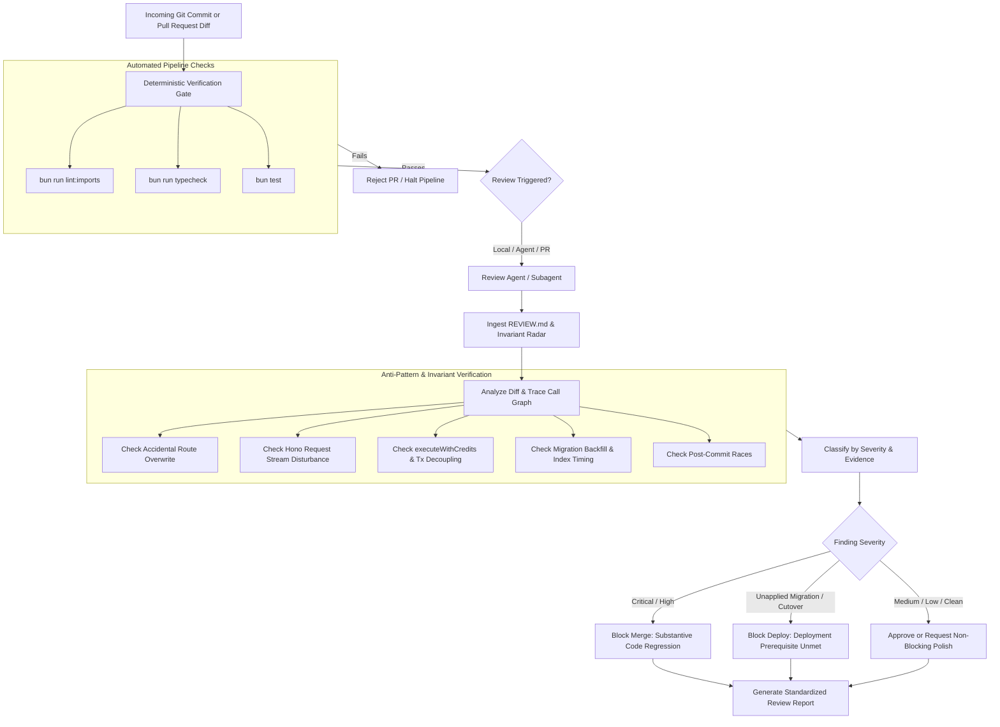

# AI Code Review Protocol (`REVIEW.md`) Roadmap

> **Status:** Completed  
> **Date:** 2026-10-26  
> **Owner:** Solo Founder / Twistloom Engineering  
> **Scope:** Repository-wide AI review governance, `REVIEW.md` root specification, anti-pattern radar, severity triage rubrics, and integration with `.agents/skills/critique-workflow`.

---

## 1. Summary Table

| # | Item | Priority | Status |
|---|------|----------|--------|
| 1 | Root `REVIEW.md` Specification — Establish review mandate, evidence standards, and severity triage rubrics | `P0` | ✅ Completed |
| 2 | Twistloom Anti-Pattern Radar — Encode concrete checks for Hono streams, route replacements, financial decoupling, and counter backfills | `P0` | ✅ Completed |
| 3 | Integration with `.agents/skills/critique-workflow` — Wire `REVIEW.md` as the authoritative evaluation rubric for audit skills | `P1` | ✅ Completed |
| 4 | Alignment with `.github/agents/` Specialist Reviewers — Connect review rubrics with existing quality, payments, and security agent personas | `P1` | ✅ Completed |
| 5 | Tool-Agnostic Local Review Command — Provide zero-cost review execution via agent skills or Bun CLI script | `P2` | ✅ Completed |

---

## 2. Problem Statement

### Current State

- The repository maintains an extensive architectural constitution in `AGENTS.md:1-722` (48 KB) defining core principles (assume 10M users, type safety, no short-term debt, permanent API contracts, DRY, Neon Postgres, Drizzle ORM, Upstash Redis, and Netlify/Bun dual-runtime boundaries).
- Operational development rules live in `.github/copilot-instructions.md:1-120`, supplemented by 6 path-specific instructions in `.github/instructions/` and 9 specialized agents in `.github/agents/` (including `backend-quality-engineer.agent.md:1-57` and `payments-economy-reviewer.agent.md:1-79`).
- Audit procedures exist under `.agents/skills/`, particularly `.agents/skills/critique-workflow/SKILL.md:1-55` and `.agents/skills/credit-transaction-audit/SKILL.md`.
- However, there is no standardized root-level `REVIEW.md` defining how review agents must evaluate code diffs. When reviewing code, AI agents currently load general authoring instructions, causing two symmetrical failure modes:
  1. Flooding reviews with low-value cosmetic nitpicks (naming suggestions, variable extraction, speculative refactorings).
  2. Missing deep, repository-specific architectural regressions that do not fail basic compilation.
- This gap was demonstrated in the cumulative audit of commits `15cddfc` and `7c9fb68` (October 24–25, 2026), where 7 real defects (4 High, 2 Medium, 1 Low) bypassed initial development:
  - `H1`: Accidental deletion of the manuscript export route (`POST /:identifier/export`) when inserting testimonial-like endpoints in `src/routes/books.ts`.
  - `H2`: Runtime fatal crash calling `c.req.raw.clone().json()` on a body stream already consumed by `parseJsonBody` in `src/routes/books.ts:7631`.
  - `H3`: Unannounced deletion of legacy guest progress routes without client deprecation shims, risking local data loss.
  - `H4`: Non-critical notification writes embedded directly inside the financial `awardCredits` transaction (`src/services/credits.ts:1043`), threatening transaction rollbacks if database migrations lag.
  - `M1`: Counter migration adding `likes_count integer DEFAULT 0` without backfilling existing records from `user_likes`.
  - `M2`: Testimonial notifier dispatching phantom notifications because it never checked if the actor still liked the review after a rapid unlike.
  - `L1`: Unsafe `type: notificationType as any` cast bypassing strict TypeScript taxonomy unions.

### Pain Points

1. **Absence of Review-Specific Gate Criteria:** Existing documentation tells agents *how to write* code, but not *how to critique* a pull request, what evidence is required to substantiate a finding, or what to intentionally ignore.
2. **Noise vs. Signal Imbalance:** Without explicit instructions forbidding hypothetical edge cases, AI reviewers flag speculative risks while failing to verify concrete execution paths.
3. **Confusion Between Merge Blockers and Deployment Blockers:** Reviews frequently fail to distinguish between code-level defects that must block git merge and database schema migrations that must block production deployment.
4. **Tooling Misconception:** Recent industry discussions around Anthropic's Claude Code Review create the impression that AI code review requires an expensive SaaS subscription ($15–$25 per review), whereas a well-structured `REVIEW.md` can be executed locally and across multiple AI coding tools for free.

### Goal

Establish an evidence-driven, tool-agnostic `REVIEW.md` specification at the repository root that enforces strict finding quality standards, equips reviewers with an anti-pattern radar derived from real-world Twistloom failures, and integrates seamlessly with `.agents/skills/critique-workflow`.

---

## 3. Intended Design & Rationale

### The 3-Tier AI Instruction Architecture

To maintain a clean Single Source of Truth (SSOT) without duplicating architectural rules, Twistloom adopts a three-tier documentation structure:

1. **Tier 1 — Architectural Constitution (`AGENTS.md`):** System invariants, technology choices, 10M concurrency scaling rules, and permanent design contracts.
2. **Tier 2 — Operational Authoring Rules (`.github/copilot-instructions.md`, `.github/instructions/*.md`):** Coding conventions, Bun/TypeScript commands, import paths, and path-specific authoring guidelines.
3. **Tier 3 — Quality Gate & Review Policy (`REVIEW.md`, `.agents/skills/`):** Audit heuristics, evidence requirements, severity rubrics, merge vs. deployment blocking logic, and regression checklists.

```
┌─────────────────────────────────────────────────────────────┐
│ Tier 1: Architectural Constitution                          │
│ AGENTS.md — How systems MUST be designed                    │
└──────────────────────────────┬──────────────────────────────┘
                               │
            ┌──────────────────┴──────────────────┐
            ▼                                     ▼
┌──────────────────────────────────────┐  ┌──────────────────────────────────────┐
│ Tier 2: Operational Authoring        │  │ Tier 3: Quality Gate & Review        │
│ .github/copilot-instructions.md      │  │ REVIEW.md                            │
│ .github/instructions/*.md            │  │ .agents/skills/critique-workflow     │
│ .github/agents/*.agent.md            │  │ Anti-pattern radar & severity rubric │
│ (How code is WRITTEN)                │  │ (How code is AUDITED & VERIFIED)     │
└──────────────────────────────────────┘  └──────────────────────────────────────┘
```

### Design Alternatives

#### Alternative A: Expand `AGENTS.md` to Include Review Rules

Incorporate review rubrics, output templates, and evidence standards into the existing `AGENTS.md`.

- **Pros:** Keeps all AI instructions in one single file.
- **Cons:** Increases `AGENTS.md` beyond 50 KB, bloating prompt context for basic coding tasks; mixes authoring instructions with audit instructions, confusing code generation agents.

#### Alternative B: Rely Solely on Anthropic's Default Hosted Claude Code Review

Subscribe to Claude Code Review Team plan and rely on default cloud evaluation without repository-specific configuration.

- **Pros:** Zero local configuration.
- **Cons:** Billed at $15–$25 per review; vendor lock-in to Anthropic; lacks knowledge of Twistloom-specific invariants (e.g. `executeWithCredits`, Hono body middleware disturbance, Netlify Node vs. Bun runtime boundaries).

#### Alternative C: Root `REVIEW.md` + Tool-Agnostic Skill Integration (Recommended)

Place a focused, high-density `REVIEW.md` at the repository root. Configure it to be natively discovered by Claude Code CLI, while simultaneously serving as the authoritative rubric for Antigravity, Copilot Chat, and `.agents/skills/critique-workflow`.

- **Pros:** Native discovery by Claude Code; 100% usable by any local or cloud AI assistant; zero extra subscription cost; encodes concrete Twistloom anti-patterns; maintains strict SSOT separation from `AGENTS.md`.
- **Cons:** Requires a one-time setup and alignment with existing skill files.

### Non-Breaking Guarantees

| Change | What it does NOT change | Why safe |
|---|---|---|
| Adding root `REVIEW.md` | Application runtime, build scripts, API routes | Purely an engineering governance and documentation file. |
| Updating `.agents/skills/critique-workflow` | Core agent tools or permissions | Enhances the evaluation rubric used during review turns. |
| Adding optional review CLI script | CI pipeline or build requirements | Standalone developer convenience tool; does not block CI. |

---

## 4. Feasibility Analysis

| Dimension | Assessment |
|---|---|
| **Effort** | Low (3 to 5 engineering hours) |
| **Risk** | Low — No runtime code, schema, or API contract modifications |
| **Backend changes** | None to application logic; configuration and documentation only |
| **Dependencies** | None. Compatible with Bun, Hono, Git, and all current agent tools |
| **Reversibility** | Fully reversible — Markdown files can be edited or deleted without side effects |

---

## 5. Flow Diagram



---

## 6. Implementation Plan

### Step 1: Author Root `REVIEW.md` Specification — ✅ Completed

**Files:** `REVIEW.md:1-250` (NEW)  
**Effort:** Low (1 hour)

Draft and commit the canonical `REVIEW.md` at the repository root. Define:
1. **Mandate:** Audit for substantive regressions, security flaws, financial data leaks, and production reliability issues. Explicitly exclude cosmetic style debates.
2. **Evidence Standards:** Mandate that every finding provide an end-to-end execution path showing: `Trigger` → `Execution Path` → `Concrete Failure` → `Impact`.
3. **Severity Taxonomy:** Explicit definitions for Critical, High, Medium, and Low.
4. **Decision Boundary:** Clear demarcation between Merge Blockers and Deployment Blockers.
5. **Output Schema:** Standardized report layout (Verdict, Positive Highlights, Findings, Missing Tests, Deployment Prerequisites).

**Non-breaking:** Adds a single root markdown document; does not alter build, tests, or runtime.

---

### Step 2: Encode Twistloom Anti-Pattern Radar — ✅ Completed

**Files:** `REVIEW.md:80-180` (NEW)  
**Effort:** Low (1 hour)

Incorporate the 5 domain anti-pattern categories directly into `REVIEW.md`, capturing the concrete bugs uncovered during the October 2026 audits:
- **HTTP/Routing:** Forbid `c.req.raw.clone()` on requests parsed by `parseJsonBody`; enforce route insertion checks to ensure existing routes are not replaced; mandate safe deprecation shims (`426 Upgrade Required`) for retired endpoints.
- **Financial/Credits:** Enforce `executeWithCredits` row locking; forbid non-critical writes inside payment transactions; enforce refund idempotency.
- **Database/Migrations:** Require backfill SQL whenever adding counter columns; forbid auto-running migrations at app startup; require chunked batching (500 rows) for follower fan-outs.
- **Concurrency:** Require post-commit notification services to verify underlying relationship state before alerting.
- **Runtime:** Ensure Bun-only APIs do not enter Netlify Node runtime paths; enforce `.js` extensions and ban `as any`.

**Non-breaking:** Provides audit guidelines; does not modify application logic.

---

### Step 3: Integrate with `.agents/skills/critique-workflow` — ✅ Completed

**Files:** `.agents/skills/critique-workflow/SKILL.md:15-55`  
**Effort:** Low (30 minutes)

Update `.agents/skills/critique-workflow/SKILL.md` to establish `REVIEW.md` as its primary evaluation standard:
1. In Phase 1 (Rigorous Critique), cross-reference `REVIEW.md §3` (Anti-Pattern Radar).
2. In Phase 2 (Assessment), use `REVIEW.md §2` (Severity and Merge Guidance) to classify real issues vs. false positives.
3. In Phase 4 (Report), adopt the structured output schema specified in `REVIEW.md §4`.

**Non-breaking:** Updates skill instructions; preserves existing critique triggers and phase structure.

---

### Step 4: Align Specialist Agents (`.github/agents/`) with Review Rubrics — ✅ Completed

**Files:** `.github/agents/backend-quality-engineer.agent.md:18-38`, `.github/agents/payments-economy-reviewer.agent.md:18-35`  
**Effort:** Low (30 minutes)

Update specialist agent personas to cite `REVIEW.md`:
- `backend-quality-engineer.agent.md`: Reference `REVIEW.md` for regression evidence criteria and Hono request lifecycle safety.
- `payments-economy-reviewer.agent.md`: Reference `REVIEW.md §3.2` for credit transaction decoupling and idempotency invariants.

**Non-breaking:** Enhances agent system prompts; does not alter agent definitions or target runtimes.

---

### Step 5: Add Tool-Agnostic Local Review Command — ✅ Completed

**Files:** `package.json:18`, `scripts/review-diff.js:1-40` (NEW)  
**Effort:** Low (30 minutes)

Add cross-platform npm script in `package.json`:
```json
"review:diff": "bun ./scripts/review-diff.js"
```
Allows developers to generate a clean diff patch ready for local agent evaluation without paid subscriptions.

**Non-breaking:** Adds an optional developer utility script.

---

## 7. Open Questions

### Q1. Automatic CI Review vs. On-Demand Review? — ✅ Decided

**Context:** Should every GitHub pull request automatically trigger an AI code review via GitHub Actions, or should reviews be triggered on demand by the developer?

- **(A) Automatic on every PR:** High automation, but incurs token costs and risks review fatigue on small iterations.
- **(B) On-demand only (local agent or manual PR comment):** Zero ongoing SaaS cost, runs precisely when a significant change set is ready for audit.

**Decision:** Option (B). For Twistloom's solo-founder workflow, on-demand reviews via local AI agents (or Claude Code CLI / Antigravity) running against `REVIEW.md` provide maximum signal with zero subscription overhead.

---

### Q2. Full Codebase Scan vs. Scoped Diff Audit? — ✅ Decided

**Context:** Should review agents review entire files or restrict attention to the git diff?

- **(A) Entire file scan:** Catches pre-existing technical debt, but produces large reports with out-of-scope issues that distract from the PR.
- **(B) Scoped diff audit with call-graph tracing:** Focuses strictly on newly introduced or worsened code, tracing callers only as necessary to verify execution paths.

**Decision:** Option (B). Mandate in `REVIEW.md §1` that pre-existing issues must only be reported if the changed code materially worsens them.

---

### Q3. Relationship between `REVIEW.md` and `AGENTS.md`? — ✅ Decided

**Context:** How much architectural detail from `AGENTS.md` should be duplicated in `REVIEW.md`?

- **(A) Duplicate major sections:** Makes `REVIEW.md` self-contained, but creates severe synchronization drift whenever `AGENTS.md` evolves.
- **(B) Purely reference-based with specific anti-patterns:** `REVIEW.md` defines review mechanics, rubrics, and high-frequency traps, explicitly referencing `AGENTS.md` for full architectural contracts.

**Decision:** Option (B). Keep `REVIEW.md` focused on *evaluation heuristics*, referencing `AGENTS.md` as the architectural baseline.

---

## 8. References & File Touch List

### File Touch List

| File | Change |
|---|---|
| `REVIEW.md` | **NEW** — Canonical root code review policy, severity rubric, anti-pattern radar, and output schema |
| `.agents/skills/critique-workflow/SKILL.md:15-50` | Update to reference `REVIEW.md` as the evaluation rubric |
| `.github/agents/backend-quality-engineer.agent.md:18-35` | Reference `REVIEW.md` for quality audit criteria |
| `.github/agents/payments-economy-reviewer.agent.md:18-30` | Reference `REVIEW.md §3.2` for financial review standards |
| `package.json:20-30` | Add optional helper script for diff generation |
| `docs/roadmap/AI_CODE_REVIEW_PROTOCOL_ROADMAP.md` | **NEW** — This roadmap document |

### Codebase Findings (Lessons Incorporated from October 2026 Audits)

1. **Route Overwrite Defect (`src/routes/books.ts`):** Merging new routes in large router files easily overwrites existing handlers unless git diffs are explicitly audited for route deletions.
2. **Stream Disturbance Defect (`src/middleware/body.ts` & `src/routes/books.ts`):** Using `c.req.raw.clone()` after global middleware consumes the stream throws a synchronous `TypeError`.
3. **Transaction Rollback Propagation (`src/services/credits.ts`):** Non-critical notifications inside financial transactions cause payment rollbacks when database columns lag behind code.
4. **Counter Desynchronization (`drizzle/0108_tricky_malice.sql`):** Adding counter columns with default 0 without backfilling corrupts historical counts permanently.

---

## 9. Completion Status

Legend: ✅ Implemented & verified · ⏳ In Progress · ⬜ Planned · ⏩ Deferred

### Completed Work
- ✅ Item 1: Author root `REVIEW.md` specification
- ✅ Item 2: Encode Twistloom Anti-Pattern Radar
- ✅ Item 3: Integrate with `.agents/skills/critique-workflow`
- ✅ Item 4: Align `.github/agents/` specialist reviewers
- ✅ Item 5: Add tool-agnostic local review helper script

### Decided Architecture
- ✅ Tiered AI instruction model (`AGENTS.md` constitution vs. `REVIEW.md` review gate)
- ✅ Zero-cost on-demand review workflow over expensive third-party SaaS subscriptions
- ✅ Concrete anti-pattern radar derived from verified October 25 audit findings
